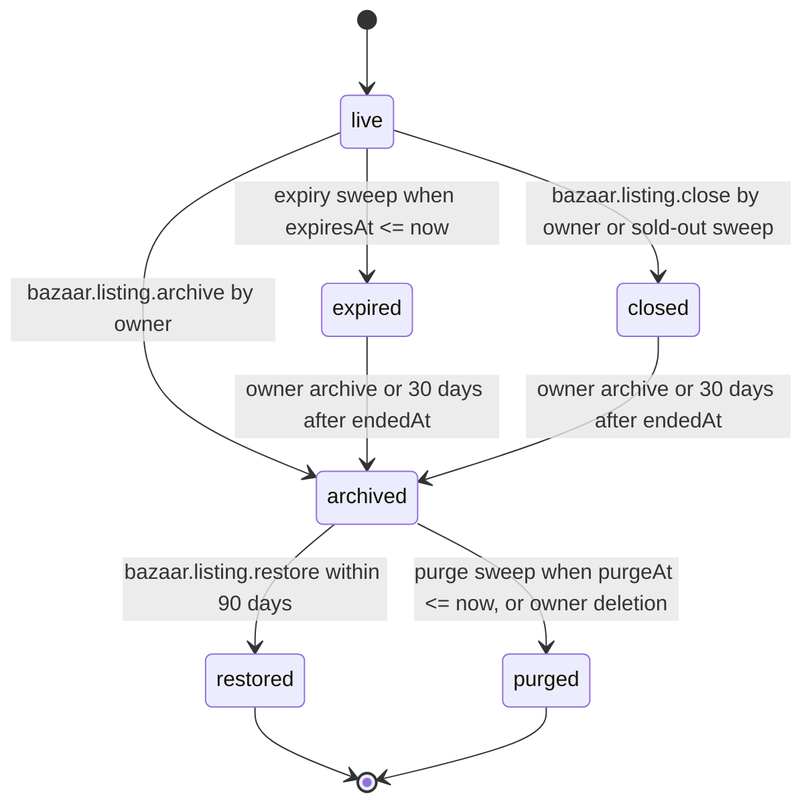

# PS-001-03 — Workflow state machine: Listing archive and expiry

**Status:** SPECIFIED (Stage 3). **Module:** [F01.S01.M04 Listing archive and expiry](SPEC.md) · **Scope:** MVP · **Code:** `packages/bazaar/src/listings/archive` · **Contracts:** [CTR-ID-001](../../../planning/contracts/CTR-ID-001.md), [CTR-EVT-001](../../../planning/contracts/CTR-EVT-001.md), [CTR-ERR-001](../../../planning/contracts/CTR-ERR-001.md), [CTR-CAP-001](../../../planning/contracts/CTR-CAP-001.md), [CTR-IDM-001](../../../planning/contracts/CTR-IDM-001.md), [CTR-PRV-001](../../../planning/contracts/CTR-PRV-001.md), [CTR-SCH-001](../../../planning/contracts/CTR-SCH-001.md)

> Generated from `module.spec.yaml` by `tools/specgen`. Edit the YAML, then run `pnpm spec:render`.

## Requirements

- **PS-001-03.R01** ArchiveRecord follows the declared machine; the pseudo-state live means the listing has no record yet.
- **PS-001-03.R02** Every transition runs together with the matching Listing.apply_status call and, where a publication is active, with bazaar.publication.end, in one transaction.
- **PS-001-03.R03** Restored listings return as unpublished and must go through publication checks again; restore never republishes automatically.

## Specification

### ArchiveRecord lifecycle

Initial **live**; terminal **restored**, **purged**.

| Transition | Trigger | Guard / effect |
|---|---|---|
| live -> expired | expiry sweep when expiresAt <= now | Listing published -> expired; emits bazaar.listing.expired |
| live -> closed | bazaar.listing.close by owner or sold-out sweep | end publication first; Listing unpublished -> closed; emits bazaar.listing.closed |
| live -> archived | bazaar.listing.archive by owner | end publication if active; Listing -> archived; emits bazaar.listing.archived |
| expired -> archived | owner archive or 30 days after endedAt | emits bazaar.listing.archived |
| closed -> archived | owner archive or 30 days after endedAt | emits bazaar.listing.archived |
| archived -> restored | bazaar.listing.restore within 90 days | Listing archived -> unpublished; emits bazaar.listing.restored |
| archived -> purged | purge sweep when purgeAt <= now, or owner deletion | Listing archived -> deleted |

### Timeouts and scheduled transitions

- Expiry sweep every 5 minutes and at app start.
- Auto-archive sweep daily for expired and closed records older than 30 days.
- Purge sweep daily for archived records past restoreUntil.
- Sold-out sweep daily: published listings whose stock has been zero for 7 days are closed with reason sold_out.

## Verification

| Test | Level | Covers | Scenario | Expected |
|---|---|---|---|---|
| TEST-PS-001-09.T04 | property | PS-001-03.R01, PS-001-03.R02 | random command and clock sequences | only declared transitions; at most one open record per listing |
| TEST-PS-001-09.T05 | integration | PS-001-03.R02, PS-001-03.R03, PS-001-06.R02 | close A with active publication | publication ended and tombstone queued in the same transaction; restore of C gives unpublished, never published |

## Dependencies

Module depends on: F01.S01.M01, F01.S01.M03, F01.S03.M01, CTR-ID-001, CTR-EVT-001, CTR-ERR-001, CTR-CAP-001, CTR-IDM-001, CTR-PRV-001, CTR-SCH-001. Predecessor: [domain_schema.md](domain_schema.md).
