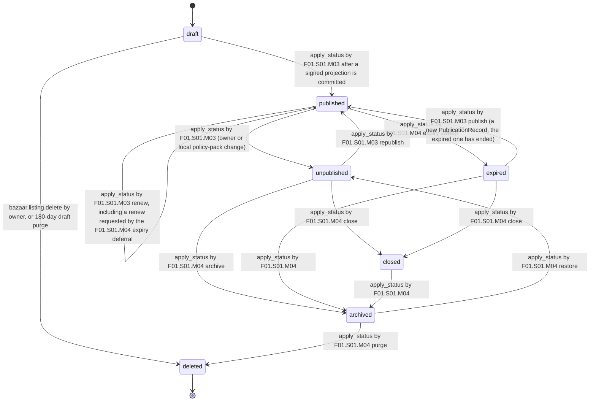

# PS-002-03 — Workflow state machine: Listing creation

**Status:** SPECIFIED (Stage 3). **Module:** [F01.S01.M01 Listing creation](SPEC.md) · **Scope:** MVP · **Code:** `packages/bazaar/src/listings/create` · **Contracts:** [CTR-ID-001](../../../planning/contracts/CTR-ID-001.md), [CTR-EVT-001](../../../planning/contracts/CTR-EVT-001.md), [CTR-ERR-001](../../../planning/contracts/CTR-ERR-001.md), [CTR-CAP-001](../../../planning/contracts/CTR-CAP-001.md), [CTR-IDM-001](../../../planning/contracts/CTR-IDM-001.md), [CTR-PRV-001](../../../planning/contracts/CTR-PRV-001.md), [CTR-SCH-001](../../../planning/contracts/CTR-SCH-001.md), [CTR-FLG-001](../../../planning/contracts/CTR-FLG-001.md), [CTR-IOX-001](../../../planning/contracts/CTR-IOX-001.md)

> Generated from `module.spec.yaml` by `tools/specgen`. Edit the YAML, then run `pnpm spec:render`.

## Requirements

- **PS-002-03.R01** Listing status follows the declared machine; any other transition is refused with CONFLICT_STATE and nothing changes.
- **PS-002-03.R02** Only the sibling modules F01.S01.M03 and F01.S01.M04 may request status changes, and only through apply_status in their own transaction.
- **PS-002-03.R03** Deleted is terminal; the tombstone keeps id, type and deletedAt for 180 days as required by CTR-PRV-001.
- **PS-002-03.R04** Relay hosting notices never change Listing.status: unpublishing is triggered only by the owner or a local policy-pack change, and a relay's removal changes only that relay's delivery state in the PublicationRecord of F01.S01.M03 (ADR-0016 §3, §8).

## Specification

### Listing lifecycle

Initial **draft**; terminal **deleted**.

| Transition | Trigger | Guard / effect |
|---|---|---|
| draft -> published | apply_status by F01.S01.M03 after a signed projection is committed | sets currentPublicationId, publishedAt, expiresAt |
| draft -> deleted | bazaar.listing.delete by owner, or 180-day draft purge | tombstone written; emits bazaar.listing.deleted |
| published -> unpublished | apply_status by F01.S01.M03 (owner or local policy-pack change) | clears expiresAt; relay notices are not a trigger |
| published -> published | apply_status by F01.S01.M03 renew, including a renew requested by the F01.S01.M04 expiry deferral | new expiresAt from the renewed signed projection |
| published -> expired | apply_status by F01.S01.M04 expiry sweep | expiresAt <= now and no deferral applies |
| unpublished -> published | apply_status by F01.S01.M03 republish | requires new PublicationRecord |
| unpublished -> closed | apply_status by F01.S01.M04 close | closeReason required |
| unpublished -> archived | apply_status by F01.S01.M04 archive | restorableUntil = now + 90 d |
| expired -> published | apply_status by F01.S01.M03 publish (a new PublicationRecord, the expired one has ended) | new expiresAt |
| expired -> closed | apply_status by F01.S01.M04 close | closeReason required; the owner sold, gave or traded after expiry |
| expired -> archived | apply_status by F01.S01.M04 | automatic 30 days after expiry |
| closed -> archived | apply_status by F01.S01.M04 | automatic 30 days after close |
| archived -> unpublished | apply_status by F01.S01.M04 restore | within 90 days of archiving |
| archived -> deleted | apply_status by F01.S01.M04 purge | after 90 days or owner deletion; keepEvidence passed through; emits bazaar.listing.deleted |

### Timeouts and scheduled transitions

- Draft purge sweep every 24 h and at app start: drafts with updatedAt older than 166 days raise a warning notification; older than 180 days move to deleted.

## Verification

| Test | Level | Covers | Scenario | Expected |
|---|---|---|---|---|
| TEST-PS-002-09.T03 | property | PS-002-03.R01, PS-002-03.R02 | random sequences of apply_status calls | only declared transitions succeed, including expired -> closed and published -> published on renew; others return CONFLICT_STATE |
| TEST-PS-002-09.T04 | integration | PS-002-03.R03, PS-002-07.R02 | delete draft | tombstone with id, type, deletedAt exists; content and blob keys purged after 30 days (clock advance) |
| TEST-PS-002-09.T07 | abuse | PS-002-03.R02, PS-002-05.R02, PS-002-05.R03 | UI-context dispatch of apply_status and a network spy during create | FORBIDDEN for non-sibling callers; zero network requests |
| TEST-PS-002-09.T18 | property | PS-002-03.R04, PS-002-03.R01 | random apply_status calls including reason relay_notice and a relay removal processed by F01.S01.M03 | relay_notice refused with VALIDATION_FAILED; Listing.status unchanged by any relay removal |

## Dependencies

Module depends on: F18.S01.M03, F15.S02.M03, F10.S01.M02, F10.S01.M03, F10.S01.M04, F10.S02.M02, F10.S02.M03, CTR-ID-001, CTR-EVT-001, CTR-ERR-001, CTR-CAP-001, CTR-IDM-001, CTR-PRV-001, CTR-SCH-001, CTR-FLG-001, CTR-IOX-001. Predecessor: [domain_schema.md](domain_schema.md).
