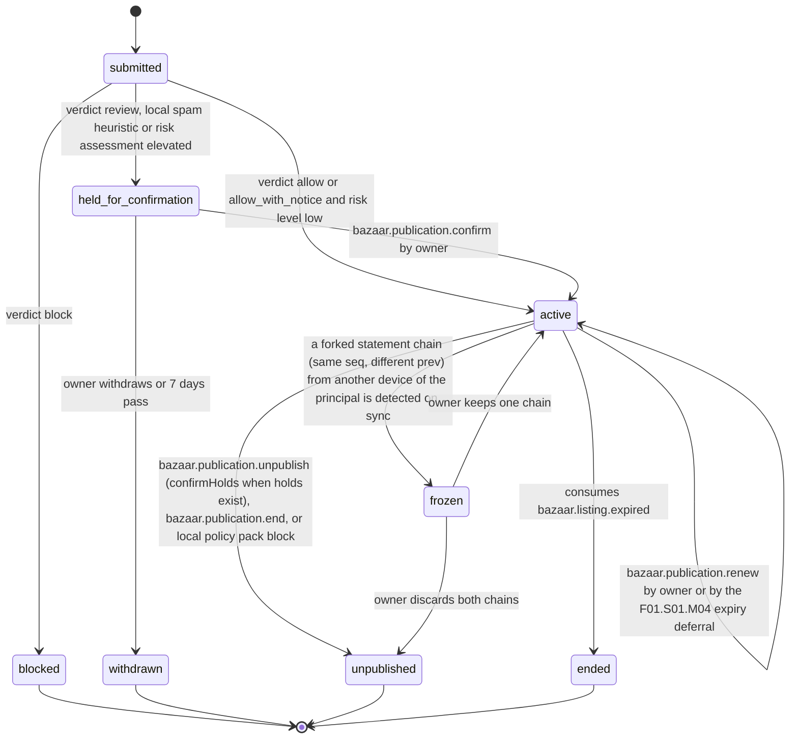
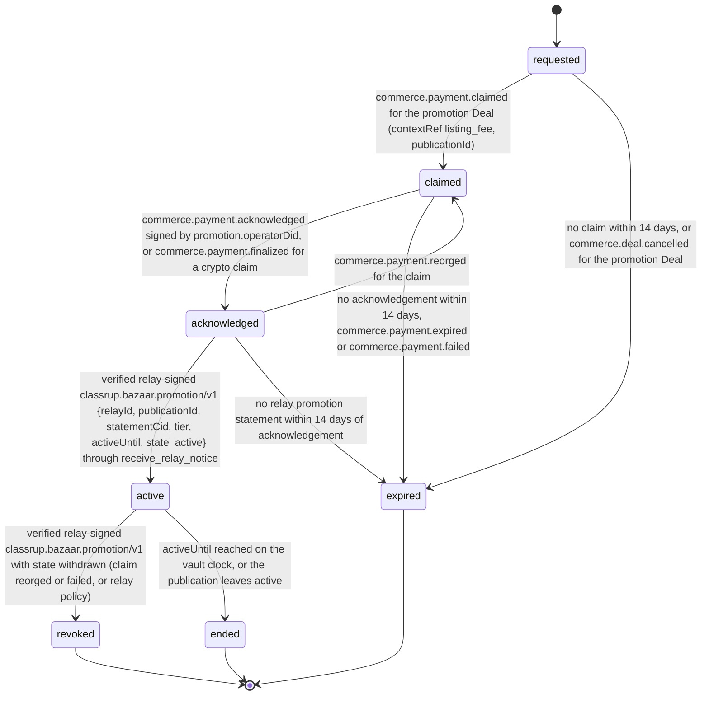

# PS-004-03 — Workflow state machine: Listing publication

**Status:** SPECIFIED (Stage 3). **Module:** [F01.S01.M03 Listing publication](SPEC.md) · **Scope:** MVP · **Code:** `packages/bazaar/src/listings/publish` · **Contracts:** [CTR-ID-001](../../../planning/contracts/CTR-ID-001.md), [CTR-EVT-001](../../../planning/contracts/CTR-EVT-001.md), [CTR-ERR-001](../../../planning/contracts/CTR-ERR-001.md), [CTR-CAP-001](../../../planning/contracts/CTR-CAP-001.md), [CTR-IDM-001](../../../planning/contracts/CTR-IDM-001.md), [CTR-PRV-001](../../../planning/contracts/CTR-PRV-001.md), [CTR-FED-001](../../../planning/contracts/CTR-FED-001.md), [CTR-COM-001](../../../planning/contracts/CTR-COM-001.md), [CTR-SCH-001](../../../planning/contracts/CTR-SCH-001.md)

> Generated from `module.spec.yaml` by `tools/specgen`. Edit the YAML, then run `pnpm spec:render`.

## Requirements

- **PS-004-03.R01** A PublicationRecord follows the declared machine; every other transition is refused with CONFLICT_STATE.
- **PS-004-03.R02** Becoming active is atomic with Listing.apply_status to published and with queuing the signed statement.
- **PS-004-03.R03** Per-relay delivery state is tracked inside the record and never changes the record status; a relay rejection or a relay-signed removal does not unpublish locally.
- **PS-004-03.R04** Promotion is tracked per publication as requested, claimed, acknowledged, active, revoked, ended or expired; it becomes active only on a verified relay-signed promotion statement and the relay can revoke it.

## Specification

### PublicationRecord lifecycle

Initial **submitted**; terminal **blocked**, **withdrawn**, **unpublished**, **ended**.

| Transition | Trigger | Guard / effect |
|---|---|---|
| submitted -> active | verdict allow or allow_with_notice and risk level low | sign statement, queue to relays, Listing draft/unpublished/expired -> published; emits bazaar.listing.published |
| submitted -> held_for_confirmation | verdict review, local spam heuristic or risk assessment elevated | owner must read notice and confirm |
| submitted -> blocked | verdict block | no statement signed |
| held_for_confirmation -> active | bazaar.publication.confirm by owner | same effects as submitted -> active |
| held_for_confirmation -> withdrawn | owner withdraws or 7 days pass | no statement signed |
| active -> active | bazaar.publication.renew by owner or by the F01.S01.M04 expiry deferral | new projection seq n+1 with new expiresAt; emits bazaar.publication.renewed |
| active -> unpublished | bazaar.publication.unpublish (confirmHolds when holds exist), bazaar.publication.end, or local policy pack block | sign tombstone, queue to relays, Listing -> unpublished; emits bazaar.listing.unpublished |
| active -> ended | consumes bazaar.listing.expired | expiry already announced; tombstone queued |
| active -> frozen | a forked statement chain (same seq, different prev) from another device of the principal is detected on sync | no further statements until the owner chooses |
| frozen -> active | owner keeps one chain | the other chain is superseded by a new signed projection seq n+1 |
| frozen -> unpublished | owner discards both chains | tombstone queued; Listing -> unpublished; emits bazaar.listing.unpublished |

### PublicationRecord.promotion lifecycle

Initial **requested**; terminal **revoked**, **ended**, **expired**.

| Transition | Trigger | Guard / effect |
|---|---|---|
| requested -> claimed | commerce.payment.claimed for the promotion Deal (contextRef listing_fee, publicationId) | claimId recorded; UI shows claim sent, never paid |
| claimed -> acknowledged | commerce.payment.acknowledged signed by promotion.operatorDid, or commerce.payment.finalized for a crypto claim | UI shows payment acknowledged, waiting for the relay |
| acknowledged -> claimed | commerce.payment.reorged for the claim | waits again |
| acknowledged -> active | verified relay-signed classrup.bazaar.promotion/v1 {relayId, publicationId, statementCid, tier, activeUntil, state: active} through receive_relay_notice | emits bazaar.publication.promotion_activated; UI shows Promoted on R |
| active -> revoked | verified relay-signed classrup.bazaar.promotion/v1 with state withdrawn (claim reorged or failed, or relay policy) | label removed with the relay's reason |
| active -> ended | activeUntil reached on the vault clock, or the publication leaves active | label removed |
| requested -> expired | no claim within 14 days, or commerce.deal.cancelled for the promotion Deal | listing stays published unpromoted |
| claimed -> expired | no acknowledgement within 14 days, commerce.payment.expired or commerce.payment.failed | listing stays published unpromoted |
| acknowledged -> expired | no relay promotion statement within 14 days of acknowledgement | owner is told to contact the operator; nothing claims promotion |

### Timeouts and scheduled transitions

- held_for_confirmation expires to withdrawn after 7 days.
- Delivery in prepared for more than 24 h without transport acknowledgement is flagged stale in the UI; it keeps retrying under CTR-IDM-001 backoff.
- Promotion in requested, claimed or acknowledged state for 14 days becomes expired; active promotion ends at activeUntil.

## Verification

| Test | Level | Covers | Scenario | Expected |
|---|---|---|---|---|
| TEST-PS-004-09.T04 | property | PS-004-03.R01, PS-004-03.R02 | random command sequences | only declared transitions succeed; active implies Listing published in same transaction |
| TEST-PS-004-09.T05 | integration | PS-004-03.R03, PS-004-06.R02 | R1 accepts, R2 rejects | R1 peer_accepted after signed receipt, R2 relay_rejected, record stays active |
| TEST-PS-004-09.T13 | integration | PS-004-03.R01 | governance.prohibited_rule.changed adds a block rule matching L | publication ends with policy_changed and tombstone queued |
| TEST-PS-004-09.T15 | integration | PS-004-03.R04, PS-004-04.R05 | attach_promotion, payment claimed and acknowledged by the operator, then a promotion statement signed by R1 vs by a random key, then a signed withdrawal | Deal opened with contextRef listing_fee and payee operatorDid; acknowledged without label; active only for R1's signature with promotion_activated; revoked after withdrawal |

## Dependencies

Module depends on: F01.S01.M01, F01.S02.M01, F01.S02.M02, F01.S02.M03, F01.S03.M01, F18.S01.M01, F18.S01.M02, F18.S01.M03, F12.S02.M02, F12.S03.M01, F10.S01.M01, F06.S02.M01, F08.S01.M01, F09.S01.M01, F16.S02.M03, F11.S01.M01, F10.S01.M02, F10.S01.M03, F10.S01.M04, F10.S02.M02, CTR-ID-001, CTR-EVT-001, CTR-ERR-001, CTR-CAP-001, CTR-IDM-001, CTR-PRV-001, CTR-FED-001, CTR-COM-001, CTR-SCH-001. Predecessor: [domain_schema.md](domain_schema.md).
