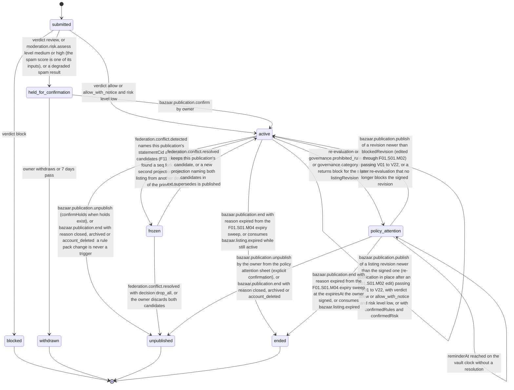
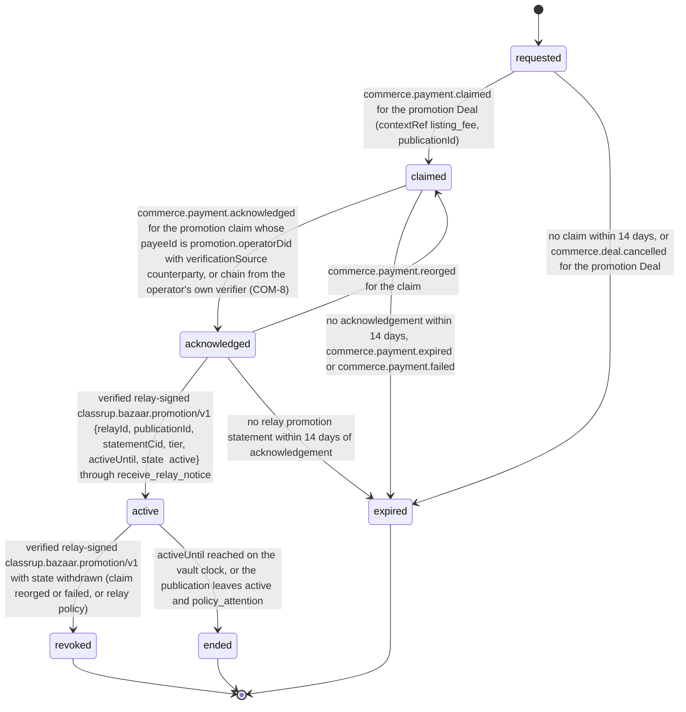

# PS-004-03 — Workflow state machine: Listing publication

**Status:** SPECIFIED (Stage 3). **Module:** [F01.S01.M03 Listing publication](SPEC.md) · **Scope:** MVP · **Code:** `packages/bazaar/src/listings/publish` · **Contracts:** [CTR-ID-001](../../../planning/contracts/CTR-ID-001.md), [CTR-EVT-001](../../../planning/contracts/CTR-EVT-001.md), [CTR-ERR-001](../../../planning/contracts/CTR-ERR-001.md), [CTR-CAP-001](../../../planning/contracts/CTR-CAP-001.md), [CTR-IDM-001](../../../planning/contracts/CTR-IDM-001.md), [CTR-PRV-001](../../../planning/contracts/CTR-PRV-001.md), [CTR-FED-001](../../../planning/contracts/CTR-FED-001.md), [CTR-COM-001](../../../planning/contracts/CTR-COM-001.md), [CTR-SCH-001](../../../planning/contracts/CTR-SCH-001.md)

> Generated from `module.spec.yaml` by `tools/specgen`. Edit the YAML, then run `pnpm spec:render`.

## Requirements

- **PS-004-03.R01** A PublicationRecord follows the declared machine; every other transition is refused with CONFLICT_STATE.
- **PS-004-03.R02** Becoming active is atomic with Listing.apply_status to published and with queuing the signed statement.
- **PS-004-03.R03** Per-relay delivery state is tracked inside the record and never changes the record status; a relay rejection or a relay-signed removal does not unpublish locally.
- **PS-004-03.R04** Promotion is tracked per publication as requested, claimed, acknowledged, active, revoked, ended or expired; it is acknowledged only by commerce.payment.acknowledged signed by promotion.operatorDid (verificationSource counterparty, or chain from the operator's own verifier), becomes active only on a verified relay-signed promotion statement after that acknowledgement, and the relay can revoke it; commerce.payment.finalized in the seller vault is only the seller's own verifier observation and never moves the promotion.
- **PS-004-03.R05** A publication that a changed rule pack or category now blocks moves to policy_attention: the owner is notified, renewals and re-publication of the unchanged revision stop, one reminder follows after a grace of at least 7 days, and it leaves that state only by a re-publication of an edited revision that clears the verdict, a later re-evaluation that no longer blocks, the owner's confirmed Unpublish or the expiry at its signed expiresAt; the verdict never causes an unpublish or a tombstone by itself (CTR-FED-001 FED-9, ADR-0016 §3 and §8).

## Specification

### PublicationRecord lifecycle

Initial **submitted**; terminal **blocked**, **withdrawn**, **unpublished**, **ended**.

| Transition | Trigger | Guard / effect |
|---|---|---|
| submitted -> active | verdict allow or allow_with_notice and risk level low | federation.record.publish signs the projection and allocates seq (StatementPublisherPort), one F15.S01.M01 entry per destination relay, Listing draft/unpublished/expired -> published; emits bazaar.listing.published |
| submitted -> held_for_confirmation | verdict review, or moderation.risk.assess level medium or high (the spam score is one of its inputs), or a degraded spam result | owner must read notice and confirm |
| submitted -> blocked | verdict block | no statement signed |
| held_for_confirmation -> active | bazaar.publication.confirm by owner | same effects as submitted -> active |
| held_for_confirmation -> withdrawn | owner withdraws or 7 days pass | no statement signed |
| active -> active | bazaar.publication.renew by owner or by the F01.S01.M04 expiry deferral | new projection with new expiresAt published through federation.record.publish, which allocates the next seq; emits bazaar.publication.renewed |
| active -> unpublished | bazaar.publication.unpublish (confirmHolds when holds exist), or bazaar.publication.end with reason closed, archived or account_deleted; a rule pack change is never a trigger | tombstone issued through federation.tombstone.issue (owner_withdrawn or account_deleted) and routed to every relay that received the projection, Listing -> unpublished; emits bazaar.listing.unpublished with tombstoneCid |
| active -> ended | bazaar.publication.end with reason expired from the F01.S01.M04 expiry sweep, or consumes bazaar.listing.expired while still active | tombstone issued through federation.tombstone.issue (listing_expired, idempotent per target); endReason expired; no bazaar.listing.unpublished |
| active -> frozen | federation.conflict.detected names this publication's statementCid among its candidates (F11.S02.M03 found a seq fork or a second projection of the listing from another device of the principal) | no further statements until the owner chooses |
| frozen -> active | federation.conflict.resolved keeps this publication's candidate, or a new projection naming both candidates in ext.supersedes is published | publication continues with the kept or superseding cid |
| frozen -> unpublished | federation.conflict.resolved with decision drop_all, or the owner discards both candidates | tombstone issued through federation.tombstone.issue; Listing -> unpublished; emits bazaar.listing.unpublished |
| active -> active | bazaar.publication.publish of a listing revision newer than the signed one (re-publication in place after an F01.S01.M02 edit) passing V01 to V22, with verdict allow or allow_with_notice and risk level low, or with confirmedRules and confirmedRisk | new projection of that revision through federation.record.publish (next seq, same recordKey with higher listingRevision), one F15.S01.M01 entry per destination relay; emits bazaar.listing.published |
| active -> policy_attention | re-evaluation on governance.prohibited_rule.changed or governance.category.changed returns block for the signed listingRevision | policyAttention {since, blockedRevision, matches with publisherId, packsDigest, reminderAt = since + 7 days} stored; emits bazaar.publication.policy_attention (raised); no statement and no tombstone; Listing stays published and relays keep the projection |
| policy_attention -> policy_attention | reminderAt reached on the vault clock without a resolution | remindedAt set; emits bazaar.publication.policy_attention (reminder) once; nothing is unpublished |
| policy_attention -> active | bazaar.publication.publish of a revision newer than blockedRevision (edited through F01.S01.M02) passing V01 to V22, or a later re-evaluation that no longer blocks the signed revision | resolution edited (new projection through federation.record.publish; emits bazaar.listing.published) or verdict_cleared (no new statement); emits bazaar.publication.policy_attention (resolved) |
| policy_attention -> unpublished | bazaar.publication.unpublish by the owner from the policy attention sheet (explicit confirmation), or bazaar.publication.end with reason closed, archived or account_deleted | endReason policy_changed for the owner's confirmation; tombstone issued through federation.tombstone.issue (owner_withdrawn or account_deleted) only now; Listing -> unpublished (apply_status reason policy_changed); emits bazaar.listing.unpublished and bazaar.publication.policy_attention (resolved) |
| policy_attention -> ended | bazaar.publication.end with reason expired from the F01.S01.M04 expiry sweep at the expiresAt the owner signed, or consumes bazaar.listing.expired | the listing_expired tombstone every expired publication gets, issued through federation.tombstone.issue; resolution expired; no bazaar.listing.unpublished |

### PublicationRecord.promotion lifecycle

Initial **requested**; terminal **revoked**, **ended**, **expired**.

| Transition | Trigger | Guard / effect |
|---|---|---|
| requested -> claimed | commerce.payment.claimed for the promotion Deal (contextRef listing_fee, publicationId) | claimId recorded; UI shows claim sent, never paid |
| claimed -> acknowledged | commerce.payment.acknowledged for the promotion claim whose payeeId is promotion.operatorDid with verificationSource counterparty, or chain from the operator's own verifier (COM-8) | UI shows payment acknowledged by the operator, waiting for the relay; commerce.payment.finalized alone never triggers this |
| acknowledged -> claimed | commerce.payment.reorged for the claim | waits again |
| acknowledged -> active | verified relay-signed classrup.bazaar.promotion/v1 {relayId, publicationId, statementCid, tier, activeUntil, state: active} through receive_relay_notice | emits bazaar.publication.promotion_activated; UI shows Promoted on R |
| active -> revoked | verified relay-signed classrup.bazaar.promotion/v1 with state withdrawn (claim reorged or failed, or relay policy) | label removed with the relay's reason |
| active -> ended | activeUntil reached on the vault clock, or the publication leaves active and policy_attention | label removed |
| requested -> expired | no claim within 14 days, or commerce.deal.cancelled for the promotion Deal | listing stays published unpromoted |
| claimed -> expired | no acknowledgement within 14 days, commerce.payment.expired or commerce.payment.failed | listing stays published unpromoted |
| acknowledged -> expired | no relay promotion statement within 14 days of acknowledgement | owner is told to contact the operator; nothing claims promotion |

### Timeouts and scheduled transitions

- held_for_confirmation expires to withdrawn after 7 days.
- Delivery in prepared for more than 24 h without transport acknowledgement is flagged stale in the UI; it keeps retrying under CTR-IDM-001 backoff.
- Promotion in requested, claimed or acknowledged state for 14 days becomes expired; active promotion ends at activeUntil.
- policy_attention sends one reminder at reminderAt (since + 7 days, never earlier) and has no timeout that unpublishes, ends or tombstones it; only the signed expiresAt ends it through the F01.S01.M04 expiry sweep.

## Verification

| Test | Level | Covers | Scenario | Expected |
|---|---|---|---|---|
| TEST-PS-004-09.T04 | property | PS-004-03.R01, PS-004-03.R02 | random command sequences | only declared transitions succeed; active implies Listing published in same transaction |
| TEST-PS-004-09.T05 | integration | PS-004-03.R03, PS-004-06.R02 | R1 accepts, R2 rejects | R1 transport_acknowledged once its verified receipt completes the outbox entry and never peer_accepted, R2 relay_rejected, record stays active |
| TEST-PS-004-09.T13 | integration | PS-004-03.R01, PS-004-03.R05, PS-004-02.R09, PS-004-04.R08 | governance.prohibited_rule.changed adds a block rule matching active L; renew and publish of the unchanged revision; 6 days, then 7 days pass; the owner edits L so the verdict clears and publishes it; in a second run the owner confirms Unpublish; in a third run a later pack retires the rule | L moves to policy_attention with bazaar.publication.policy_attention raised for ownerId and no unpublish, end or federation.tombstone.issue call; renew and unchanged publish refused with BAZAAR_PUBLISH_POLICY_ATTENTION; no reminder at day 6, one at day 7; the edited revision is published and the attention resolved as edited; the confirmation unpublishes with reason policy_changed and only then issues the tombstone; the retirement returns L to active as verdict_cleared without a new statement |
| TEST-PS-004-09.T15 | integration | PS-004-03.R04, PS-004-04.R05 | attach_promotion, a crypto claim finalized only by the seller's own verifier, then commerce.payment.acknowledged by the operator with verificationSource chain, then a promotion statement signed by R1 vs by a random key, then a signed withdrawal | Deal opened with contextRef listing_fee and payee operatorDid; finalized alone keeps the promotion claimed with the label final per your verifier; acknowledged only after the operator's acknowledgement, without label; active only for R1's signature with promotion_activated; revoked after withdrawal |
| TEST-PS-004-09.T30 | integration | PS-004-03.R01, PS-004-04.R01 | edit active L to revision 6 and publish; publish revision 6 again; edit to revision 7 matching review rule r1 and publish without, then with confirmedRules and confirmedRisk | revision 6 projection published in place with the next seq and bazaar.listing.published; the repeat refused with BAZAAR_PUBLISH_NOT_ALLOWED; revision 7 refused with BAZAAR_PUBLISH_CONFIRMATION_REQUIRED first, published with ownerConfirmedAt after confirmation; one live PublicationRecord throughout |

## Dependencies

Module depends on: F01.S01.M01, F01.S02.M01, F01.S02.M02, F01.S02.M03, F01.S03.M01, F18.S01.M01, F18.S01.M02, F18.S01.M03, F12.S02.M02, F12.S03.M01, F10.S01.M01, F06.S02.M01, F08.S01.M01, F09.S01.M01, F11.S01.M01, F11.S01.M02, F15.S01.M01, F15.S02.M01, F10.S01.M02, F10.S01.M03, F10.S01.M04, F10.S02.M02, CTR-ID-001, CTR-EVT-001, CTR-ERR-001, CTR-CAP-001, CTR-IDM-001, CTR-PRV-001, CTR-FED-001, CTR-COM-001, CTR-SCH-001. Predecessor: [domain_schema.md](domain_schema.md).
