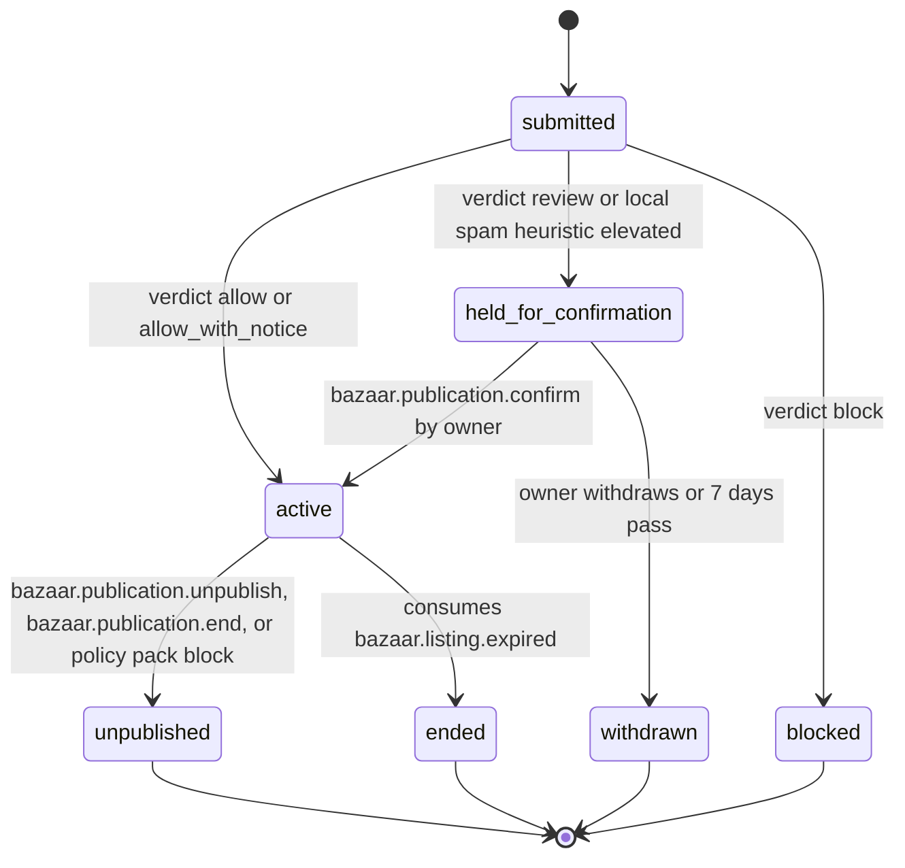

# PS-004-03 — Workflow state machine: Listing publication

**Status:** SPECIFIED (Stage 3). **Module:** [F01.S01.M03 Listing publication](SPEC.md) · **Scope:** MVP · **Code:** `packages/bazaar/src/listings/publish` · **Contracts:** [CTR-ID-001](../../../planning/contracts/CTR-ID-001.md), [CTR-EVT-001](../../../planning/contracts/CTR-EVT-001.md), [CTR-ERR-001](../../../planning/contracts/CTR-ERR-001.md), [CTR-CAP-001](../../../planning/contracts/CTR-CAP-001.md), [CTR-IDM-001](../../../planning/contracts/CTR-IDM-001.md), [CTR-PRV-001](../../../planning/contracts/CTR-PRV-001.md), [CTR-FED-001](../../../planning/contracts/CTR-FED-001.md), [CTR-COM-001](../../../planning/contracts/CTR-COM-001.md), [CTR-SCH-001](../../../planning/contracts/CTR-SCH-001.md)

> Generated from `module.spec.yaml` by `tools/specgen`. Edit the YAML, then run `pnpm spec:render`.

## Requirements

- **PS-004-03.R01** A PublicationRecord follows the declared machine; every other transition is refused with CONFLICT_STATE.
- **PS-004-03.R02** Becoming active is atomic with Listing.apply_status to published and with queuing the signed statement.
- **PS-004-03.R03** Per-relay delivery state is tracked inside the record and never changes the record status; a relay rejection does not unpublish locally.

## Specification

### PublicationRecord lifecycle

Initial **submitted**; terminal **blocked**, **withdrawn**, **unpublished**, **ended**.

| Transition | Trigger | Guard / effect |
|---|---|---|
| submitted -> active | verdict allow or allow_with_notice | sign statement, queue to relays, Listing draft/unpublished/expired -> published; emits bazaar.listing.published |
| submitted -> held_for_confirmation | verdict review or local spam heuristic elevated | owner must read notice and confirm |
| submitted -> blocked | verdict block | no statement signed |
| held_for_confirmation -> active | bazaar.publication.confirm by owner | same effects as submitted -> active |
| held_for_confirmation -> withdrawn | owner withdraws or 7 days pass | no statement signed |
| active -> unpublished | bazaar.publication.unpublish, bazaar.publication.end, or policy pack block | sign tombstone, queue to relays, Listing -> unpublished; emits bazaar.listing.unpublished |
| active -> ended | consumes bazaar.listing.expired | expiry already announced; tombstone queued |

### Timeouts and scheduled transitions

- held_for_confirmation expires to withdrawn after 7 days.
- Delivery in prepared for more than 24 h without transport acknowledgement is flagged stale in the UI; it keeps retrying under CTR-IDM-001 backoff.
- Promotion in claimed state for 14 days becomes expired.

## Verification

| Test | Level | Covers | Scenario | Expected |
|---|---|---|---|---|
| TEST-PS-004-09.T04 | property | PS-004-03.R01, PS-004-03.R02 | random command sequences | only declared transitions succeed; active implies Listing published in same transaction |
| TEST-PS-004-09.T05 | integration | PS-004-03.R03, PS-004-06.R02 | R1 accepts, R2 rejects | R1 peer_accepted after signed receipt, R2 relay_rejected, record stays active |
| TEST-PS-004-09.T13 | integration | PS-004-03.R01 | governance.prohibited_rule.changed adds a block rule matching L | publication ends with policy_changed and tombstone queued |

## Dependencies

Module depends on: F01.S01.M01, F01.S02.M01, F01.S02.M02, F01.S02.M03, F01.S03.M01, F18.S01.M01, F18.S01.M02, F18.S01.M03, F12.S02.M02, F09.S01.M01, F16.S02.M03, F11.S01.M01, CTR-ID-001, CTR-EVT-001, CTR-ERR-001, CTR-CAP-001, CTR-IDM-001, CTR-PRV-001, CTR-FED-001, CTR-COM-001, CTR-SCH-001. Predecessor: [domain_schema.md](domain_schema.md).
