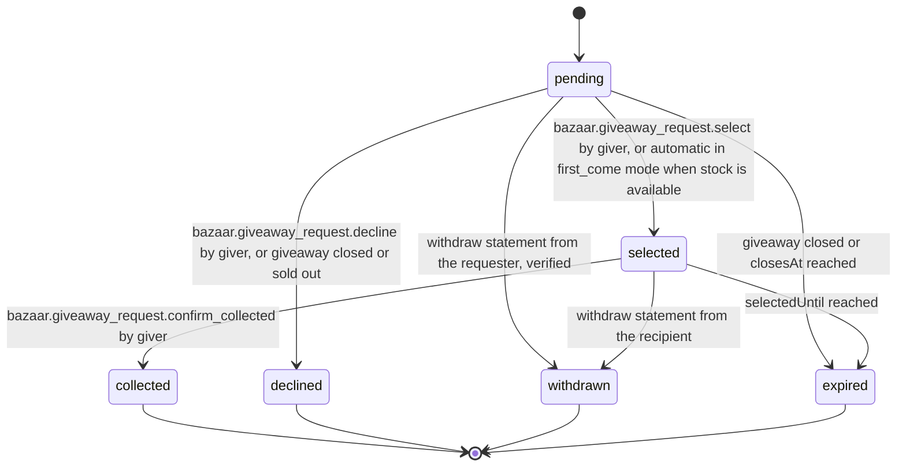

# PS-005-03 — Workflow state machine: Giveaway listing type

**Status:** SPECIFIED (Stage 3). **Module:** [F01.S02.M03 Giveaway listing type](SPEC.md) · **Scope:** MVP · **Code:** `packages/bazaar/src/listing_types/giveaway` · **Contracts:** [CTR-ID-001](../../../planning/contracts/CTR-ID-001.md), [CTR-EVT-001](../../../planning/contracts/CTR-EVT-001.md), [CTR-ERR-001](../../../planning/contracts/CTR-ERR-001.md), [CTR-CAP-001](../../../planning/contracts/CTR-CAP-001.md), [CTR-IDM-001](../../../planning/contracts/CTR-IDM-001.md), [CTR-PRV-001](../../../planning/contracts/CTR-PRV-001.md), [CTR-FED-001](../../../planning/contracts/CTR-FED-001.md), [CTR-SCH-001](../../../planning/contracts/CTR-SCH-001.md)

> Generated from `module.spec.yaml` by `tools/specgen`. Edit the YAML, then run `pnpm spec:render`.

## Requirements

- **PS-005-03.R01** GiveawayRequest follows the declared machine; collected, declined, withdrawn and expired are terminal.
- **PS-005-03.R02** Selecting a recipient is atomic with the inventory hold; if the hold fails, the request stays pending.
- **PS-005-03.R03** A selected request that is not collected within 72 hours expires and releases its hold, making the unit selectable again; no cross-vault lock is claimed.

## Specification

### GiveawayRequest lifecycle

Initial **pending**; terminal **collected**, **declined**, **withdrawn**, **expired**.

| Transition | Trigger | Guard / effect |
|---|---|---|
| pending -> selected | bazaar.giveaway_request.select by giver, or automatic in first_come mode when stock is available | inventory hold taken in same transaction; selection statement signed; emits bazaar.giveaway.recipient_selected |
| pending -> declined | bazaar.giveaway_request.decline by giver, or giveaway closed or sold out | signed decline statement queued |
| pending -> withdrawn | withdraw statement from the requester, verified | no event |
| pending -> expired | giveaway closed or closesAt reached | no event |
| selected -> collected | bazaar.giveaway_request.confirm_collected by giver | inventory hold converted; optional recipient acknowledgement recorded when it arrives |
| selected -> withdrawn | withdraw statement from the recipient | hold released |
| selected -> expired | selectedUntil reached | hold released; giver may select again |

### Timeouts and scheduled transitions

- Selected requests expire 72 h after selection.
- Pending requests expire when the giveaway closes (closesAt or listing leaves published).
- Selection statement expiry equals selectedUntil; the requester's app shows expired after that time by its own clock.

## Verification

| Test | Level | Covers | Scenario | Expected |
|---|---|---|---|---|
| TEST-PS-005-09.T04 | property | PS-005-03.R01, PS-005-03.R02, PS-005-03.R03 | random commands, withdrawals and clock advances | only declared transitions; selected implies active hold; terminal states never regress |
| TEST-PS-005-09.T05 | integration | PS-005-03.R02, PS-005-06.R02 | two tabs select different requests for last unit | one selected, other BAZAAR_GIVEAWAY_NOT_SELECTABLE |
| TEST-PS-005-09.T06 | integration | PS-005-03.R03 | selected recipient does not collect for 72 h | request expired, hold released, second selection possible |

## Dependencies

Module depends on: F01.S01.M01, F01.S03.M01, F07.S02.M02, F16.S02.M03, CTR-ID-001, CTR-EVT-001, CTR-ERR-001, CTR-CAP-001, CTR-IDM-001, CTR-PRV-001, CTR-FED-001, CTR-SCH-001. Predecessor: [domain_schema.md](domain_schema.md).
