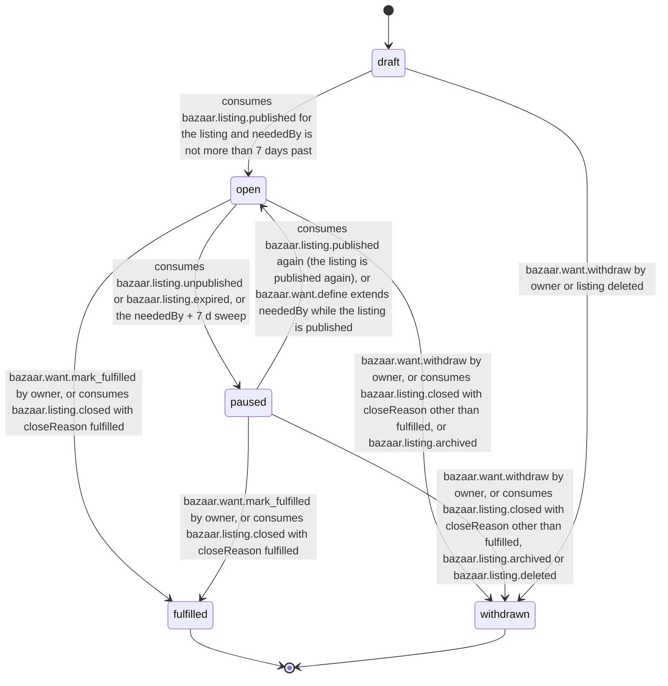

# PS-007-03 — Workflow state machine: Wanted listing type

**Status:** SPECIFIED (Stage 3). **Module:** [F01.S02.M02 Wanted listing type](SPEC.md) · **Scope:** MVP · **Code:** `packages/bazaar/src/listing_types/wanted` · **Contracts:** [CTR-ID-001](../../../planning/contracts/CTR-ID-001.md), [CTR-EVT-001](../../../planning/contracts/CTR-EVT-001.md), [CTR-ERR-001](../../../planning/contracts/CTR-ERR-001.md), [CTR-CAP-001](../../../planning/contracts/CTR-CAP-001.md), [CTR-IDM-001](../../../planning/contracts/CTR-IDM-001.md), [CTR-MNY-001](../../../planning/contracts/CTR-MNY-001.md), [CTR-PRV-001](../../../planning/contracts/CTR-PRV-001.md), [CTR-SCH-001](../../../planning/contracts/CTR-SCH-001.md)

> Generated from `module.spec.yaml` by `tools/specgen`. Edit the YAML, then run `pnpm spec:render`.

## Requirements

- **PS-007-03.R01** WantSpec follows the declared machine; fulfilled and withdrawn are terminal.
- **PS-007-03.R02** A want becomes open only when its listing is published and pauses when the listing is unpublished or expired or when neededBy is more than 7 days past; the matching engine treats only open wants as matchable.
- **PS-007-03.R03** Owner actions and listing events race safely: the first committed transition wins and the other receives CONFLICT_STATE.
- **PS-007-03.R04** Closing the listing moves an open or paused want to fulfilled when closeReason is fulfilled and to withdrawn otherwise; listing expiry pauses rather than withdraws, so a want whose listing is published again is matchable again.

## Specification

### WantSpec lifecycle

Initial **draft**; terminal **fulfilled**, **withdrawn**.

| Transition | Trigger | Guard / effect |
|---|---|---|
| draft -> open | consumes bazaar.listing.published for the listing and neededBy is not more than 7 days past | emits bazaar.want.declared |
| open -> paused | consumes bazaar.listing.unpublished or bazaar.listing.expired, or the neededBy + 7 d sweep | pauseReason set; no event; matching engines see the unpublish or expiry through the listing tombstone or projection expiresAt |
| paused -> open | consumes bazaar.listing.published again (the listing is published again), or bazaar.want.define extends neededBy while the listing is published | emits bazaar.want.declared |
| open -> fulfilled | bazaar.want.mark_fulfilled by owner, or consumes bazaar.listing.closed with closeReason fulfilled | emits bazaar.want.fulfilled |
| paused -> fulfilled | bazaar.want.mark_fulfilled by owner, or consumes bazaar.listing.closed with closeReason fulfilled | emits bazaar.want.fulfilled |
| open -> withdrawn | bazaar.want.withdraw by owner, or consumes bazaar.listing.closed with closeReason other than fulfilled, or bazaar.listing.archived | emits bazaar.want.withdrawn with reason |
| paused -> withdrawn | bazaar.want.withdraw by owner, or consumes bazaar.listing.closed with closeReason other than fulfilled, bazaar.listing.archived or bazaar.listing.deleted | emits bazaar.want.withdrawn |
| draft -> withdrawn | bazaar.want.withdraw by owner or listing deleted | no event because the want was never declared |

### Timeouts and scheduled transitions

- neededBy sweep daily and at app start: an open want whose neededBy is more than 7 days past moves to paused (needed_by_passed) and the owner is asked to extend or withdraw.
- Listing expiry pauses the want (listing_expired); it reopens when the listing is published again.

## Verification

| Test | Level | Covers | Scenario | Expected |
|---|---|---|---|---|
| TEST-PS-007-09.T03 | property | PS-007-01.R03, PS-007-03.R01, PS-007-03.R02, PS-007-03.R03 | random owner commands and duplicated listing events | only declared transitions; terminal states never regress; open implies listing published |
| TEST-PS-007-09.T15 | property | PS-007-03.R04, PS-007-03.R02 | event orders unpublished -> closed(fulfilled), unpublished -> closed(sold), expired -> published again, and the neededBy + 7 d sweep followed by define extending neededBy | paused want becomes fulfilled or withdrawn without CONFLICT_STATE; expiry pauses and publishing again reopens with bazaar.want.declared; the sweep pauses and the extension reopens |

## Dependencies

Module depends on: F01.S01.M01, F01.S01.M02, F18.S01.M03, F09.S03.M01, F09.S03.M03, F10.S01.M02, F10.S01.M03, F10.S01.M04, F10.S02.M02, CTR-ID-001, CTR-EVT-001, CTR-ERR-001, CTR-CAP-001, CTR-IDM-001, CTR-MNY-001, CTR-PRV-001, CTR-SCH-001. Predecessor: [domain_schema.md](domain_schema.md).
