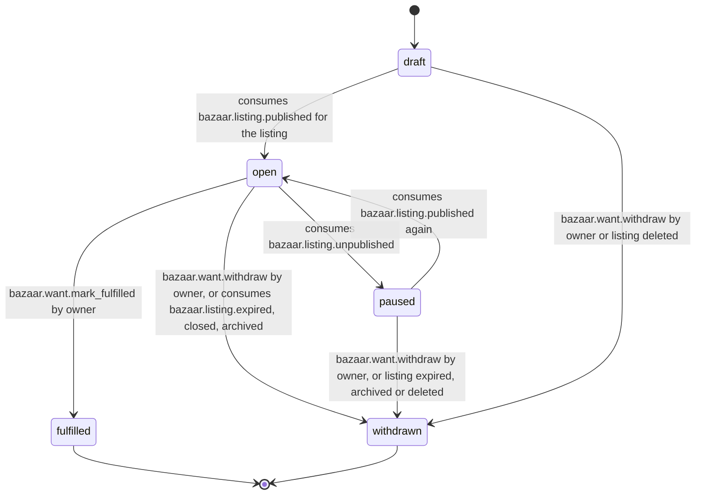

# PS-007-03 — Workflow state machine: Wanted listing type

**Status:** SPECIFIED (Stage 3). **Module:** [F01.S02.M02 Wanted listing type](SPEC.md) · **Scope:** MVP · **Code:** `packages/bazaar/src/listing_types/wanted` · **Contracts:** [CTR-ID-001](../../../planning/contracts/CTR-ID-001.md), [CTR-EVT-001](../../../planning/contracts/CTR-EVT-001.md), [CTR-ERR-001](../../../planning/contracts/CTR-ERR-001.md), [CTR-CAP-001](../../../planning/contracts/CTR-CAP-001.md), [CTR-IDM-001](../../../planning/contracts/CTR-IDM-001.md), [CTR-MNY-001](../../../planning/contracts/CTR-MNY-001.md), [CTR-PRV-001](../../../planning/contracts/CTR-PRV-001.md), [CTR-SCH-001](../../../planning/contracts/CTR-SCH-001.md)

> Generated from `module.spec.yaml` by `tools/specgen`. Edit the YAML, then run `pnpm spec:render`.

## Requirements

- **PS-007-03.R01** WantSpec follows the declared machine; fulfilled and withdrawn are terminal.
- **PS-007-03.R02** A want becomes open only when its listing is published and paused when it is unpublished; the matching engine treats only open wants as matchable.
- **PS-007-03.R03** Owner actions and listing events race safely: the first committed transition wins and the other receives CONFLICT_STATE.

## Specification

### WantSpec lifecycle

Initial **draft**; terminal **fulfilled**, **withdrawn**.

| Transition | Trigger | Guard / effect |
|---|---|---|
| draft -> open | consumes bazaar.listing.published for the listing | emits bazaar.want.declared |
| open -> paused | consumes bazaar.listing.unpublished | no event; matching engines see the unpublish through the listing tombstone |
| paused -> open | consumes bazaar.listing.published again | emits bazaar.want.declared |
| open -> fulfilled | bazaar.want.mark_fulfilled by owner | emits bazaar.want.fulfilled |
| open -> withdrawn | bazaar.want.withdraw by owner, or consumes bazaar.listing.expired, closed, archived | emits bazaar.want.withdrawn with reason |
| paused -> withdrawn | bazaar.want.withdraw by owner, or listing expired, archived or deleted | emits bazaar.want.withdrawn |
| draft -> withdrawn | bazaar.want.withdraw by owner or listing deleted | no event because the want was never declared |

### Timeouts and scheduled transitions

- A want open for 90 days without a republish is withdrawn with reason expired when its listing expires; neededBy in the past pauses the want after 7 days and asks the owner to extend or withdraw.

## Verification

| Test | Level | Covers | Scenario | Expected |
|---|---|---|---|---|
| TEST-PS-007-09.T03 | property | PS-007-03.R01, PS-007-03.R02, PS-007-03.R03 | random owner commands and duplicated listing events | only declared transitions; terminal states never regress; open implies listing published |

## Dependencies

Module depends on: F01.S01.M01, F18.S01.M03, F09.S03.M01, F09.S03.M03, CTR-ID-001, CTR-EVT-001, CTR-ERR-001, CTR-CAP-001, CTR-IDM-001, CTR-MNY-001, CTR-PRV-001, CTR-SCH-001. Predecessor: [domain_schema.md](domain_schema.md).
