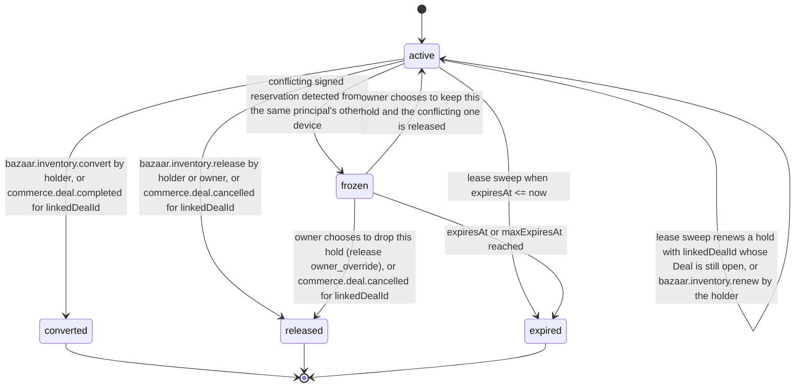
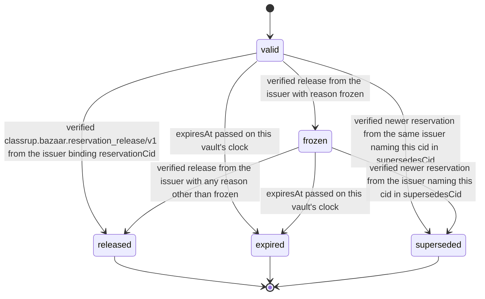

# PS-008-03 — Workflow state machine: Inventory availability

**Status:** SPECIFIED (Stage 3). **Module:** [F01.S03.M01 Inventory availability](SPEC.md) · **Scope:** MVP · **Code:** `packages/bazaar/src/inventory/availability` · **Contracts:** [CTR-ID-001](../../../planning/contracts/CTR-ID-001.md), [CTR-EVT-001](../../../planning/contracts/CTR-EVT-001.md), [CTR-ERR-001](../../../planning/contracts/CTR-ERR-001.md), [CTR-CAP-001](../../../planning/contracts/CTR-CAP-001.md), [CTR-IDM-001](../../../planning/contracts/CTR-IDM-001.md), [CTR-PRV-001](../../../planning/contracts/CTR-PRV-001.md), [CTR-FED-001](../../../planning/contracts/CTR-FED-001.md), [CTR-SCH-001](../../../planning/contracts/CTR-SCH-001.md)

> Generated from `module.spec.yaml` by `tools/specgen`. Edit the YAML, then run `pnpm spec:render`.

## Requirements

- **PS-008-03.R01** InventoryHold follows the declared machine; converted, released and expired are terminal and a new hold must be requested for new needs.
- **PS-008-03.R02** Hold, release, convert and renew each run in one IndexedDB transaction with the availability check, so concurrent callers in this vault are serialized.
- **PS-008-03.R03** A frozen hold stays frozen until the owner decides or it expires; conflicting signed reservations are never resolved by timestamp or last writer.
- **PS-008-03.R04** Frozen holds expire at expiresAt or maxExpiresAt exactly like active ones, so no hold or reservation stays frozen forever.
- **PS-008-03.R05** A hold with linkedDealId is renewed by the lease sweep in steps of at most 7 days up to maxExpiresAt (the Deal expiry, at most 30 days) while the Deal is open, is released with reason deal_cancelled on commerce.deal.cancelled and converted on commerce.deal.completed (N5).

## Specification

### InventoryHold lifecycle

Initial **active**; terminal **converted**, **released**, **expired**.

| Transition | Trigger | Guard / effect |
|---|---|---|
| active -> active | lease sweep renews a hold with linkedDealId whose Deal is still open, or bazaar.inventory.renew by the holder | expiresAt extended by at most 7 d (renew: ttl) up to maxExpiresAt; renewals + 1 |
| active -> converted | bazaar.inventory.convert by holder, or commerce.deal.completed for linkedDealId | onHand reduced by quantity; emits bazaar.inventory.converted; emits depleted if available becomes 0 |
| active -> released | bazaar.inventory.release by holder or owner, or commerce.deal.cancelled for linkedDealId | quantity returns to availability; signed release queued to the reservation audience (not for cycle); emits bazaar.inventory.released |
| active -> expired | lease sweep when expiresAt <= now | emits bazaar.inventory.released with reason expired |
| active -> frozen | conflicting signed reservation detected from the same principal's other device | signed release with reason frozen queued to the reservation audience (not for cycle); emits bazaar.inventory.conflict_detected |
| frozen -> released | owner chooses to drop this hold (release owner_override), or commerce.deal.cancelled for linkedDealId | emits bazaar.inventory.released |
| frozen -> active | owner chooses to keep this hold and the conflicting one is released | availability rechecked; a new reservation may be issued with supersedesCid |
| frozen -> expired | expiresAt or maxExpiresAt reached | emits bazaar.inventory.released with reason expired |

### PeerReservation lifecycle

Initial **valid**; terminal **released**, **expired**, **superseded**.

| Transition | Trigger | Guard / effect |
|---|---|---|
| valid -> released | verified classrup.bazaar.reservation_release/v1 from the issuer binding reservationCid | shown as released by the issuer |
| valid -> frozen | verified release from the issuer with reason frozen | shown as under conflict; not relied on |
| valid -> expired | expiresAt passed on this vault's clock | shown as expired |
| valid -> superseded | verified newer reservation from the same issuer naming this cid in supersedesCid | the newer one is shown |
| frozen -> released | verified release from the issuer with any reason other than frozen | shown as released |
| frozen -> superseded | verified newer reservation from the issuer naming this cid in supersedesCid | conflict resolved by the issuer |
| frozen -> expired | expiresAt passed on this vault's clock | shown as expired |

### Timeouts and scheduled transitions

- Lease sweep every 30 s while the app is open and at app start: active and frozen holds with expiresAt <= now become expired; Deal-linked active holds with less than 24 h left are renewed first while their Deal is open.
- Default hold ttl 15 minutes (IDM-3); accepted offers and negotiations use 7 days with linkedDealId and maxExpiresAt = Deal expiry; giveaway selections 72 h; cycle locks up to 14 days per renewal; maximum total life 30 days.
- PeerReservation expiry is evaluated on vault open and every 60 s while open.

## Verification

| Test | Level | Covers | Scenario | Expected |
|---|---|---|---|---|
| TEST-PS-008-09.T04 | property | PS-008-03.R01, PS-008-03.R02 | random hold/release/renew/convert/clock sequences | only declared transitions; onHand >= reserved; converted exactly once |
| TEST-PS-008-09.T05 | integration | PS-008-03.R02, PS-008-06.R02 | two tabs hold the last unit concurrently | exactly one hold succeeds, other gets INSUFFICIENT |
| TEST-PS-008-09.T06 | integration | PS-008-03.R03, PS-008-06.R02 | D2 holds the same last unit offline then syncs | both holds frozen, conflict event with linkedDealIds emitted, convert refused with FROZEN until owner releases one |
| TEST-PS-008-09.T20 | property | PS-008-03.R04 | frozen holds under clock advance without owner decision | every frozen hold reaches expired at expiresAt or maxExpiresAt and emits released with reason expired |
| TEST-PS-008-09.T21 | integration | PS-008-03.R05 | hold for Deal D with ttl 7 d and maxExpiresAt 30 d; advance to day 6; then commerce.deal.cancelled for D | hold renewed by the sweep before lapsing; on cancellation released with reason deal_cancelled and a signed release queued to the buyer |

## Dependencies

Module depends on: F01.S01.M01, F16.S02.M03, F11.S01.M01, F11.S01.M02, F10.S01.M02, F10.S01.M03, F10.S01.M04, F10.S02.M02, CTR-ID-001, CTR-EVT-001, CTR-ERR-001, CTR-CAP-001, CTR-IDM-001, CTR-PRV-001, CTR-FED-001, CTR-SCH-001. Predecessor: [domain_schema.md](domain_schema.md).
