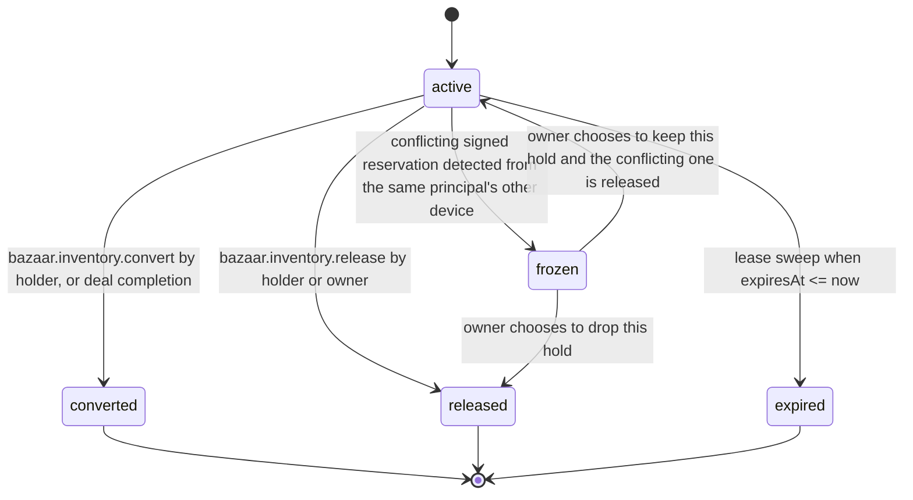

# PS-008-03 — Workflow state machine: Inventory availability

**Status:** SPECIFIED (Stage 3). **Module:** [F01.S03.M01 Inventory availability](SPEC.md) · **Scope:** MVP · **Code:** `packages/bazaar/src/inventory/availability` · **Contracts:** [CTR-ID-001](../../../planning/contracts/CTR-ID-001.md), [CTR-EVT-001](../../../planning/contracts/CTR-EVT-001.md), [CTR-ERR-001](../../../planning/contracts/CTR-ERR-001.md), [CTR-CAP-001](../../../planning/contracts/CTR-CAP-001.md), [CTR-IDM-001](../../../planning/contracts/CTR-IDM-001.md), [CTR-PRV-001](../../../planning/contracts/CTR-PRV-001.md), [CTR-FED-001](../../../planning/contracts/CTR-FED-001.md), [CTR-SCH-001](../../../planning/contracts/CTR-SCH-001.md)

> Generated from `module.spec.yaml` by `tools/specgen`. Edit the YAML, then run `pnpm spec:render`.

## Requirements

- **PS-008-03.R01** InventoryHold follows the declared machine; converted, released and expired are terminal and a new hold must be requested for new needs.
- **PS-008-03.R02** Hold, release, convert and renew each run in one IndexedDB transaction with the availability check, so concurrent callers in this vault are serialized.
- **PS-008-03.R03** A frozen hold stays frozen until the owner decides; conflicting signed reservations are never resolved by timestamp or last writer.

## Specification

### InventoryHold lifecycle

Initial **active**; terminal **converted**, **released**, **expired**.

| Transition | Trigger | Guard / effect |
|---|---|---|
| active -> converted | bazaar.inventory.convert by holder, or deal completion | onHand reduced by quantity; emits bazaar.inventory.converted; emits depleted if available becomes 0 |
| active -> released | bazaar.inventory.release by holder or owner | quantity returns to availability; emits bazaar.inventory.released |
| active -> expired | lease sweep when expiresAt <= now | emits bazaar.inventory.released with reason expired |
| active -> frozen | conflicting signed reservation detected from the same principal's other device | emits bazaar.inventory.conflict_detected |
| frozen -> released | owner chooses to drop this hold | emits bazaar.inventory.released |
| frozen -> active | owner chooses to keep this hold and the conflicting one is released | availability rechecked |

### Timeouts and scheduled transitions

- Lease sweep every 30 s while the app is open and at app start: active holds with expiresAt <= now become expired.
- Default hold ttl 15 minutes (IDM-3); offers use 7 days; cycle locks use their consent deadline up to 14 days; maximum total life 30 days.

## Verification

| Test | Level | Covers | Scenario | Expected |
|---|---|---|---|---|
| TEST-PS-008-09.T04 | property | PS-008-03.R01, PS-008-03.R02 | random hold/release/renew/convert/clock sequences | only declared transitions; onHand >= reserved; converted exactly once |
| TEST-PS-008-09.T05 | integration | PS-008-03.R02, PS-008-06.R02 | two tabs hold the last unit concurrently | exactly one hold succeeds, other gets INSUFFICIENT |
| TEST-PS-008-09.T06 | integration | PS-008-03.R03, PS-008-06.R02 | D2 holds the same last unit offline then syncs | both holds frozen, conflict event emitted, convert refused with FROZEN until owner releases one |

## Dependencies

Module depends on: F01.S01.M01, F16.S02.M03, CTR-ID-001, CTR-EVT-001, CTR-ERR-001, CTR-CAP-001, CTR-IDM-001, CTR-PRV-001, CTR-FED-001, CTR-SCH-001. Predecessor: [domain_schema.md](domain_schema.md).
