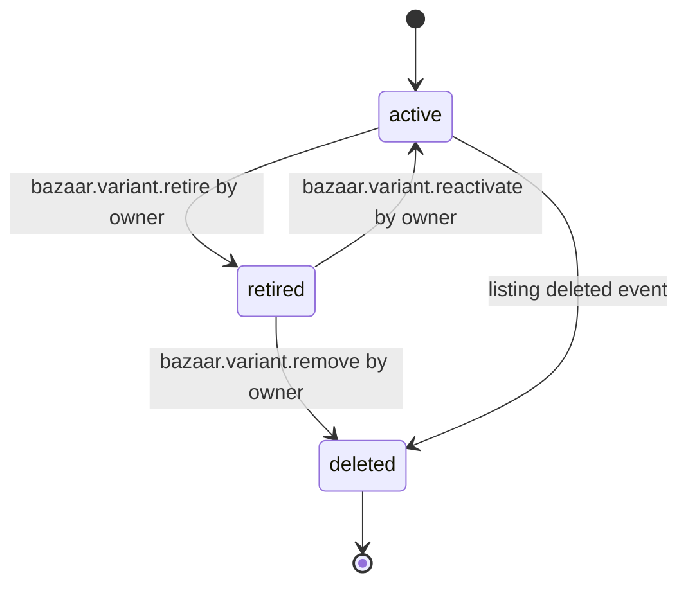

# PS-009-03 — Workflow state machine: Listing variants

**Status:** SPECIFIED (Stage 3). **Module:** [F01.S03.M02 Listing variants](SPEC.md) · **Scope:** MVP · **Code:** `packages/bazaar/src/inventory/variants` · **Contracts:** [CTR-ID-001](../../../planning/contracts/CTR-ID-001.md), [CTR-EVT-001](../../../planning/contracts/CTR-EVT-001.md), [CTR-ERR-001](../../../planning/contracts/CTR-ERR-001.md), [CTR-CAP-001](../../../planning/contracts/CTR-CAP-001.md), [CTR-IDM-001](../../../planning/contracts/CTR-IDM-001.md), [CTR-MNY-001](../../../planning/contracts/CTR-MNY-001.md), [CTR-PRV-001](../../../planning/contracts/CTR-PRV-001.md), [CTR-SCH-001](../../../planning/contracts/CTR-SCH-001.md)

> Generated from `module.spec.yaml` by `tools/specgen`. Edit the YAML, then run `pnpm spec:render`.

## Requirements

- **PS-009-03.R01** A Variant moves only along the declared transitions; deleted is terminal and keeps a tombstone for 180 days.
- **PS-009-03.R02** Retiring hides the variant from new offers and reservations but leaves existing holds, offers and history intact.
- **PS-009-03.R03** Reactivation re-checks the 50 variant limit and attribute uniqueness.

## Specification

### Variant lifecycle

Initial **active**; terminal **deleted**.

| Transition | Trigger | Guard / effect |
|---|---|---|
| active -> retired | bazaar.variant.retire by owner | no active hold or open offer; emits bazaar.variant.changed (retired) |
| retired -> active | bazaar.variant.reactivate by owner | limit and uniqueness rechecked; emits bazaar.variant.changed (reactivated) |
| retired -> deleted | bazaar.variant.remove by owner | no references; tombstone written; emits bazaar.variant.changed (removed) |
| active -> deleted | listing deleted event | cascade removal |

### Timeouts and scheduled transitions

_None._

## Verification

| Test | Level | Covers | Scenario | Expected |
|---|---|---|---|---|
| TEST-PS-009-09.T04 | property | PS-009-03.R01, PS-009-03.R02, PS-009-03.R03 | random commands | only declared transitions; retire blocked while holds or open offers exist; reactivation rechecks limits |

## Dependencies

Module depends on: F01.S03.M01, F01.S01.M01, F01.S01.M02, F01.S01.M03, F01.S02.M01, F01.S04.M01, F09.S03.M01, F09.S03.M03, F10.S01.M02, F10.S01.M03, F10.S01.M04, F10.S02.M02, CTR-ID-001, CTR-EVT-001, CTR-ERR-001, CTR-CAP-001, CTR-IDM-001, CTR-MNY-001, CTR-PRV-001, CTR-SCH-001. Predecessor: [domain_schema.md](domain_schema.md).
