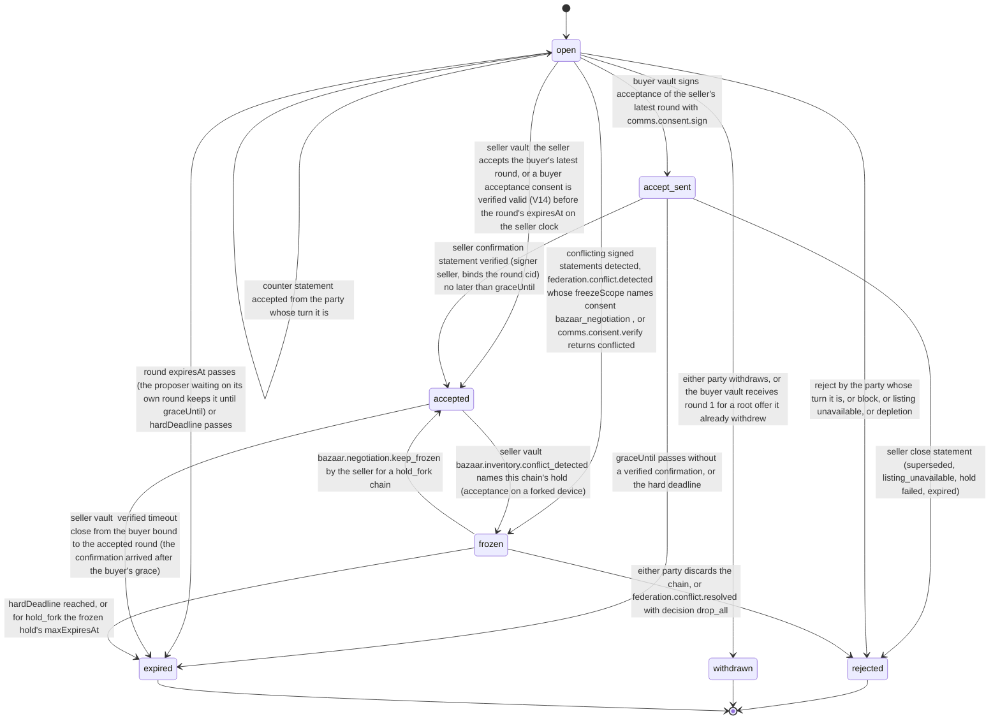

# PS-010-03 — Workflow state machine: Price negotiation

**Status:** SPECIFIED (Stage 3). **Module:** [F01.S04.M02 Price negotiation](SPEC.md) · **Scope:** MVP · **Code:** `packages/bazaar/src/pricing/negotiation` · **Contracts:** [CTR-ID-001](../../../planning/contracts/CTR-ID-001.md), [CTR-EVT-001](../../../planning/contracts/CTR-EVT-001.md), [CTR-ERR-001](../../../planning/contracts/CTR-ERR-001.md), [CTR-CAP-001](../../../planning/contracts/CTR-CAP-001.md), [CTR-IDM-001](../../../planning/contracts/CTR-IDM-001.md), [CTR-MNY-001](../../../planning/contracts/CTR-MNY-001.md), [CTR-PRV-001](../../../planning/contracts/CTR-PRV-001.md), [CTR-FED-001](../../../planning/contracts/CTR-FED-001.md), [CTR-COM-001](../../../planning/contracts/CTR-COM-001.md), [CTR-SCH-001](../../../planning/contracts/CTR-SCH-001.md)

> Generated from `module.spec.yaml` by `tools/specgen`. Edit the YAML, then run `pnpm spec:render`.

## Requirements

- **PS-010-03.R01** Negotiation follows the declared machine; rejected, withdrawn and expired are terminal, accepted is left only through a late timeout close or a hold-fork freeze in the seller vault, and any other transition is refused with CONFLICT_STATE.
- **PS-010-03.R02** Agreement is reached only when the seller's vault has taken the hold, opened the Deal handoff and signed the confirmation; a buyer's acceptance alone leaves the chain in accept_sent.
- **PS-010-03.R03** Two different signed statements for the same round number, or an acceptance and a counter for the same round, freeze the chain; frozen chains are never resolved automatically and leave only by discard, by an explicit keep after a hold fork, or at the hard deadline.
- **PS-010-03.R04** A vault waiting for the other side's decision on its own round or acceptance applies a verified confirmation or acceptance until expiresAt + 24 h; after that grace it sends a signed timeout close, and a seller vault that had confirmed cancels the Deal (commerce.deal.cancel) so the hold is released.
- **PS-010-03.R05** The first seller counter moves the root offer to rejected with reason countered through bazaar.offer.reject in the same transaction (N10); a buyer vault that receives round 1 for a root offer it already withdrew closes the chain as withdrawn with a signed close.

## Specification

### Negotiation lifecycle

Initial **open**; terminal **rejected**, **withdrawn**, **expired**.

| Transition | Trigger | Guard / effect |
|---|---|---|
| open -> open | counter statement accepted from the party whose turn it is | new round stored in the chain currency and quantity, awaiting flips; the first seller counter also calls bazaar.offer.reject {reason countered} in the same transaction; emits bazaar.negotiation.countered |
| open -> accepted | seller vault: the seller accepts the buyer's latest round, or a buyer acceptance consent is verified valid (V14) before the round's expiresAt on the seller clock | Deal-linked hold (holder {negotiation, id}, ttl 7 d, maxExpiresAt = Deal expiry), commerce.deal.open {contextRef {offer, rootOfferId}} and the signed confirmation in one transaction; emits bazaar.negotiation.closed (accepted) |
| open -> accept_sent | buyer vault signs acceptance of the seller's latest round with comms.consent.sign | consent queued; graceUntil = round expiresAt + 24 h; waits for the seller's confirmation |
| accept_sent -> accepted | seller confirmation statement verified (signer seller, binds the round cid) no later than graceUntil | records holdId, dealId; emits bazaar.negotiation.closed (accepted) |
| accept_sent -> rejected | seller close statement (superseded, listing_unavailable, hold failed, expired) | emits bazaar.negotiation.closed |
| accept_sent -> expired | graceUntil passes without a verified confirmation, or the hard deadline | signed timeout close queued; emits bazaar.negotiation.closed (expired) |
| open -> rejected | reject by the party whose turn it is, or block, or listing unavailable, or depletion | signed close queued; emits bazaar.negotiation.closed |
| open -> withdrawn | either party withdraws, or the buyer vault receives round 1 for a root offer it already withdrew | signed close queued; emits bazaar.negotiation.closed (withdrawn) |
| open -> expired | round expiresAt passes (the proposer waiting on its own round keeps it until graceUntil) or hardDeadline passes | emits bazaar.negotiation.closed (expired) |
| open -> frozen | conflicting signed statements detected, federation.conflict.detected whose freezeScope names consent:bazaar_negotiation:<negotiationId>, or comms.consent.verify returns conflicted | frozenReason conflicting_rounds; no further commands except discard |
| accepted -> frozen | seller vault: bazaar.inventory.conflict_detected names this chain's hold (acceptance on a forked device) | frozenReason hold_fork; the Deal does not proceed |
| accepted -> expired | seller vault: verified timeout close from the buyer bound to the accepted round (the confirmation arrived after the buyer's grace) | commerce.deal.cancel in the same transaction; hold released by F01.S03.M01; emits bazaar.negotiation.closed (expired) |
| frozen -> accepted | bazaar.negotiation.keep_frozen by the seller for a hold_fork chain | the competing holder is dropped by its owner module; hold active again |
| frozen -> rejected | either party discards the chain, or federation.conflict.resolved with decision drop_all | emits bazaar.negotiation.closed (frozen_discarded); for hold_fork commerce.deal.cancel and a signed close to the buyer; a new offer is needed |
| frozen -> expired | hardDeadline reached, or for hold_fork the frozen hold's maxExpiresAt | emits bazaar.negotiation.closed (expired) |

### Timeouts and scheduled transitions

- Sweep every 60 s while the app is open and at app start: open chains whose latest round expiresAt <= now become expired, except that the proposer of that round keeps it until graceUntil; accept_sent chains expire at graceUntil and queue a signed timeout close.
- Hard deadline 14 days after creation closes any open, accept_sent or frozen chain.
- accept_sent waits until the accepted round's expiresAt + 24 h for the seller confirmation.

## Verification

| Test | Level | Covers | Scenario | Expected |
|---|---|---|---|---|
| TEST-PS-010-09.T04 | property | PS-010-03.R01 | random statements in random order and duplicated | only declared transitions; terminal states never regress; same final state in both vaults when all delivered |
| TEST-PS-010-09.T05 | integration | PS-010-03.R02, PS-010-06.R02 | B accepts S's round 1; S vault holds and confirms | B shows accept_sent then accepted only after verified confirmation; S has a Deal-linked hold (ttl 7 d, maxExpiresAt = Deal expiry) and the Deal |
| TEST-PS-010-09.T06 | integration | PS-010-03.R03, PS-010-06.R03 | S and B counter simultaneously | both vaults freeze on exchange, no hold taken, discard needed to continue |
| TEST-PS-010-09.T07 | integration | PS-010-03.R02, PS-010-02.R03 | last unit held for B2 while B's acceptance is in transit | S sends signed close superseded; B shows rejected superseded; no double hold |
| TEST-PS-010-09.T13 | integration | PS-010-03.R03 | a frozen chain without any decision until the hard deadline; a hold_fork chain kept with keep_frozen | first expires at hardDeadline with bazaar.negotiation.closed (expired); second returns to accepted |
| TEST-PS-010-09.T22 | integration | PS-010-03.R04 | two vaults with clocks skewed +10 and -10 min; S confirms 5 min before expiry and delivery is delayed 3 h, then a second chain with delivery delayed 25 h | first: B applies the confirmation inside the grace and both show accepted; second: B expires, sends a timeout close, S moves accepted to expired and calls commerce.deal.cancel, and the hold is released |
| TEST-PS-010-09.T23 | integration | PS-010-03.R05 | S counters B's offer; separately B withdraws the root offer while round 1 is in transit | root offer rejected countered in the counter transaction; in the crossing case B closes the chain as withdrawn and S closes it on the signed close |

## Dependencies

Module depends on: F01.S04.M01, F01.S03.M01, F01.S01.M01, F01.S02.M01, F09.S01.M01, F09.S03.M01, F09.S03.M03, F07.S02.M02, F08.S02.M02, F11.S01.M01, F11.S01.M02, F11.S02.M03, F16.S02.M03, F10.S01.M02, F10.S01.M03, F10.S01.M04, F10.S02.M02, CTR-ID-001, CTR-EVT-001, CTR-ERR-001, CTR-CAP-001, CTR-IDM-001, CTR-MNY-001, CTR-PRV-001, CTR-FED-001, CTR-COM-001, CTR-SCH-001. Predecessor: [domain_schema.md](domain_schema.md).
