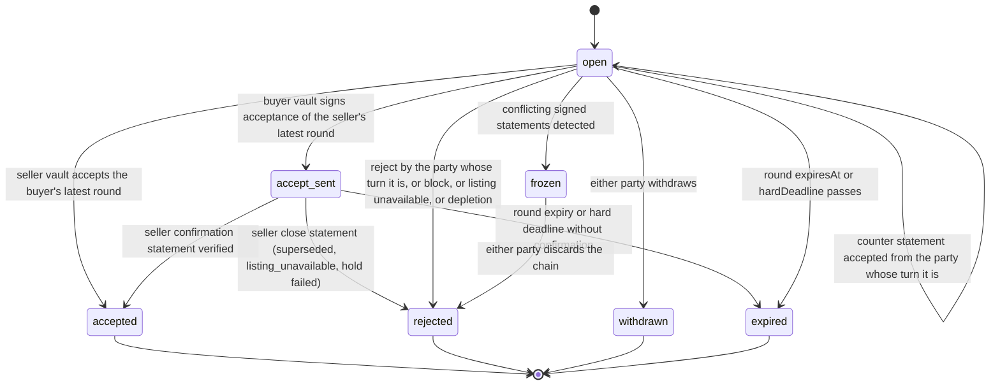

# PS-010-03 — Workflow state machine: Price negotiation

**Status:** SPECIFIED (Stage 3). **Module:** [F01.S04.M02 Price negotiation](SPEC.md) · **Scope:** MVP · **Code:** `packages/bazaar/src/pricing/negotiation` · **Contracts:** [CTR-ID-001](../../../planning/contracts/CTR-ID-001.md), [CTR-EVT-001](../../../planning/contracts/CTR-EVT-001.md), [CTR-ERR-001](../../../planning/contracts/CTR-ERR-001.md), [CTR-CAP-001](../../../planning/contracts/CTR-CAP-001.md), [CTR-IDM-001](../../../planning/contracts/CTR-IDM-001.md), [CTR-MNY-001](../../../planning/contracts/CTR-MNY-001.md), [CTR-PRV-001](../../../planning/contracts/CTR-PRV-001.md), [CTR-FED-001](../../../planning/contracts/CTR-FED-001.md), [CTR-COM-001](../../../planning/contracts/CTR-COM-001.md), [CTR-SCH-001](../../../planning/contracts/CTR-SCH-001.md)

> Generated from `module.spec.yaml` by `tools/specgen`. Edit the YAML, then run `pnpm spec:render`.

## Requirements

- **PS-010-03.R01** Negotiation follows the declared machine; accepted, rejected, withdrawn and expired are terminal and any other transition is refused with CONFLICT_STATE.
- **PS-010-03.R02** Agreement is reached only when the seller's vault has taken the hold, opened the Deal handoff and signed the confirmation; a buyer's acceptance alone leaves the chain in accept_sent.
- **PS-010-03.R03** Two different signed statements for the same round number, or an acceptance and a counter for the same round, freeze the chain; frozen chains are never resolved automatically.

## Specification

### Negotiation lifecycle

Initial **open**; terminal **accepted**, **rejected**, **withdrawn**, **expired**.

| Transition | Trigger | Guard / effect |
|---|---|---|
| open -> open | counter statement accepted from the party whose turn it is | new round stored, awaiting flips; emits bazaar.negotiation.countered |
| open -> accepted | seller vault accepts the buyer's latest round | inventory hold and Deal handoff in one transaction; confirmation signed; emits bazaar.negotiation.closed (accepted) |
| open -> accept_sent | buyer vault signs acceptance of the seller's latest round | acceptance statement queued; waits for the seller's confirmation |
| accept_sent -> accepted | seller confirmation statement verified | records holdId, dealId; emits bazaar.negotiation.closed (accepted) |
| accept_sent -> rejected | seller close statement (superseded, listing_unavailable, hold failed) | emits bazaar.negotiation.closed |
| accept_sent -> expired | round expiry or hard deadline without confirmation | emits bazaar.negotiation.closed (expired) |
| open -> rejected | reject by the party whose turn it is, or block, or listing unavailable, or depletion | signed close queued; emits bazaar.negotiation.closed |
| open -> withdrawn | either party withdraws | signed close queued; emits bazaar.negotiation.closed (withdrawn) |
| open -> expired | round expiresAt or hardDeadline passes | emits bazaar.negotiation.closed (expired) |
| open -> frozen | conflicting signed statements detected | no further commands except discard or restart |
| frozen -> rejected | either party discards the chain | emits bazaar.negotiation.closed (frozen_discarded); a new offer is needed |

### Timeouts and scheduled transitions

- Sweep every 60 s while the app is open and at app start: open or accept_sent chains with expiresAt <= now become expired.
- Hard deadline 14 days after creation closes any non-terminal chain.
- accept_sent waits at most until the accepted round's expiresAt for the seller confirmation.

## Verification

| Test | Level | Covers | Scenario | Expected |
|---|---|---|---|---|
| TEST-PS-010-09.T04 | property | PS-010-03.R01 | random statements in random order and duplicated | only declared transitions; terminal states never regress; same final state in both vaults when all delivered |
| TEST-PS-010-09.T05 | integration | PS-010-03.R02, PS-010-06.R02 | B accepts S's round 1; S vault holds and confirms | B shows accept_sent then accepted only after verified confirmation; S has hold and Deal handoff |
| TEST-PS-010-09.T06 | integration | PS-010-03.R03, PS-010-06.R03 | S and B counter simultaneously | both vaults freeze on exchange, no hold taken, discard needed to continue |
| TEST-PS-010-09.T07 | integration | PS-010-03.R02, PS-010-02.R03 | last unit held for B2 while B's acceptance is in transit | S sends signed close superseded; B shows rejected superseded; no double hold |
| TEST-PS-010-09.T13 | integration | PS-010-03.R03 | round expiry according to receiver clock vs sender claim | accept after receiver-clock expiry gets EXPIRED |

## Dependencies

Module depends on: F01.S04.M01, F01.S03.M01, F01.S01.M01, F01.S02.M01, F09.S01.M01, F09.S03.M03, F07.S02.M02, F16.S02.M03, CTR-ID-001, CTR-EVT-001, CTR-ERR-001, CTR-CAP-001, CTR-IDM-001, CTR-MNY-001, CTR-PRV-001, CTR-FED-001, CTR-COM-001, CTR-SCH-001. Predecessor: [domain_schema.md](domain_schema.md).
