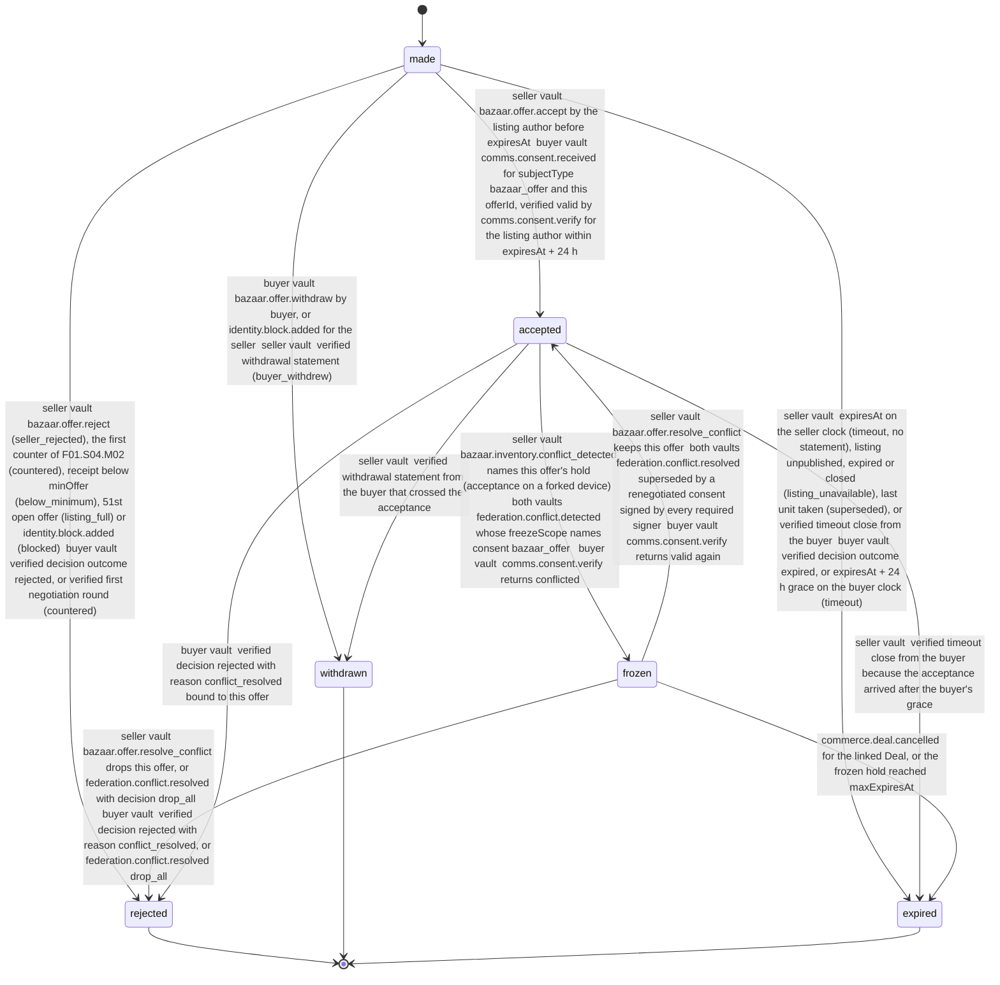

# PS-011-03 — Workflow state machine: Purchase offers

**Status:** SPECIFIED (Stage 3). **Module:** [F01.S04.M01 Purchase offers](SPEC.md) · **Scope:** MVP · **Code:** `packages/bazaar/src/pricing/offers` · **Contracts:** [CTR-ID-001](../../../planning/contracts/CTR-ID-001.md), [CTR-EVT-001](../../../planning/contracts/CTR-EVT-001.md), [CTR-ERR-001](../../../planning/contracts/CTR-ERR-001.md), [CTR-CAP-001](../../../planning/contracts/CTR-CAP-001.md), [CTR-MNY-001](../../../planning/contracts/CTR-MNY-001.md), [CTR-IDM-001](../../../planning/contracts/CTR-IDM-001.md), [CTR-PRV-001](../../../planning/contracts/CTR-PRV-001.md), [CTR-FED-001](../../../planning/contracts/CTR-FED-001.md), [CTR-SCH-001](../../../planning/contracts/CTR-SCH-001.md)

> Generated from `module.spec.yaml` by `tools/specgen`. Edit the YAML, then run `pnpm spec:render`.

## Requirements

- **PS-011-03.R01** Offers follow the declared lifecycle; any transition not listed is refused with CONFLICT_STATE.
- **PS-011-03.R02** Acceptance in the seller vault is atomic with the inventory hold, the Deal creation and the consent signature; if any of them fails, the offer stays made.
- **PS-011-03.R03** Accepting one offer for the last available unit expires all other open offers on that variant with reason superseded, and each of those buyers receives a signed decision.
- **PS-011-03.R04** The first counter by F01.S04.M02 moves the root offer from made to rejected with reason countered in the same transaction (N10); once countered the offer can no longer be accepted or withdrawn, and the buyer vault applies the same transition on the verified first round.
- **PS-011-03.R05** Expiry is evaluated in each vault: the seller vault expires at expiresAt on its clock without a statement, and the buyer vault applies a verified acceptance until expiresAt + 24 h; after that grace the buyer vault sends a signed timeout close, and a seller vault that had accepted cancels the Deal (commerce.deal.cancel) and the hold is released.
- **PS-011-03.R06** Within one vault two offers for the same unit are never both accepted; acceptances from forked devices of the seller are both kept, frozen through bazaar.inventory.conflict_detected and resolved only by the owner keeping one and sending a signed close to the other buyer.
- **PS-011-03.R07** Every seller-side close except timeout and below_minimum is sent to the buyer as a signed decision; the buyer vault derives listing changes and unavailability from verified mirror updates (federation.record.accepted, federation.tombstone.applied), never from bazaar.listing.* events, which fire only in the seller vault (EVT-8).

## Specification

### Offer lifecycle

Initial **made**; terminal **rejected**, **withdrawn**, **expired**.

| Transition | Trigger | Guard / effect |
|---|---|---|
| made -> accepted | seller vault: bazaar.offer.accept by the listing author before expiresAt; buyer vault: comms.consent.received for subjectType bazaar_offer and this offerId, verified valid by comms.consent.verify for the listing author within expiresAt + 24 h | seller: hold (holder {offer, offerId}, ttl 7 d, maxExpiresAt = Deal expiry, linkedDealId), commerce.deal.open and comms.consent.sign in one IndexedDB transaction, reservation statement queued; emits bazaar.offer.accepted |
| made -> rejected | seller vault: bazaar.offer.reject (seller_rejected), the first counter of F01.S04.M02 (countered), receipt below minOffer (below_minimum), 51st open offer (listing_full) or identity.block.added (blocked); buyer vault: verified decision outcome rejected, or verified first negotiation round (countered) | decision statement queued except for countered and below_minimum; block decision says seller_rejected; emits bazaar.offer.rejected except for below_minimum |
| made -> withdrawn | buyer vault: bazaar.offer.withdraw by buyer, or identity.block.added for the seller; seller vault: verified withdrawal statement (buyer_withdrew) | withdrawal statement queued; emits bazaar.offer.withdrawn |
| made -> expired | seller vault: expiresAt on the seller clock (timeout, no statement), listing unpublished, expired or closed (listing_unavailable), last unit taken (superseded), or verified timeout close from the buyer; buyer vault: verified decision outcome expired, or expiresAt + 24 h grace on the buyer clock (timeout) | seller: decision statement queued for listing_unavailable and superseded; buyer: timeout close queued after the grace; emits bazaar.offer.expired |
| accepted -> withdrawn | seller vault: verified withdrawal statement from the buyer that crossed the acceptance | commerce.deal.cancel in the same transaction; the hold is released by F01.S03.M01 on commerce.deal.cancelled with a signed release; emits bazaar.offer.withdrawn (withdrawn before accept) |
| accepted -> expired | seller vault: verified timeout close from the buyer because the acceptance arrived after the buyer's grace | commerce.deal.cancel in the same transaction; hold released; emits bazaar.offer.expired (timeout) |
| accepted -> frozen | seller vault: bazaar.inventory.conflict_detected names this offer's hold (acceptance on a forked device); both vaults: federation.conflict.detected whose freezeScope names consent:bazaar_offer:<offerId>; buyer vault: comms.consent.verify returns conflicted | the Deal does not proceed; the owner must keep one offer |
| frozen -> accepted | seller vault: bazaar.offer.resolve_conflict keeps this offer; both vaults: federation.conflict.resolved superseded by a renegotiated consent signed by every required signer; buyer vault: comms.consent.verify returns valid again | competing offers are dropped in the same transaction; the hold returns to active |
| frozen -> rejected | seller vault: bazaar.offer.resolve_conflict drops this offer, or federation.conflict.resolved with decision drop_all; buyer vault: verified decision rejected with reason conflict_resolved, or federation.conflict.resolved drop_all | commerce.deal.cancel; decision statement queued to that buyer; emits bazaar.offer.rejected |
| accepted -> rejected | buyer vault: verified decision rejected with reason conflict_resolved bound to this offer | the mirrored Deal is cancelled by the seller's statement; emits bazaar.offer.rejected |
| frozen -> expired | commerce.deal.cancelled for the linked Deal, or the frozen hold reached maxExpiresAt | emits bazaar.offer.expired (timeout) |

### Timeouts and scheduled transitions

- Seller vault: expiry sweep every 60 s while the app is open and at app start transitions made offers with expiresAt ≤ now to expired (reason timeout) without a statement.
- Buyer vault: made offers move to expired (reason timeout) at expiresAt + 24 h and queue a signed timeout close; until then a verified acceptance is still applied.

## Verification

| Test | Level | Covers | Scenario | Expected |
|---|---|---|---|---|
| TEST-PS-011-09.T03 | property | PS-011-03.R01 | random sequences of commands and inbound statements on one offer | only declared transitions succeed; others return CONFLICT_STATE |
| TEST-PS-011-09.T04 | integration | PS-011-03.R02, PS-011-06.R03 | Deal port or consent signing fails during accept | offer stays made, no hold, no Deal, no consent; DEPENDENCY_UNAVAILABLE returned |
| TEST-PS-011-09.T05 | integration | PS-011-03.R03, PS-011-06.R02, PS-011-09.R03 | B1 and B2 offers accepted concurrently in two tabs of S's vault for qty 1 | within one vault one accepted, the other CONFLICT_STATE, then expired superseded with a signed decision to B2 |
| TEST-PS-011-09.T22 | integration | PS-011-03.R04 | S counters B1's offer through F01.S04.M02, then B1 tries to withdraw and S tries to accept the root offer | root offer rejected with reason countered in the counter transaction without a decision statement; B1's vault applies countered on the verified first round; withdraw and accept return CONFLICT_STATE |
| TEST-PS-011-09.T23 | integration | PS-011-03.R05 | two vaults with clocks skewed +10 and -10 min; acceptance delivered 3 h after expiresAt, then another delivered 25 h after | first applied inside the grace and both vaults show accepted; second refused; B1 expires and sends a timeout close; S moves accepted to expired, cancels the Deal and the hold is released |
| TEST-PS-011-09.T24 | integration | PS-011-03.R06, PS-011-06.R02 | S and S2 accept B1's and B2's offers offline for the last unit, then sync | both acceptances kept; conflict_detected freezes both holds and both offers; neither Deal proceeds; S keeps B1 and B2 receives a signed decision rejected conflict_resolved with its Deal cancelled |
| TEST-PS-011-09.T25 | integration | PS-011-03.R07 | seller-side reject, listing unpublished, superseded and block; then a seller-side timeout | a signed decision reaches the buyer for each close except the timeout; the block decision reads seller_rejected; both vaults converge on the same terminal status |
| TEST-PS-011-09.T28 | integration | PS-011-03.R02, PS-011-06.R03 | accept B1's offer, then deliver a crossing withdrawal from B1 | hold has holder {offer, offerId}, ttl 7 d, maxExpiresAt equal to the Deal expiry and linkedDealId; the withdrawal moves the offer to withdrawn and calls commerce.deal.cancel in the same transaction; the hold is released through commerce.deal.cancelled |

## Dependencies

Module depends on: F01.S01.M01, F01.S01.M03, F01.S02.M01, F01.S03.M01, F09.S01.M01, F09.S03.M01, F09.S03.M03, F07.S02.M02, F08.S02.M02, F11.S01.M01, F11.S01.M02, F11.S02.M03, F16.S02.M03, F10.S01.M02, F10.S01.M03, F10.S01.M04, F10.S02.M02, CTR-ID-001, CTR-EVT-001, CTR-ERR-001, CTR-CAP-001, CTR-MNY-001, CTR-IDM-001, CTR-PRV-001, CTR-FED-001, CTR-SCH-001. Predecessor: [domain_schema.md](domain_schema.md).
