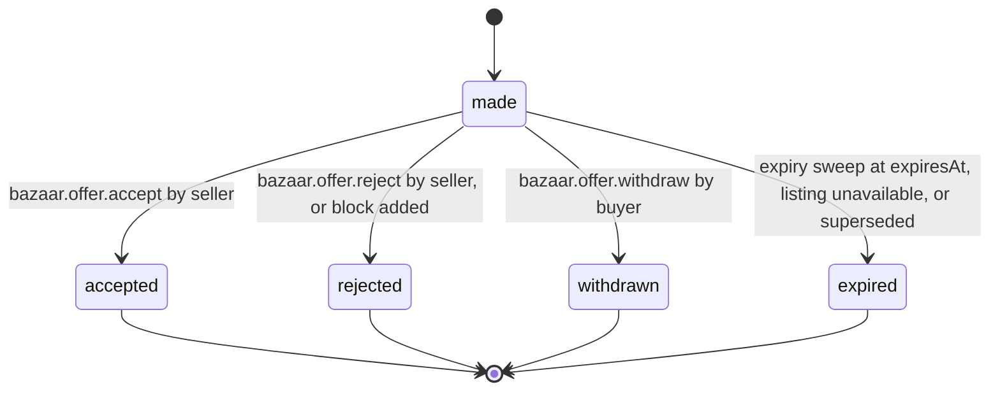

# PS-011-03 — Workflow state machine: Purchase offers

**Status:** SPECIFIED (Stage 3). **Module:** [F01.S04.M01 Purchase offers](SPEC.md) · **Scope:** MVP · **Code:** `packages/bazaar/src/pricing/offers` · **Contracts:** [CTR-ID-001](../../../planning/contracts/CTR-ID-001.md), [CTR-EVT-001](../../../planning/contracts/CTR-EVT-001.md), [CTR-ERR-001](../../../planning/contracts/CTR-ERR-001.md), [CTR-CAP-001](../../../planning/contracts/CTR-CAP-001.md), [CTR-MNY-001](../../../planning/contracts/CTR-MNY-001.md), [CTR-IDM-001](../../../planning/contracts/CTR-IDM-001.md), [CTR-PRV-001](../../../planning/contracts/CTR-PRV-001.md)

> Generated from `module.spec.yaml` by `tools/specgen`. Edit the YAML, then run `pnpm spec:render`.

## Requirements

- **PS-011-03.R01** Offers follow the declared lifecycle; any transition not listed is refused with CONFLICT_STATE.
- **PS-011-03.R02** Acceptance is atomic with the inventory hold and Deal creation; if either fails, the offer stays made.
- **PS-011-03.R03** Accepting one offer for the last available unit expires all other open offers on that variant with reason superseded.

## Specification

### Offer lifecycle

Initial **made**; terminal **accepted**, **rejected**, **withdrawn**, **expired**.

| Transition | Trigger | Guard / effect |
|---|---|---|
| made -> accepted | bazaar.offer.accept by seller | inventory hold acquired and Deal opened in same transaction; emits bazaar.offer.accepted |
| made -> rejected | bazaar.offer.reject by seller, or block added | emits bazaar.offer.rejected |
| made -> withdrawn | bazaar.offer.withdraw by buyer | emits bazaar.offer.withdrawn |
| made -> expired | expiry sweep at expiresAt, listing unavailable, or superseded | emits bazaar.offer.expired |

### Timeouts and scheduled transitions

- Expiry sweep every 60 s transitions made offers with expiresAt ≤ now to expired (reason timeout).

## Verification

| Test | Level | Covers | Scenario | Expected |
|---|---|---|---|---|
| TEST-PS-011-09.T03 | property | PS-011-03.R01 | random sequences of commands on one offer | only declared transitions succeed; others return CONFLICT_STATE |
| TEST-PS-011-09.T04 | integration | PS-011-03.R02, PS-011-06.R03 | Deal port fails during accept | offer stays made, no hold exists, DEPENDENCY_UNAVAILABLE returned |
| TEST-PS-011-09.T05 | integration | PS-011-03.R03, PS-011-06.R02, PS-011-09.R03 | B1 and B2 offers accepted concurrently for qty 1 | one accepted, other CONFLICT_STATE, then expired superseded |

## Dependencies

Module depends on: F01.S01.M03, F01.S02.M01, F01.S03.M01, F09.S01.M01, F09.S03.M03, F07.S02.M02, CTR-ID-001, CTR-EVT-001, CTR-ERR-001, CTR-CAP-001, CTR-MNY-001, CTR-IDM-001, CTR-PRV-001. Predecessor: [domain_schema.md](domain_schema.md).
