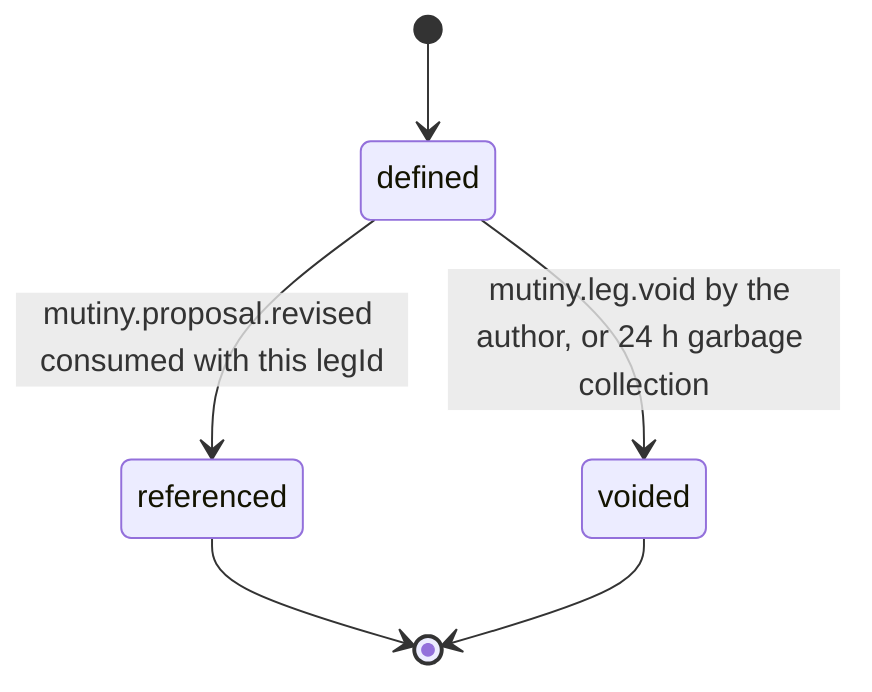

# PS-013-03 — Workflow state machine: Barter offer items

**Status:** SPECIFIED (Stage 3). **Module:** [F02.S01.M03 Barter offer items](SPEC.md) · **Scope:** MVP · **Code:** `packages/mutiny/src/trade_proposals/offer` · **Contracts:** [CTR-ID-001](../../../planning/contracts/CTR-ID-001.md), [CTR-EVT-001](../../../planning/contracts/CTR-EVT-001.md), [CTR-ERR-001](../../../planning/contracts/CTR-ERR-001.md), [CTR-CAP-001](../../../planning/contracts/CTR-CAP-001.md), [CTR-FED-001](../../../planning/contracts/CTR-FED-001.md), [CTR-IDM-001](../../../planning/contracts/CTR-IDM-001.md), [CTR-MNY-001](../../../planning/contracts/CTR-MNY-001.md), [CTR-PRV-001](../../../planning/contracts/CTR-PRV-001.md), [CTR-SCH-001](../../../planning/contracts/CTR-SCH-001.md)

> Generated from `module.spec.yaml` by `tools/specgen`. Edit the YAML, then run `pnpm spec:render`.

## Requirements

- **PS-013-03.R01** A leg is defined, then referenced when a sealed revision includes it, and voided only if never referenced.
- **PS-013-03.R02** Defined legs that no revision references within 24 hours are voided automatically so abandoned drafts do not accumulate.
- **PS-013-03.R03** Legs materialized from a peer revision start as referenced because the revision that carries them is already sealed.

## Specification

### TradeLeg lifecycle

Initial **defined**; terminal **referenced**, **voided**.

| Transition | Trigger | Guard / effect |
|---|---|---|
| defined -> referenced | mutiny.proposal.revised consumed with this legId | sealed by a ProposalRevision; leg becomes permanent evidence |
| defined -> voided | mutiny.leg.void by the author, or 24 h garbage collection | no revision references it; emits nothing further |

### Timeouts and scheduled transitions

- Garbage collection of unreferenced defined legs after 24 h, evaluated on vault open and every 60 s while open.

## Verification

| Test | Level | Covers | Scenario | Expected |
|---|---|---|---|---|
| TEST-PS-013-09.T03 | property | PS-013-01.R02, PS-013-03.R01 | random define and void sequences | status only moves defined to referenced or voided, never back; referenced never voided |
| TEST-PS-013-09.T05 | integration | PS-013-03.R01, PS-013-03.R02 | unreferenced leg after 24 h with injected clock | voided by garbage collection |
| TEST-PS-013-09.T06 | integration | PS-013-03.R03, PS-013-04.R02 | peer revision ingested | peer legs materialized as referenced with provenance and leg.defined emitted with actor.kind federated |

## Dependencies

Module depends on: F01.S03.M01, F01.S01.M01, F02.S04.M03, F16.S02.M03, CTR-ID-001, CTR-EVT-001, CTR-ERR-001, CTR-CAP-001, CTR-FED-001, CTR-IDM-001, CTR-MNY-001, CTR-PRV-001, CTR-SCH-001. Predecessor: [domain_schema.md](domain_schema.md).
