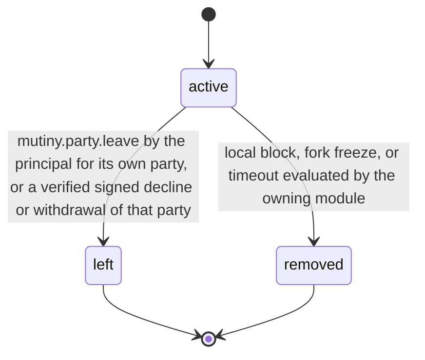

# PS-014-03 — Workflow state machine: Proposal party roster

**Status:** SPECIFIED (Stage 3). **Module:** [F02.S01.M02 Proposal party roster](SPEC.md) · **Scope:** MVP · **Code:** `packages/mutiny/src/trade_proposals/party` · **Contracts:** [CTR-ID-001](../../../planning/contracts/CTR-ID-001.md), [CTR-EVT-001](../../../planning/contracts/CTR-EVT-001.md), [CTR-ERR-001](../../../planning/contracts/CTR-ERR-001.md), [CTR-CAP-001](../../../planning/contracts/CTR-CAP-001.md), [CTR-FED-001](../../../planning/contracts/CTR-FED-001.md), [CTR-IDM-001](../../../planning/contracts/CTR-IDM-001.md), [CTR-PRV-001](../../../planning/contracts/CTR-PRV-001.md), [CTR-SCH-001](../../../planning/contracts/CTR-SCH-001.md)

> Generated from `module.spec.yaml` by `tools/specgen`. Edit the YAML, then run `pnpm spec:render`.

## Requirements

- **PS-014-03.R01** A party is active until it leaves or is removed; both are terminal and never reversed.
- **PS-014-03.R02** Removal never substitutes another party and never reorders positions, so the ring stays exactly as consented.
- **PS-014-03.R03** Local status changes are recorded with a reason code that is shared with other parties only as a coarse code (declined, withdrew, unavailable, timeout).

## Specification

### ProposalParty lifecycle

Initial **active**; terminal **left**, **removed**.

| Transition | Trigger | Guard / effect |
|---|---|---|
| active -> left | mutiny.party.leave by the principal for its own party, or a verified signed decline or withdrawal of that party | emits mutiny.party.left with coarse reason |
| active -> removed | local block, fork freeze, or timeout evaluated by the owning module | emits mutiny.party.left with reason locally_removed, unavailable, fork_frozen or timeout |

### Timeouts and scheduled transitions

_None._

## Verification

| Test | Level | Covers | Scenario | Expected |
|---|---|---|---|---|
| TEST-PS-014-09.T04 | property | PS-014-03.R01, PS-014-03.R02 | random leave and removal sequences | left or removed never reactivates, positions never change, no substitution |
| TEST-PS-014-09.T05 | integration | PS-014-03.R03, PS-014-04.R03 | consume block.added, cycle.declined, participant_dropped, proposal.revised | rows marked with coarse reasons; roster mismatch detected on altered revision |

## Dependencies

Module depends on: F07.S01.M01, F07.S02.M02, F12.S03.M04, F16.S02.M03, F10.S01.M02, F10.S01.M03, F10.S01.M04, F10.S02.M02, CTR-ID-001, CTR-EVT-001, CTR-ERR-001, CTR-CAP-001, CTR-FED-001, CTR-IDM-001, CTR-PRV-001, CTR-SCH-001. Predecessor: [domain_schema.md](domain_schema.md).
