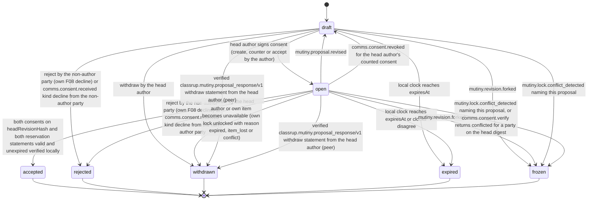

# PS-015-03 — Workflow state machine: Two-party barter

**Status:** SPECIFIED (Stage 3). **Module:** [F02.S01.M01 Two-party barter](SPEC.md) · **Scope:** MVP · **Code:** `packages/mutiny/src/trade_proposals/two` · **Contracts:** [CTR-ID-001](../../../planning/contracts/CTR-ID-001.md), [CTR-EVT-001](../../../planning/contracts/CTR-EVT-001.md), [CTR-ERR-001](../../../planning/contracts/CTR-ERR-001.md), [CTR-CAP-001](../../../planning/contracts/CTR-CAP-001.md), [CTR-FED-001](../../../planning/contracts/CTR-FED-001.md), [CTR-IDM-001](../../../planning/contracts/CTR-IDM-001.md), [CTR-MNY-001](../../../planning/contracts/CTR-MNY-001.md), [CTR-PRV-001](../../../planning/contracts/CTR-PRV-001.md), [CTR-SCH-001](../../../planning/contracts/CTR-SCH-001.md)

> Generated from `module.spec.yaml` by `tools/specgen`. Edit the YAML, then run `pnpm spec:render`.

## Requirements

- **PS-015-03.R01** Acceptance is a local verdict derived from verified statements, not a message that either party can force on the other, and it is re-evaluated whenever a consent, reservation or revision arrives.
- **PS-015-03.R02** Any new revision voids all consents and returns the proposal to draft until the author's consent on the new hash is signed, which makes it open again.
- **PS-015-03.R03** Terminal states never reopen; a forked or expired proposal is renegotiated as a new proposal that cites the old one.
- **PS-015-03.R04** Expiry is decided by the vault's own clock; a relay receipt time later than the deadline on a statement needed for acceptance shortens the window and the proposal is expired with reason clock_disagreement, while a relay time can never extend the deadline.

## Specification

### TradeProposal lifecycle

Initial **draft**; terminal **accepted**, **rejected**, **withdrawn**, **expired**, **frozen**.

| Transition | Trigger | Guard / effect |
|---|---|---|
| draft -> open | head author signs consent (create, counter or accept by the author) | own items reserved and reservation and consent statements prepared; emits mutiny.proposal.created on first open |
| open -> accepted | both consents on headRevisionHash and both reservation statements valid and unexpired verified locally | emits mutiny.proposal.accepted with cycleId reserved for F02.S03.M01 |
| open -> draft | mutiny.proposal.revised | all consents void; own reservation released and re-made if the leg items changed |
| draft -> rejected | reject by the non-author party (own F08 decline) or comms.consent.received kind decline from the non-author party | releases own reservation; emits mutiny.proposal.rejected |
| open -> rejected | reject by the non-author party (own F08 decline) or comms.consent.received kind decline from the non-author party | releases own reservation; emits mutiny.proposal.rejected |
| draft -> withdrawn | withdraw by the head author | releases own reservation; emits mutiny.proposal.withdrawn |
| open -> withdrawn | withdraw by the head author or own item becomes unavailable (own lock unlocked with reason expired, item_lost or conflict) | releases own reservation; emits mutiny.proposal.withdrawn |
| draft -> withdrawn | verified classrup.mutiny.proposal_response/v1 withdraw statement from the head author (peer) | releases the principal's own reservation in the same transaction; emits mutiny.proposal.withdrawn |
| open -> withdrawn | verified classrup.mutiny.proposal_response/v1 withdraw statement from the head author (peer) | releases the principal's own reservation in the same transaction; emits mutiny.proposal.withdrawn |
| open -> draft | comms.consent.revoked for the head author's counted consent | consent void with voidReason consent_revoked; verdict re-evaluated; the counterparty's revoked consent only voids that consent and the proposal stays open |
| draft -> expired | local clock reaches expiresAt | releases own reservation; emits mutiny.proposal.expired |
| open -> expired | local clock reaches expiresAt or clocks disagree | releases own reservation; emits mutiny.proposal.expired |
| draft -> frozen | mutiny.revision.forked | releases own reservation; no signature is produced |
| open -> frozen | mutiny.revision.forked | releases own reservation; no signature is produced |
| draft -> frozen | mutiny.lock.conflict_detected naming this proposal | own reservation released by F02.S03.M02 with releaseReason fork_frozen; no signature is produced |
| open -> frozen | mutiny.lock.conflict_detected naming this proposal, or comms.consent.verify returns conflicted for a party on the head digest | own reservation released with releaseReason fork_frozen; no signature is produced |

### Timeouts and scheduled transitions

- Proposal expiry evaluated on vault open and every 60 s while the PWA is open; default 72 h from creation, extended by a counter to at most 14 d after the first revision.
- A draft that is not signed within 24 h is withdrawn locally with reason timeout.

## Verification

| Test | Level | Covers | Scenario | Expected |
|---|---|---|---|---|
| TEST-PS-015-09.T01 | integration | PS-015-01.R01, PS-015-01.R03, PS-015-03.R01 | Alice creates, Bob accepts, statements delivered | both vaults reach accepted after receiving the other's consent and reservation; acceptance event carries both statement ids |
| TEST-PS-015-09.T03 | property | PS-015-03.R01, PS-015-03.R03 | random interleavings of counters, accepts, rejects, drops and duplicates | accepted only with both valid consents on the head hash; terminal states never change |
| TEST-PS-015-09.T04 | integration | PS-015-03.R02, PS-015-02.R02 | counter after Bob signed consent on revision 1 | revision 2 voids Bob's consent; proposal returns to draft then open after author signs |
| TEST-PS-015-09.T05 | integration | PS-015-03.R03, PS-015-06.R03 | both parties counter revision 3 offline | fork detected in both vaults, proposal frozen, reservations released, no consent counted |
| TEST-PS-015-09.T06 | integration | PS-015-03.R04, PS-015-01.R03 | Bob's deadline passes while Alice's has not, and relay receipt time later than deadline | each vault expires on its own clock; a later relay receipt makes the consent late and the proposal expires with clock_disagreement |
| TEST-PS-015-09.T16 | chaos | PS-015-06.R04, PS-015-03.R01 | relay down for 30 min then up | outbox delivers, no state ever claims peer acknowledgement before it arrives |
| TEST-PS-015-09.T19 | integration | PS-015-03.R01, PS-015-02.R02, PS-015-04.R04 | Bob revokes his consent through F08 before Alice's vault receives his reservation | consent void with consent_revoked; comms.consent.verify inside the accepting transaction returns revoked; Alice's vault never reaches accepted |
| TEST-PS-015-09.T20 | integration | PS-015-03.R03, PS-015-04.R01 | Alice withdraws; her signed withdrawal reaches Bob's vault | Bob's proposal moves to withdrawn, mutiny.proposal.withdrawn emitted with both party DIDs, Bob's own reservation released in the same transaction |
| TEST-PS-015-09.T25 | integration | PS-015-03.R02, PS-015-02.R02 | Bob tries to accept an imbalance not in the head snapshot, then counters with acceptedImbalances naming himself | first refused; Alice's vault verifies Bob's consent on the new digest as his signed acceptance and feasibility C05 passes |

## Dependencies

Module depends on: F02.S01.M02, F02.S01.M03, F02.S01.M04, F02.S02.M05, F02.S03.M02, F01.S03.M01, F07.S01.M01, F07.S02.M02, F08.S02.M02, F12.S03.M04, F16.S02.M03, F15.S01.M01, F11.S01.M01, F10.S01.M02, F10.S01.M03, F10.S01.M04, F10.S02.M02, CTR-ID-001, CTR-EVT-001, CTR-ERR-001, CTR-CAP-001, CTR-FED-001, CTR-IDM-001, CTR-MNY-001, CTR-PRV-001, CTR-SCH-001. Predecessor: [domain_schema.md](domain_schema.md).
