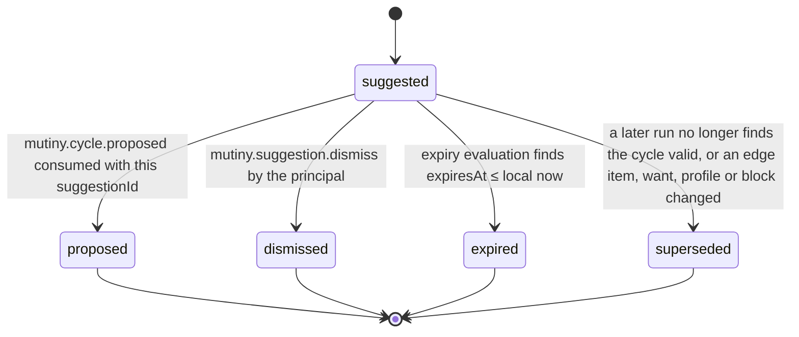

# PS-018-03 — Workflow state machine: N-party cycle engine

**Status:** SPECIFIED (Stage 3). **Module:** [F02.S02.M03 N-party cycle engine](SPEC.md) · **Scope:** MVP · **Code:** `packages/mutiny/src/cycle_matching/n` · **Contracts:** [CTR-ID-001](../../../planning/contracts/CTR-ID-001.md), [CTR-EVT-001](../../../planning/contracts/CTR-EVT-001.md), [CTR-ERR-001](../../../planning/contracts/CTR-ERR-001.md), [CTR-CAP-001](../../../planning/contracts/CTR-CAP-001.md), [CTR-FED-001](../../../planning/contracts/CTR-FED-001.md), [CTR-IDM-001](../../../planning/contracts/CTR-IDM-001.md), [CTR-MNY-001](../../../planning/contracts/CTR-MNY-001.md), [CTR-PRV-001](../../../planning/contracts/CTR-PRV-001.md), [CTR-OBS-001](../../../planning/contracts/CTR-OBS-001.md), [CTR-SCH-001](../../../planning/contracts/CTR-SCH-001.md)

> Generated from `module.spec.yaml` by `tools/specgen`. Edit the YAML, then run `pnpm spec:render`.

## Requirements

- **PS-018-03.R01** A suggestion is advice with a short lifecycle; it moves to proposed only when F02.S03.M01 reports that a participant proposed it.
- **PS-018-03.R02** Expiry, supersession and dismissal are terminal, and a dismissed cycleKey is suppressed for 30 days so it is not suggested again.
- **PS-018-03.R03** A later run that finds the same cycleKey still valid refreshes expiresAt instead of creating a second record, so suggestions are stable between runs.

## Specification

### CycleSuggestion lifecycle

Initial **suggested**; terminal **proposed**, **dismissed**, **expired**, **superseded**.

| Transition | Trigger | Guard / effect |
|---|---|---|
| suggested -> proposed | mutiny.cycle.proposed consumed with this suggestionId | emits nothing; sets proposedCycleId |
| suggested -> dismissed | mutiny.suggestion.dismiss by the principal | sets suppressedUntil = now + 30 d |
| suggested -> expired | expiry evaluation finds expiresAt ≤ local now | no statement is sent |
| suggested -> superseded | a later run no longer finds the cycle valid, or an edge item, want, profile or block changed | reason recorded |

### Timeouts and scheduled transitions

- Suggestions expire 24 h after the last confirming run, hard cap 7 d after firstSeenAt; evaluated on vault open and every 60 s while the PWA is open (lazy, no background guarantee).
- CompatibilityGraph caches are purged 24 h after startedAt.

## Verification

| Test | Level | Covers | Scenario | Expected |
|---|---|---|---|---|
| TEST-PS-018-09.T05 | unit | PS-018-03.R01, PS-018-03.R02, PS-018-03.R03 | g6 with Lmax 5 and Lmax 8, and gG | no cycle at Lmax 5, 6-party cycle at Lmax 8, greedy picks the 4-party cycle and drops the overlapping 2-party one |
| TEST-PS-018-09.T08 | integration | PS-018-03.R03, PS-018-06.R01 | two consecutive runs on same graph | second run keeps suggestion id and refreshes expiresAt; no duplicate cycleKey |
| TEST-PS-018-09.T11 | integration | PS-018-04.R04, PS-018-03.R02 | consume want.withdrawn, block.added, cycle.declined | suggestions superseded, and declined cycleKey suppressed 30 days |
| TEST-PS-018-09.T15 | chaos | PS-018-06.R03, PS-018-03.R03 | kill the vault mid-run | previous suggestion set intact after restart, no partial records |

## Dependencies

Module depends on: F02.S02.M04, F02.S02.M05, F02.S04.M03, F01.S01.M01, F01.S02.M02, F01.S03.M01, F06.S02.M01, F07.S02.M02, F09.S03.M02, F09.S03.M03, F11.S01.M02, F16.S02.M03, F15.S01.M01, CTR-ID-001, CTR-EVT-001, CTR-ERR-001, CTR-CAP-001, CTR-FED-001, CTR-IDM-001, CTR-MNY-001, CTR-PRV-001, CTR-OBS-001, CTR-SCH-001. Predecessor: [domain_schema.md](domain_schema.md).
