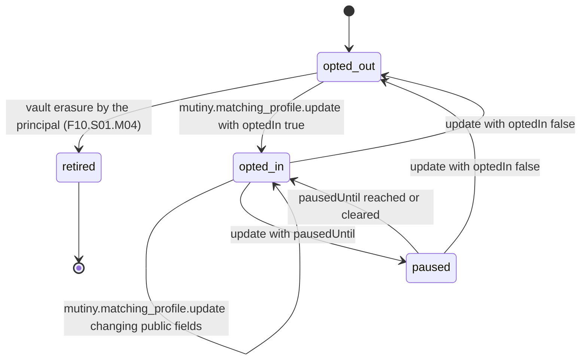

# PS-019-03 — Workflow state machine: Matching participant eligibility

**Status:** SPECIFIED (Stage 3). **Module:** [F02.S02.M04 Matching participant eligibility](SPEC.md) · **Scope:** MVP · **Code:** `packages/mutiny/src/cycle_matching/party` · **Contracts:** [CTR-ID-001](../../../planning/contracts/CTR-ID-001.md), [CTR-EVT-001](../../../planning/contracts/CTR-EVT-001.md), [CTR-ERR-001](../../../planning/contracts/CTR-ERR-001.md), [CTR-CAP-001](../../../planning/contracts/CTR-CAP-001.md), [CTR-FED-001](../../../planning/contracts/CTR-FED-001.md), [CTR-IDM-001](../../../planning/contracts/CTR-IDM-001.md), [CTR-PRV-001](../../../planning/contracts/CTR-PRV-001.md), [CTR-SCH-001](../../../planning/contracts/CTR-SCH-001.md)

> Generated from `module.spec.yaml` by `tools/specgen`. Edit the YAML, then run `pnpm spec:render`.

## Requirements

- **PS-019-03.R01** The local profile follows opted_out, opted_in and paused states and every change that alters the public projection increments seq by exactly 1.
- **PS-019-03.R02** Opting out always publishes a signed tombstone, even when relays are unreachable, by queueing it in the sync outbox until transport acknowledged.
- **PS-019-03.R03** A pause expires by local clock evaluation without a statement because pause is a local filter, not a public fact.

## Specification

### MatchingProfile lifecycle

Initial **opted_out**; terminal **retired**.

| Transition | Trigger | Guard / effect |
|---|---|---|
| opted_out -> retired | vault erasure by the principal (F10.S01.M04) | local record purged; tombstone already published if it had been opted in |
| opted_out -> opted_in | mutiny.matching_profile.update with optedIn true | V03 and V04 pass; signs projection seq+1; emits mutiny.matching_profile.updated |
| opted_in -> opted_in | mutiny.matching_profile.update changing public fields | signs projection seq+1; emits mutiny.matching_profile.updated |
| opted_in -> paused | update with pausedUntil | local only; emits mutiny.matching_profile.updated with paused true |
| paused -> opted_in | pausedUntil reached or cleared | local evaluation; emits mutiny.matching_profile.updated |
| opted_in -> opted_out | update with optedIn false | signs tombstone with seq+1; emits mutiny.matching_profile.updated |
| paused -> opted_out | update with optedIn false | signs tombstone; emits mutiny.matching_profile.updated |

### Timeouts and scheduled transitions

- Pause end is evaluated on vault open and every 60 s while the PWA is open.
- A projection not refreshed for 180 days is re-signed with a new seq on next vault open so relays do not drop it as stale.

## Verification

| Test | Level | Covers | Scenario | Expected |
|---|---|---|---|---|
| TEST-PS-019-09.T04 | property | PS-019-03.R01, PS-019-03.R02 | random sequences of update commands | seq increments by exactly 1 per public change; opt-out always yields tombstone |
| TEST-PS-019-09.T05 | integration | PS-019-03.R02, PS-019-06.R03 | opt out while all relays unreachable | tombstone queued with state prepared and delivered on reconnect |
| TEST-PS-019-09.T06 | unit | PS-019-03.R03 | pausedUntil passes with injected clock | state returns to opted_in without any statement |

## Dependencies

Module depends on: F07.S01.M01, F07.S02.M02, F06.S02.M02, F16.S02.M03, F12.S03.M04, F15.S01.M01, CTR-ID-001, CTR-EVT-001, CTR-ERR-001, CTR-CAP-001, CTR-FED-001, CTR-IDM-001, CTR-PRV-001, CTR-SCH-001. Predecessor: [domain_schema.md](domain_schema.md).
