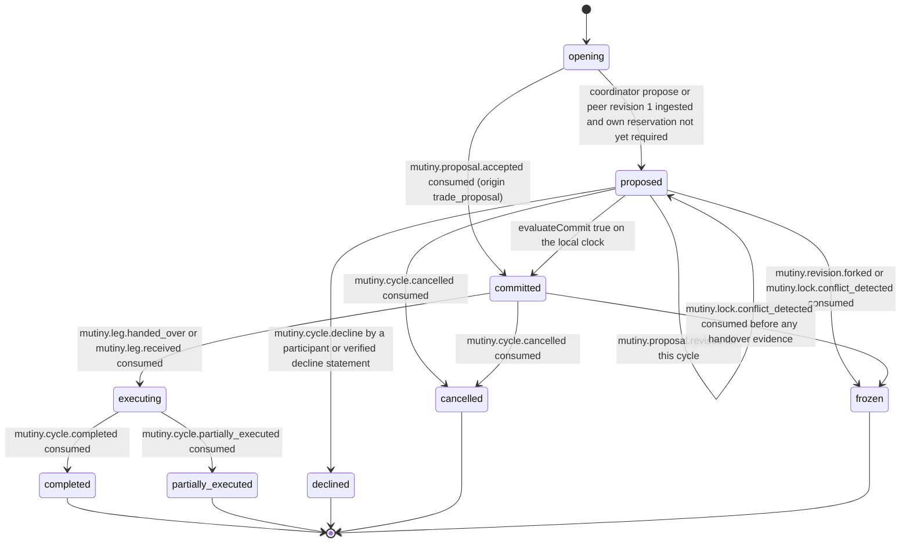

# PS-021-03 — Workflow state machine: Cycle consent

**Status:** SPECIFIED (Stage 3). **Module:** [F02.S03.M01 Cycle consent](SPEC.md) · **Scope:** MVP · **Code:** `packages/mutiny/src/cycle_execution/consent` · **Contracts:** [CTR-ID-001](../../../planning/contracts/CTR-ID-001.md), [CTR-EVT-001](../../../planning/contracts/CTR-EVT-001.md), [CTR-ERR-001](../../../planning/contracts/CTR-ERR-001.md), [CTR-CAP-001](../../../planning/contracts/CTR-CAP-001.md), [CTR-FED-001](../../../planning/contracts/CTR-FED-001.md), [CTR-IDM-001](../../../planning/contracts/CTR-IDM-001.md), [CTR-MNY-001](../../../planning/contracts/CTR-MNY-001.md), [CTR-PRV-001](../../../planning/contracts/CTR-PRV-001.md), [CTR-SCH-001](../../../planning/contracts/CTR-SCH-001.md)

> Generated from `module.spec.yaml` by `tools/specgen`. Edit the YAML, then run `pnpm spec:render`.

## Requirements

- **PS-021-03.R01** The commit verdict is a pure function of verified evidence and the local clock; it is re-evaluated whenever evidence or the clock changes and never depends on a message from a coordinator saying committed.
- **PS-021-03.R02** Any decline, expiry, fork, conflicting promise or participant loss before commit ends the cycle for this vault, and no replacement participant is ever substituted.
- **PS-021-03.R03** Terminal states do not reopen; renegotiation after a freeze or cancellation is a brand-new cycle with new consents.
- **PS-021-03.R04** The consent deadline is evaluated on each vault's own clock, and if the clock disagrees with a relay receipt time about the deadline, the cycle is expired.

## Specification

### Cycle lifecycle

Initial **opening**; terminal **completed**, **partially_executed**, **declined**, **cancelled**, **frozen**.

| Transition | Trigger | Guard / effect |
|---|---|---|
| opening -> proposed | coordinator propose or peer revision 1 ingested and own reservation not yet required | roster, legs, revision stored; emits mutiny.cycle.proposed |
| opening -> committed | mutiny.proposal.accepted consumed (origin trade_proposal) | consents and reservations imported by reference and re-verified; emits mutiny.cycle.proposed then mutiny.cycle.committed |
| proposed -> proposed | mutiny.proposal.revised for this cycle | all consents void, reservations superseded after re-reserve; coordinator re-signs |
| proposed -> committed | evaluateCommit true on the local clock | every participant has valid consent on head hash, every giver has valid unexpired reservation, fresh feasibility, no fork; emits mutiny.cycle.committed |
| proposed -> declined | mutiny.cycle.decline by a participant or verified decline statement | emits mutiny.cycle.declined |
| proposed -> cancelled | mutiny.cycle.cancelled consumed | consent deadline passed, participant dropped or lock lost before commit |
| proposed -> frozen | mutiny.revision.forked or mutiny.lock.conflict_detected consumed | no signature is produced; own reservation released by F02.S03.M02 |
| committed -> executing | mutiny.leg.handed_over or mutiny.leg.received consumed | first handover evidence verified |
| committed -> cancelled | mutiny.cycle.cancelled consumed | dropout before any handover evidence |
| committed -> frozen | mutiny.lock.conflict_detected consumed before any handover evidence | renegotiation as a new cycle |
| executing -> completed | mutiny.cycle.completed consumed | all legs received and compensation settled as verified by F02.S03.M04 |
| executing -> partially_executed | mutiny.cycle.partially_executed consumed | recovery case opened by F02.S03.M04 |

### Timeouts and scheduled transitions

- Consent deadline evaluated on vault open and every 60 s while open; at the deadline a proposed cycle is cancelled with reason consent_timeout by F02.S03.M03.
- A feasibility report older than 10 minutes cannot be used for the verdict and is refreshed automatically before evaluation.

## Verification

| Test | Level | Covers | Scenario | Expected |
|---|---|---|---|---|
| TEST-PS-021-09.T01 | integration | PS-021-01.R01, PS-021-03.R01, PS-021-04.R03 | 3-party happy path across three vaults | each vault commits after verifying 3 consents and 3 reservations; committed event carries executionDeadline |
| TEST-PS-021-09.T02 | integration | PS-021-01.R01, PS-021-03.R01 | 2-party accepted proposal opens cycle as committed | Cycle id equals proposal id and both vaults commit with imported consents re-verified |
| TEST-PS-021-09.T04 | property | PS-021-03.R01, PS-021-03.R02, PS-021-09.R03 | random interleavings, drops and duplicates of consents, locks, revisions | committed only with all valid consents and reservations on the head hash; terminal states immutable |
| TEST-PS-021-09.T05 | integration | PS-021-03.R02, PS-021-04.R02, PS-021-01.R03 | coordinator revises after two consents | all consents void, reservations superseded, only the coordinator can revise, participant change refused |
| TEST-PS-021-09.T06 | integration | PS-021-01.R04, PS-021-03.R04, PS-021-07.R04 | 4-party with Dan's consent arriving after deadline on Alice's clock | no commit at Alice's vault, cycle expires, reservations released, disagreement counted expired |
| TEST-PS-021-09.T08 | integration | PS-021-03.R03, PS-021-06.R03 | fork: coordinator sends two different revision 2 to different participants | cids compared, mutiny.revision.forked, both vaults freeze, no consent counted |
| TEST-PS-021-09.T09 | integration | PS-021-03.R03, PS-021-06.R03 | conflicting reservation for one item in two cycles seen by one vault | mutiny.lock.conflict_detected, both cycles frozen, renegotiation requires new cycle |
| TEST-PS-021-09.T19 | integration | PS-021-03.R02, PS-021-01.R02 | participant declines after consent; others not yet committed and already committed | declined at uncommitted vaults; committed vaults hand over to dropout handling |

## Dependencies

Module depends on: F02.S03.M02, F02.S02.M03, F02.S02.M05, F02.S01.M02, F02.S01.M03, F02.S01.M04, F02.S04.M02, F08.S02.M02, F07.S01.M01, F12.S03.M04, F16.S02.M03, F15.S01.M01, CTR-ID-001, CTR-EVT-001, CTR-ERR-001, CTR-CAP-001, CTR-FED-001, CTR-IDM-001, CTR-MNY-001, CTR-PRV-001, CTR-SCH-001. Predecessor: [domain_schema.md](domain_schema.md).
