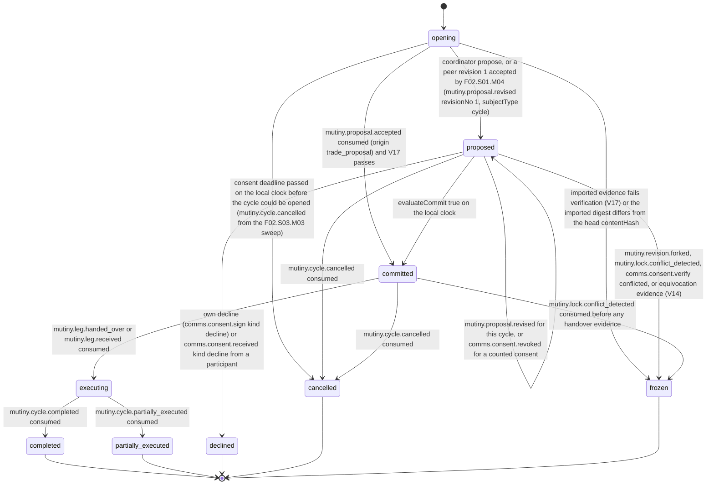

# PS-021-03 — Workflow state machine: Cycle consent

**Status:** SPECIFIED (Stage 3). **Module:** [F02.S03.M01 Cycle consent](SPEC.md) · **Scope:** MVP · **Code:** `packages/mutiny/src/cycle_execution/consent` · **Contracts:** [CTR-ID-001](../../../planning/contracts/CTR-ID-001.md), [CTR-EVT-001](../../../planning/contracts/CTR-EVT-001.md), [CTR-ERR-001](../../../planning/contracts/CTR-ERR-001.md), [CTR-CAP-001](../../../planning/contracts/CTR-CAP-001.md), [CTR-FED-001](../../../planning/contracts/CTR-FED-001.md), [CTR-IDM-001](../../../planning/contracts/CTR-IDM-001.md), [CTR-MNY-001](../../../planning/contracts/CTR-MNY-001.md), [CTR-PRV-001](../../../planning/contracts/CTR-PRV-001.md), [CTR-SCH-001](../../../planning/contracts/CTR-SCH-001.md)

> Generated from `module.spec.yaml` by `tools/specgen`. Edit the YAML, then run `pnpm spec:render`.

## Requirements

- **PS-021-03.R01** The commit verdict is a pure function of verified evidence and the local clock; it is re-evaluated whenever evidence or the clock changes and never depends on a message from a coordinator saying committed.
- **PS-021-03.R02** Any decline, revocation of a counted consent by its author, expiry, fork, equivocation, conflicting promise or participant loss before commit ends or freezes the cycle for this vault or voids that consent, and no replacement participant is ever substituted.
- **PS-021-03.R03** Terminal states do not reopen; renegotiation after a freeze or cancellation is a brand-new cycle with new consents.
- **PS-021-03.R04** The consent deadline is evaluated on each vault's own clock, and if the clock disagrees with a relay receipt time about the deadline, the cycle is expired.
- **PS-021-03.R05** The opening state always has an exit: imported evidence that fails verification freezes the cycle and a passed consent deadline cancels it.

## Specification

### Cycle lifecycle

Initial **opening**; terminal **completed**, **partially_executed**, **declined**, **cancelled**, **frozen**.

| Transition | Trigger | Guard / effect |
|---|---|---|
| opening -> proposed | coordinator propose, or a peer revision 1 accepted by F02.S01.M04 (mutiny.proposal.revised revisionNo 1, subjectType cycle) | roster, legs, revision stored; trust panel computed; emits mutiny.cycle.proposed |
| opening -> committed | mutiny.proposal.accepted consumed (origin trade_proposal) and V17 passes | both mutiny_proposal consents re-verified with comms.consent.verify on the same contentHash and both reservations active; emits mutiny.cycle.proposed then mutiny.cycle.committed |
| opening -> frozen | imported evidence fails verification (V17) or the imported digest differs from the head contentHash | closeReason import_verification_failed; own reservation released through LockPort.releaseForSubject with reason fork_frozen; no signature produced |
| opening -> cancelled | consent deadline passed on the local clock before the cycle could be opened (mutiny.cycle.cancelled from the F02.S03.M03 sweep) | own reservation released; nothing signed |
| proposed -> proposed | mutiny.proposal.revised for this cycle, or comms.consent.revoked for a counted consent | on revision all consents void and reservations superseded after re-reserve; on revocation that consent is void with voidReason consent_revoked and the verdict is re-evaluated |
| proposed -> committed | evaluateCommit true on the local clock | every participant has a consent on the head number and hash verified valid by comms.consent.verify in this transaction, every giver has a valid unexpired reservation, fresh feasibility, no fork or equivocation; emits mutiny.cycle.committed |
| proposed -> declined | own decline (comms.consent.sign kind decline) or comms.consent.received kind decline from a participant | own reservation released through LockPort.releaseForSubject in the same transaction; emits mutiny.cycle.declined |
| proposed -> cancelled | mutiny.cycle.cancelled consumed | consent deadline passed, participant withdrew or dropped, or lock lost before commit |
| proposed -> frozen | mutiny.revision.forked, mutiny.lock.conflict_detected, comms.consent.verify conflicted, or equivocation evidence (V14) | no signature is produced; own reservation released by F02.S03.M02 with releaseReason fork_frozen |
| committed -> executing | mutiny.leg.handed_over or mutiny.leg.received consumed | first handover evidence verified |
| committed -> cancelled | mutiny.cycle.cancelled consumed | dropout before any handover evidence, including a revocation after commit handled by F02.S03.M03 |
| committed -> frozen | mutiny.lock.conflict_detected consumed before any handover evidence | renegotiation as a new cycle |
| executing -> completed | mutiny.cycle.completed consumed | all legs received and compensation settled as verified by F02.S03.M04 |
| executing -> partially_executed | mutiny.cycle.partially_executed consumed | recovery case opened by F02.S03.M04 |

### Timeouts and scheduled transitions

- Consent deadline evaluated on vault open and every 60 s while open; at the deadline an opening or proposed cycle is cancelled with reason consent_timeout by F02.S03.M03.
- A feasibility report older than 10 minutes cannot be used for the verdict and is refreshed automatically before evaluation.

## Verification

| Test | Level | Covers | Scenario | Expected |
|---|---|---|---|---|
| TEST-PS-021-09.T01 | integration | PS-021-01.R01, PS-021-03.R01, PS-021-04.R03 | 3-party happy path across three vaults | each vault commits after verifying 3 consents and 3 reservations; committed event carries executionDeadline and parties |
| TEST-PS-021-09.T02 | integration | PS-021-01.R01, PS-021-03.R01, PS-021-03.R05 | 2-party accepted proposal opens cycle | Cycle id equals proposal id; both mutiny_proposal consents re-verified on the same contentHash (V07 exception, V17) and both vaults commit |
| TEST-PS-021-09.T04 | property | PS-021-03.R01, PS-021-03.R02, PS-021-09.R03 | random interleavings, drops and duplicates of consents, revocations, locks and revisions | committed only with all valid consents on the head number and hash and all reservations; terminal states immutable |
| TEST-PS-021-09.T05 | integration | PS-021-03.R02, PS-021-04.R02, PS-021-01.R03 | coordinator revises after two consents | all consents void, reservations superseded, only the coordinator can revise, participant change refused |
| TEST-PS-021-09.T06 | integration | PS-021-01.R04, PS-021-03.R04 | 4-party with Dan's consent arriving after deadline on Alice's clock | no commit at Alice's vault, cycle expires, reservations released, disagreement counted expired |
| TEST-PS-021-09.T08 | integration | PS-021-03.R03, PS-021-06.R03, PS-021-07.R06 | equivocation: coordinator sends revision 2 with digest H2a to Bob and H2b to Carol; Carol's correctly signed consent on revision 2 with H2b reaches Bob's vault whose head is H2a | V14: both hashes stored, mutiny.revision.report_fork called, mutiny.revision.forked emitted, cycle frozen, no consent counted |
| TEST-PS-021-09.T09 | integration | PS-021-03.R03, PS-021-06.R03 | conflicting reservation for one item in two cycles seen by one vault | mutiny.lock.conflict_detected, both cycles frozen, renegotiation requires new cycle |
| TEST-PS-021-09.T19 | integration | PS-021-03.R02, PS-021-01.R02 | participant declines (F08 kind decline) after consent; others not yet committed and already committed | declined at uncommitted vaults with own reservation released; committed vaults hand over to dropout handling |
| TEST-PS-021-09.T21 | integration | PS-021-03.R02, PS-021-02.R03, PS-021-01.R02 | 4-party: Bob revokes his consent through F08 before Dan's last consent arrives at Alice's vault | Bob's consent void with consent_revoked; comms.consent.verify inside the evaluating transaction returns revoked; Alice's vault never commits |
| TEST-PS-021-09.T24 | integration | PS-021-03.R05, PS-021-03.R02 | opening from an accepted proposal whose imported consent no longer verifies; opening whose consent deadline passes on the local clock | opening -> frozen with import_verification_failed and own reservation released; opening -> cancelled |

## Dependencies

Module depends on: F02.S03.M02, F02.S02.M03, F02.S02.M05, F02.S01.M02, F02.S01.M03, F02.S01.M04, F02.S04.M02, F08.S02.M02, F07.S01.M01, F07.S02.M02, F07.S03.M01, F12.S03.M04, F16.S02.M03, F15.S01.M01, F11.S01.M01, F10.S01.M02, F10.S01.M03, F10.S01.M04, F10.S02.M02, CTR-ID-001, CTR-EVT-001, CTR-ERR-001, CTR-CAP-001, CTR-FED-001, CTR-IDM-001, CTR-MNY-001, CTR-PRV-001, CTR-SCH-001. Predecessor: [domain_schema.md](domain_schema.md).
