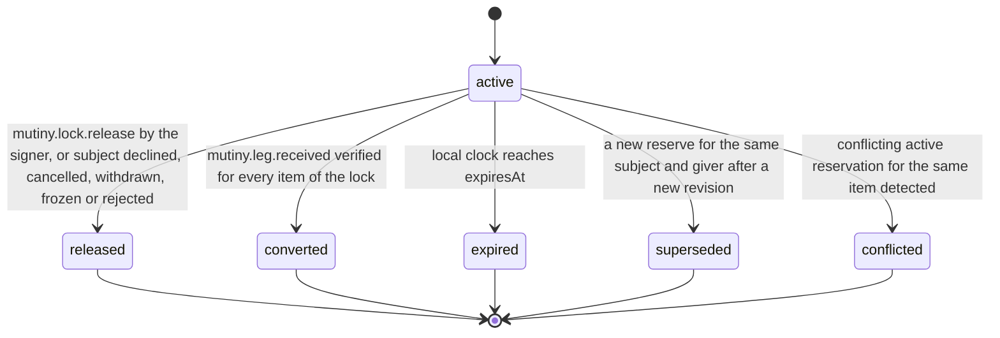

# PS-023-03 — Workflow state machine: Cycle locks

**Status:** SPECIFIED (Stage 3). **Module:** [F02.S03.M02 Cycle locks](SPEC.md) · **Scope:** MVP · **Code:** `packages/mutiny/src/cycle_execution/lock` · **Contracts:** [CTR-ID-001](../../../planning/contracts/CTR-ID-001.md), [CTR-EVT-001](../../../planning/contracts/CTR-EVT-001.md), [CTR-ERR-001](../../../planning/contracts/CTR-ERR-001.md), [CTR-CAP-001](../../../planning/contracts/CTR-CAP-001.md), [CTR-FED-001](../../../planning/contracts/CTR-FED-001.md), [CTR-IDM-001](../../../planning/contracts/CTR-IDM-001.md), [CTR-PRV-001](../../../planning/contracts/CTR-PRV-001.md), [CTR-SCH-001](../../../planning/contracts/CTR-SCH-001.md)

> Generated from `module.spec.yaml` by `tools/specgen`. Edit the YAML, then run `pnpm spec:render`.

## Requirements

- **PS-023-03.R01** A reservation is active until the earliest of release, conversion after receipt, supersession, expiry by the local clock or conflict detection.
- **PS-023-03.R02** Conversion happens per lock only when every item of the lock has a verified signed receipt from the receiver; partial receipt keeps the lock active.
- **PS-023-03.R03** Expiry is evaluated lazily and on a 60 s timer while the vault is open, without any background guarantee, and always before any command touching the lock.

## Specification

### CycleLock lifecycle

Initial **active**; terminal **released**, **converted**, **expired**, **superseded**, **conflicted**.

| Transition | Trigger | Guard / effect |
|---|---|---|
| active -> released | mutiny.lock.release by the signer, or subject declined, cancelled, withdrawn, frozen or rejected | own holds released in the same transaction; emits mutiny.cycle.unlocked |
| active -> converted | mutiny.leg.received verified for every item of the lock | own holds converted to traded in F01.S03.M01; emits mutiny.cycle.unlocked with reason converted |
| active -> superseded | a new reserve for the same subject and giver after a new revision | emits mutiny.cycle.unlocked with reason superseded |
| active -> expired | local clock reaches expiresAt | own holds released; emits mutiny.cycle.unlocked with reason expired |
| active -> conflicted | conflicting active reservation for the same item detected | subject owners freeze the subjects; emits mutiny.lock.conflict_detected |

### Timeouts and scheduled transitions

- Expiry evaluation on vault open and every 60 s while open; maximum reservation lifetime 37 days (72 h default consent window plus 14 d default execution window is 17 days).

## Verification

| Test | Level | Covers | Scenario | Expected |
|---|---|---|---|---|
| TEST-PS-023-09.T03 | property | PS-023-03.R01, PS-023-06.R02 | random reserve, release, supersede, expire sequences | status only moves forward; active own locks always have active holds; sum of quantities within availability |
| TEST-PS-023-09.T06 | integration | PS-023-03.R03, PS-023-06.R03 | vault closed beyond expiry then opened | lock expired before any command runs, holds released, unlocked emitted |
| TEST-PS-023-09.T07 | integration | PS-023-03.R02, PS-023-04.R03 | leg.received for all items, then for part of the items | lock converted only when all items received; holds converted in inventory |

## Dependencies

Module depends on: F01.S03.M01, F01.S01.M01, F07.S01.M01, F16.S02.M03, F15.S01.M01, CTR-ID-001, CTR-EVT-001, CTR-ERR-001, CTR-CAP-001, CTR-FED-001, CTR-IDM-001, CTR-PRV-001, CTR-SCH-001. Predecessor: [domain_schema.md](domain_schema.md).
