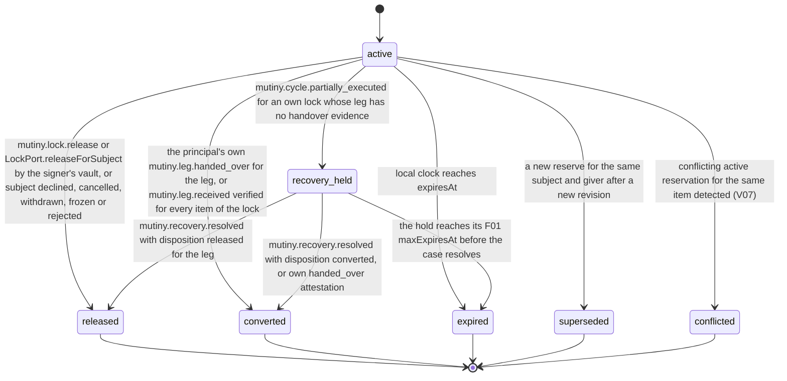

# PS-023-03 — Workflow state machine: Cycle locks

**Status:** SPECIFIED (Stage 3). **Module:** [F02.S03.M02 Cycle locks](SPEC.md) · **Scope:** MVP · **Code:** `packages/mutiny/src/cycle_execution/lock` · **Contracts:** [CTR-ID-001](../../../planning/contracts/CTR-ID-001.md), [CTR-EVT-001](../../../planning/contracts/CTR-EVT-001.md), [CTR-ERR-001](../../../planning/contracts/CTR-ERR-001.md), [CTR-CAP-001](../../../planning/contracts/CTR-CAP-001.md), [CTR-FED-001](../../../planning/contracts/CTR-FED-001.md), [CTR-IDM-001](../../../planning/contracts/CTR-IDM-001.md), [CTR-PRV-001](../../../planning/contracts/CTR-PRV-001.md), [CTR-SCH-001](../../../planning/contracts/CTR-SCH-001.md)

> Generated from `module.spec.yaml` by `tools/specgen`. Edit the YAML, then run `pnpm spec:render`.

## Requirements

- **PS-023-03.R01** A reservation is active until the earliest of release, conversion after handover evidence, supersession, expiry by the local clock or conflict detection, and after partial execution undelivered legs are held for the recovery case.
- **PS-023-03.R02** Conversion happens per lock when the giver's own handed_over attestation is recorded or every item of the lock has a verified signed receipt from the receiver, whichever comes first; partial receipt alone keeps the lock active.
- **PS-023-03.R03** Expiry is evaluated lazily and on a 60 s timer while the vault is open, without any background guarantee, and always before any command touching the lock.

## Specification

### CycleLock lifecycle

Initial **active**; terminal **released**, **converted**, **expired**, **superseded**, **conflicted**.

| Transition | Trigger | Guard / effect |
|---|---|---|
| active -> released | mutiny.lock.release or LockPort.releaseForSubject by the signer's vault, or subject declined, cancelled, withdrawn, frozen or rejected | own holds released with bazaar.inventory.release in the same transaction; release notice sent for own locks; emits mutiny.cycle.unlocked |
| active -> converted | the principal's own mutiny.leg.handed_over for the leg, or mutiny.leg.received verified for every item of the lock | own holds converted with bazaar.inventory.convert {holder}; emits mutiny.cycle.unlocked with reason converted |
| active -> superseded | a new reserve for the same subject and giver after a new revision | emits mutiny.cycle.unlocked with reason superseded |
| active -> expired | local clock reaches expiresAt | own holds released; emits mutiny.cycle.unlocked with reason expired |
| active -> conflicted | conflicting active reservation for the same item detected (V07) | own active locks of every subject named in the conflict released with releaseReason fork_frozen in the same transaction; subject owners freeze; emits mutiny.lock.conflict_detected |
| active -> recovery_held | mutiny.cycle.partially_executed for an own lock whose leg has no handover evidence | statement not re-signed; local hold renewed internally up to its maxExpiresAt and owned by the RecoveryCase |
| recovery_held -> released | mutiny.recovery.resolved with disposition released for the leg | own holds released; emits mutiny.cycle.unlocked with reason released |
| recovery_held -> converted | mutiny.recovery.resolved with disposition converted, or own handed_over attestation | own holds converted; emits mutiny.cycle.unlocked with reason converted |
| recovery_held -> expired | the hold reaches its F01 maxExpiresAt before the case resolves | own holds released; the RecoveryCase is told and the owner decides availability; emits mutiny.cycle.unlocked with reason expired |

### Timeouts and scheduled transitions

- Expiry evaluation on vault open and every 60 s while open; maximum statement lifetime 30 days (72 h default consent window plus 14 d default execution window is 17 days).
- Local hold renewal with bazaar.inventory.renew when less than 24 h of hold ttl remain, in steps of at most 14 d, until expiresAt (statement) or maxExpiresAt (recovery_held); at most 20 renewals per F01.

## Verification

| Test | Level | Covers | Scenario | Expected |
|---|---|---|---|---|
| TEST-PS-023-09.T03 | property | PS-023-03.R01, PS-023-06.R02 | random reserve, release, supersede, expire sequences | status only moves forward; active own locks always have active holds; sum of quantities within availability |
| TEST-PS-023-09.T06 | integration | PS-023-03.R03, PS-023-06.R03 | vault closed beyond expiry then opened | lock expired before any command runs, holds released, unlocked emitted |
| TEST-PS-023-09.T07 | integration | PS-023-03.R02, PS-023-04.R03 | leg.received for all items, then for part of the items | lock converted only when all items received; holds converted in inventory |
| TEST-PS-023-09.T18 | integration | PS-023-03.R01, PS-023-01.R03 | 17-day reservation with injected clock across day 13 and day 17 | hold renewed once with bazaar.inventory.renew, no statement re-signed, lock expires at the absolute expiresAt |
| TEST-PS-023-09.T19 | integration | PS-023-03.R02, PS-023-04.R05 | own handed_over attestation, then partially_executed with one undelivered own leg and a recovery lasting 40 days | handed-over leg converted at once; undelivered leg recovery_held with renewals up to maxExpiresAt, then expired and the RecoveryCase told |
| TEST-PS-023-09.T20 | integration | PS-023-02.R03, PS-023-03.R01 | peer lock of a cycle that ended locally plus a new cycle over the same item; conflict_detected between two live subjects | ended subject's peer lock marked subject_ended and not counted, new cycle not frozen; for live subjects own locks of both are released with fork_frozen |

## Dependencies

Module depends on: F01.S03.M01, F01.S01.M01, F07.S01.M01, F07.S02.M02, F16.S02.M03, F15.S01.M01, F11.S01.M01, F10.S01.M02, F10.S01.M03, F10.S01.M04, F10.S02.M02, CTR-ID-001, CTR-EVT-001, CTR-ERR-001, CTR-CAP-001, CTR-FED-001, CTR-IDM-001, CTR-PRV-001, CTR-SCH-001. Predecessor: [domain_schema.md](domain_schema.md).
