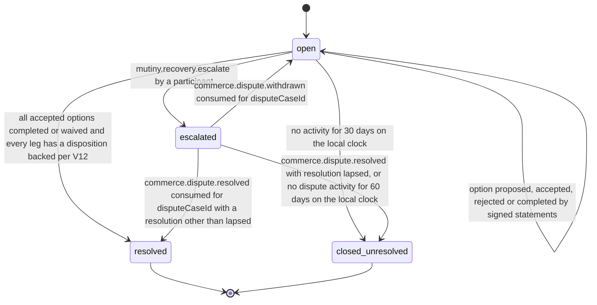

# PS-024-03 — Workflow state machine: Cycle execution and recovery

**Status:** SPECIFIED (Stage 3). **Module:** [F02.S03.M04 Cycle execution and recovery](SPEC.md) · **Scope:** MVP · **Code:** `packages/mutiny/src/cycle_execution/recovery` · **Contracts:** [CTR-ID-001](../../../planning/contracts/CTR-ID-001.md), [CTR-EVT-001](../../../planning/contracts/CTR-EVT-001.md), [CTR-ERR-001](../../../planning/contracts/CTR-ERR-001.md), [CTR-CAP-001](../../../planning/contracts/CTR-CAP-001.md), [CTR-FED-001](../../../planning/contracts/CTR-FED-001.md), [CTR-IDM-001](../../../planning/contracts/CTR-IDM-001.md), [CTR-COM-001](../../../planning/contracts/CTR-COM-001.md), [CTR-PRV-001](../../../planning/contracts/CTR-PRV-001.md), [CTR-SCH-001](../../../planning/contracts/CTR-SCH-001.md)

> Generated from `module.spec.yaml` by `tools/specgen`. Edit the YAML, then run `pnpm spec:render`.

## Requirements

- **PS-024-03.R01** A cycle is completed in a vault only when every leg has a valid receiver attestation and every compensation leg is settled, as verified in that vault, and the verdict is re-evaluated whenever evidence arrives.
- **PS-024-03.R02** Issue reports, dropouts after handover and execution deadlines with partial evidence move the cycle to partially_executed and open exactly one RecoveryCase; nothing is cancelled or rerouted.
- **PS-024-03.R03** A RecoveryCase resolves only through signed agreement on options, a dispute outcome from F09.S02.M02, or by closing as unresolved after 30 days without activity.
- **PS-024-03.R04** No relay, moderator or counterparty can mark a leg received or a case resolved for someone else; only that party's signature counts.
- **PS-024-03.R05** Every leg's disposition is backed by the signed acceptance of that leg's own giver and receiver or by a dispute outcome they acknowledged, so other participants of an N-party cycle can never settle a leg they are not part of.

## Specification

### RecoveryCase lifecycle

Initial **open**; terminal **resolved**, **closed_unresolved**.

| Transition | Trigger | Guard / effect |
|---|---|---|
| open -> open | option proposed, accepted, rejected or completed by signed statements | lastActivityAt updated; no state change |
| open -> escalated | mutiny.recovery.escalate by a participant | dispute opened with commerce.dispute.open contextRef {type: cycle, id: cycleId} and the evidence bundle; disputeCaseId stored |
| open -> resolved | all accepted options completed or waived and every leg has a disposition backed per V12 | emits mutiny.recovery.resolved with outcome agreed and reviewUnlock |
| escalated -> resolved | commerce.dispute.resolved consumed for disputeCaseId with a resolution other than lapsed | dispositions recorded only when both parties of each leg acknowledged the outcome; emits mutiny.recovery.resolved with outcome dispute_outcome and reviewUnlock |
| escalated -> open | commerce.dispute.withdrawn consumed for disputeCaseId | disputeCaseId cleared; options and dispositions remain; lastActivityAt updated |
| open -> closed_unresolved | no activity for 30 days on the local clock | emits mutiny.recovery.resolved with outcome unresolved and reviewUnlock with disputeFlag true (FLOW-08) |
| escalated -> closed_unresolved | commerce.dispute.resolved with resolution lapsed, or no dispute activity for 60 days on the local clock | emits mutiny.recovery.resolved with outcome unresolved and reviewUnlock with disputeFlag true (FLOW-08) |

### Timeouts and scheduled transitions

- Recovery deadlineAt is 14 days after opening; unresolved closure after 30 days without activity (60 days when escalated), evaluated on vault open and every 60 s while open.
- Giver and receiver actions have no deadline of their own; the execution deadline (consentDeadline + executionWindowMs) is enforced by F02.S03.M03.

## Verification

| Test | Level | Covers | Scenario | Expected |
|---|---|---|---|---|
| TEST-PS-024-09.T01 | integration | PS-024-01.R01, PS-024-03.R01, PS-024-04.R03 | 3-party cycle with all handed_over and received attestations delivered | each vault emits leg.received per leg and completed after the third receipt |
| TEST-PS-024-09.T02 | integration | PS-024-01.R04, PS-024-03.R01 | 2-party cycle; receiver attests without giver attestation | leg received and cycle completes; giver evidence not required |
| TEST-PS-024-09.T04 | property | PS-024-03.R01, PS-024-03.R04, PS-024-09.R03 | random interleavings of attestations, issues, drops and duplicates | completed only with all receiver attestations and settled compensation; cancelled and terminal states never reopen |
| TEST-PS-024-09.T05 | integration | PS-024-03.R02, PS-024-04.R03 | Dan drops in 4-party cycle after Alice's handed_over | cycle partially_executed, one RecoveryCase opened, no cancellation, no reroute |
| TEST-PS-024-09.T06 | integration | PS-024-03.R02, PS-024-06.R04 | receiver reports not_received after giver handed_over | issue recorded, partially_executed, both statements kept unmerged, options offered |
| TEST-PS-024-09.T07 | integration | PS-024-03.R03, PS-024-01.R02 | return_item proposed by Alice, accepted by Bob, returned and return_confirmed attested | case resolved with dispositions released for returned legs |
| TEST-PS-024-09.T08 | integration | PS-024-03.R03, PS-024-04.R01 | escalate case to dispute and resolve via commerce.dispute.resolved | outcome dispute_outcome and recovery.resolved emitted once |
| TEST-PS-024-09.T09 | integration | PS-024-03.R03 | no activity for 30 days with injected clock | closed_unresolved with outcome unresolved and UI statement that no remedy exists |
| TEST-PS-024-09.T16 | integration | PS-024-07.R03, PS-024-03.R04 | late handed_over arrives after cycle cancelled | cycle stays cancelled and standalone recovery case opens |
| TEST-PS-024-09.T23 | abuse | PS-024-02.R02, PS-024-03.R05 | 6-party recovery: four participants accept a waive option on leg L2 without Carol (giver) and Dan (receiver); later Carol and Dan accept | no disposition for L2 and MUTINY_RECOVERY_DISPOSITION_UNSIGNED until Carol and Dan signed; then disposition recorded with backedBy signed_acceptance |
| TEST-PS-024-09.T25 | integration | PS-024-03.R03, PS-024-04.R05 | escalated case: dispute withdrawn, then re-escalated and lapsed; separate open case without activity for 30 days | escalated -> open on commerce.dispute.withdrawn; closed_unresolved on lapsed; both resolved events carry reviewUnlock with disputeFlag true |
| TEST-PS-024-09.T26 | integration | PS-024-02.R02, PS-024-03.R03 | compensation option payer Dan payee Alice 80.00 EUR accepted by Dan then Alice | option accepted only after both; mutiny.compensation.activate called once in the transaction of Alice's accept |
| TEST-PS-024-09.T27 | contract | PS-024-04.R06, PS-024-03.R03 | F09.S02.M02 DisputeContextPort conformance for type cycle on C4 (committed), an unknown cycle id and a proposed cycle without RecoveryCase; then escalate C4's case twice | resolve returns the four participants with role participant and contextCid equal to the committed revisionHash; unknown for the other two; commerce.dispute.open is called with contextRef {type: cycle, id: C4}, reason not_received, evidence cids and idempotencyRef recoveryCaseId, and the repeat returns the same case; commerce.dispute.resolved for that contextRef resolves the case |

## Dependencies

Module depends on: F02.S03.M01, F02.S04.M01, F02.S01.M03, F09.S02.M02, F08.S01.M03, F16.S02.M03, F07.S01.M01, F07.S02.M02, F15.S01.M01, F15.S02.M03, F10.S02.M03, F11.S01.M01, F10.S01.M02, F10.S01.M03, F10.S01.M04, F10.S02.M02, CTR-ID-001, CTR-EVT-001, CTR-ERR-001, CTR-CAP-001, CTR-FED-001, CTR-IDM-001, CTR-COM-001, CTR-PRV-001, CTR-SCH-001. Predecessor: [domain_schema.md](domain_schema.md).
