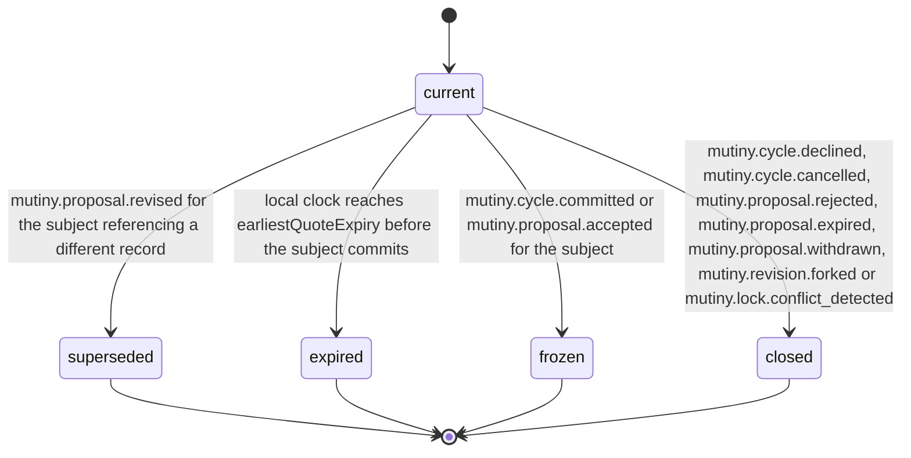

# PS-025-03 — Workflow state machine: Barter currency normalization

**Status:** SPECIFIED (Stage 3). **Module:** [F02.S04.M02 Barter currency normalization](SPEC.md) · **Scope:** MVP · **Code:** `packages/mutiny/src/value_balancing/currency` · **Contracts:** [CTR-ID-001](../../../planning/contracts/CTR-ID-001.md), [CTR-EVT-001](../../../planning/contracts/CTR-EVT-001.md), [CTR-ERR-001](../../../planning/contracts/CTR-ERR-001.md), [CTR-CAP-001](../../../planning/contracts/CTR-CAP-001.md), [CTR-FED-001](../../../planning/contracts/CTR-FED-001.md), [CTR-IDM-001](../../../planning/contracts/CTR-IDM-001.md), [CTR-MNY-001](../../../planning/contracts/CTR-MNY-001.md), [CTR-PRV-001](../../../planning/contracts/CTR-PRV-001.md), [CTR-SCH-001](../../../planning/contracts/CTR-SCH-001.md)

> Generated from `module.spec.yaml` by `tools/specgen`. Edit the YAML, then run `pnpm spec:render`.

## Requirements

- **PS-025-03.R01** A record is current until a newer record supersedes it, its earliest quote expires, or its subject commits or closes.
- **PS-025-03.R02** Expiry before commit emits an event that tells the coordinator a quote_refresh revision is needed; expiry after commit has no effect because the consented numbers are fixed.
- **PS-025-03.R03** Records are immutable, and refreshing creates a new record and a new revision with fresh consent from everyone.

## Specification

### NormalizationRecord lifecycle

Initial **current**; terminal **superseded**, **expired**, **frozen**, **closed**.

| Transition | Trigger | Guard / effect |
|---|---|---|
| current -> superseded | mutiny.proposal.revised for the subject referencing a different record | newer record is the one in the head revision |
| current -> expired | local clock reaches earliestQuoteExpiry before the subject commits | emits mutiny.normalization.expired |
| current -> frozen | mutiny.cycle.committed or mutiny.proposal.accepted for the subject | numbers are consented; later quote expiry is ignored |
| current -> closed | mutiny.cycle.declined, mutiny.cycle.cancelled, mutiny.proposal.rejected, mutiny.proposal.expired, mutiny.proposal.withdrawn, mutiny.revision.forked or mutiny.lock.conflict_detected | subject ended or froze without commit |

### Timeouts and scheduled transitions

- Quote expiry is evaluated on vault open and every 60 s while open; a notice is raised 30 minutes before earliestQuoteExpiry.

## Verification

| Test | Level | Covers | Scenario | Expected |
|---|---|---|---|---|
| TEST-PS-025-09.T05 | integration | PS-025-03.R01, PS-025-03.R02 | quote expires before commit with injected clock | record expired, mutiny.normalization.expired emitted, coordinator must create quote_refresh revision |
| TEST-PS-025-09.T06 | integration | PS-025-03.R02, PS-025-03.R03 | subject commits then quote expires | record frozen and expiry ignored |
| TEST-PS-025-09.T17 | integration | PS-025-03.R01, PS-025-04.R04 | mutiny.proposal.withdrawn, mutiny.revision.forked and mutiny.lock.conflict_detected for subjects with current records | each record closed; later compute for a new subject creates a new record |

## Dependencies

Module depends on: F02.S04.M03, F09.S03.M01, F09.S03.M02, F09.S03.M03, F16.S02.M03, F15.S01.M01, F10.S01.M02, F10.S01.M03, F10.S01.M04, F10.S02.M02, CTR-ID-001, CTR-EVT-001, CTR-ERR-001, CTR-CAP-001, CTR-FED-001, CTR-IDM-001, CTR-MNY-001, CTR-PRV-001, CTR-SCH-001. Predecessor: [domain_schema.md](domain_schema.md).
