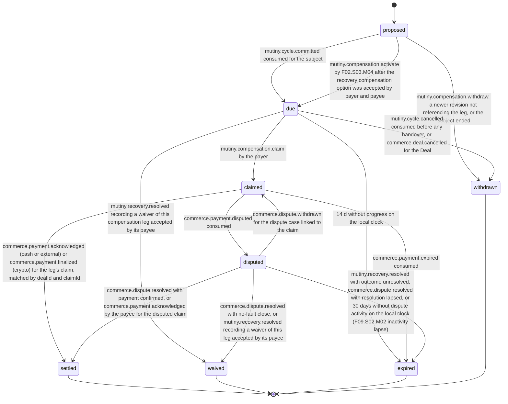

# PS-026-03 — Workflow state machine: Mixed-value compensation

**Status:** SPECIFIED (Stage 3). **Module:** [F02.S04.M01 Mixed-value compensation](SPEC.md) · **Scope:** MVP · **Code:** `packages/mutiny/src/value_balancing/mixed` · **Contracts:** [CTR-ID-001](../../../planning/contracts/CTR-ID-001.md), [CTR-EVT-001](../../../planning/contracts/CTR-EVT-001.md), [CTR-ERR-001](../../../planning/contracts/CTR-ERR-001.md), [CTR-CAP-001](../../../planning/contracts/CTR-CAP-001.md), [CTR-FED-001](../../../planning/contracts/CTR-FED-001.md), [CTR-IDM-001](../../../planning/contracts/CTR-IDM-001.md), [CTR-MNY-001](../../../planning/contracts/CTR-MNY-001.md), [CTR-COM-001](../../../planning/contracts/CTR-COM-001.md), [CTR-PRV-001](../../../planning/contracts/CTR-PRV-001.md), [CTR-SCH-001](../../../planning/contracts/CTR-SCH-001.md)

> Generated from `module.spec.yaml` by `tools/specgen`. Edit the YAML, then run `pnpm spec:render`.

## Requirements

- **PS-026-03.R01** A leg is proposed in a revision, becomes due when the cycle is committed, is claimed by the payer, and is settled only by payee acknowledgement or chain finality as reported by F09.
- **PS-026-03.R02** A cycle cancelled before any handover withdraws all non-terminal legs, while a partially executed cycle keeps due legs for the recovery case to waive, adjust by agreement or dispute.
- **PS-026-03.R03** Expiry follows COM-3, 14 days without progress, and is shown to both parties; an expired leg never counts as settled.
- **PS-026-03.R04** Disputed legs are resolved only by the outcome of F09.S02.M02, by a waiver agreed in recovery, or end as expired when the dispute is withdrawn without acknowledgement for too long, lapses or the recovery closes unresolved; a disputed leg always has an exit.
- **PS-026-03.R05** Money legs of a recovery case become due only when the payer and the payee both accepted the compensation option.

## Specification

### CompensationLeg lifecycle

Initial **proposed**; terminal **settled**, **waived**, **expired**, **withdrawn**.

| Transition | Trigger | Guard / effect |
|---|---|---|
| proposed -> due | mutiny.cycle.committed consumed for the subject | dueAt = local commit time + 14 d; Deal opened with commerce.deal.open {contextRef {type: cycle_compensation, id: cycleId}, contextCid: head revision contentHash, parties, obligations: money legs of the subject} |
| proposed -> due | mutiny.compensation.activate by F02.S03.M04 after the recovery compensation option was accepted by payer and payee | dueAt = now + 14 d; Deal opened with contextRef {type: cycle_compensation, id: recoveryCaseId} and contextCid of the accepting recovery action |
| proposed -> withdrawn | mutiny.compensation.withdraw, a newer revision not referencing the leg, or the subject ended | no obligation exists |
| due -> claimed | mutiny.compensation.claim by the payer | PaymentClaim created in F09.S01.M01; emits mutiny.compensation.claimed |
| due -> withdrawn | mutiny.cycle.cancelled consumed before any handover, or commerce.deal.cancelled for the Deal | commerce.deal.cancel called when this vault initiated it; no money is owed |
| due -> waived | mutiny.recovery.resolved recording a waiver of this compensation leg accepted by its payee | commerce.deal.cancel called; no payment due |
| due -> expired | 14 d without progress on the local clock | shown as expired; recovery or a new proposal may follow |
| claimed -> settled | commerce.payment.acknowledged (cash or external) or commerce.payment.finalized (crypto) for the leg's claim, matched by dealId and claimId | emits mutiny.compensation.settled with via acknowledged or final |
| claimed -> disputed | commerce.payment.disputed consumed | recovery case or dispute referenced |
| claimed -> expired | commerce.payment.expired consumed | 14 d without progress per COM-3 |
| disputed -> settled | commerce.dispute.resolved with payment confirmed, or commerce.payment.acknowledged by the payee for the disputed claim | emits mutiny.compensation.settled |
| disputed -> claimed | commerce.dispute.withdrawn for the dispute case linked to the claim | the payer's claim awaits acknowledgement again; progress clock restarts |
| disputed -> waived | commerce.dispute.resolved with no-fault close, or mutiny.recovery.resolved recording a waiver of this leg accepted by its payee | no payment due |
| disputed -> expired | mutiny.recovery.resolved with outcome unresolved, commerce.dispute.resolved with resolution lapsed, or 30 days without dispute activity on the local clock (F09.S02.M02 inactivity lapse) | never counted as settled |

### Timeouts and scheduled transitions

- A due or claimed leg without progress expires 14 days after dueAt or the last claim update, evaluated on vault open and every 60 s while open.
- A disputed leg with no dispute activity for 30 days on the local clock expires, matching the F09.S02.M02 inactivity lapse.

## Verification

| Test | Level | Covers | Scenario | Expected |
|---|---|---|---|---|
| TEST-PS-026-09.T01 | unit | PS-026-01.R01, PS-026-01.R03, PS-026-03.R01 | planner on 3-party fixture | legs p2 to p1 4000 and p2 to p3 2000, all residuals zero |
| TEST-PS-026-09.T05 | integration | PS-026-03.R01, PS-026-03.R04, PS-026-04.R04 | cycle committed then claim then acknowledged | proposed to due to claimed to settled; Deal opened with contextRef {type: cycle_compensation, id: cycleId}, contextCid equal to the head contentHash and one obligation per money leg; events matched by dealId and claimId; settled event emitted |
| TEST-PS-026-09.T06 | integration | PS-026-03.R02, PS-026-03.R03 | cycle cancelled before handover; cycle partially executed | due legs withdrawn in first case, kept in second |
| TEST-PS-026-09.T12 | unit | PS-026-03.R03, PS-026-07.R02 | leg without progress for 14 days with injected clock | expired and not counted as settled |
| TEST-PS-026-09.T17 | integration | PS-026-03.R01, PS-026-01.R04 | crypto claim with a configured verifier reaching final | commerce.payment.finalized for the claim settles the leg with via final; cycle completion can proceed |
| TEST-PS-026-09.T18 | integration | PS-026-03.R05, PS-026-04.R04 | recovery compensation option Dan to Alice 80.00 EUR accepted by Dan only, then by Alice | leg stays proposed, then mutiny.compensation.activate moves it to due and opens a Deal with contextRef id recoveryCaseId |
| TEST-PS-026-09.T19 | integration | PS-026-03.R04 | disputed leg: dispute withdrawn; second leg: recovery closes unresolved; third leg: 30 days without dispute activity with injected clock | claimed again; expired; expired; none counted as settled |
| TEST-PS-026-09.T22 | integration | PS-026-03.R02, PS-026-04.R04 | cycle cancelled before handover with due legs; commerce.deal.cancelled received for another Deal | commerce.deal.cancel called once; legs withdrawn in both cases |

## Dependencies

Module depends on: F02.S04.M02, F02.S04.M03, F02.S02.M03, F09.S01.M01, F09.S01.M03, F09.S02.M02, F09.S03.M03, F16.S02.M03, F15.S01.M01, F10.S01.M02, F10.S01.M03, F10.S01.M04, F10.S02.M02, CTR-ID-001, CTR-EVT-001, CTR-ERR-001, CTR-CAP-001, CTR-FED-001, CTR-IDM-001, CTR-MNY-001, CTR-COM-001, CTR-PRV-001, CTR-SCH-001. Predecessor: [domain_schema.md](domain_schema.md).
