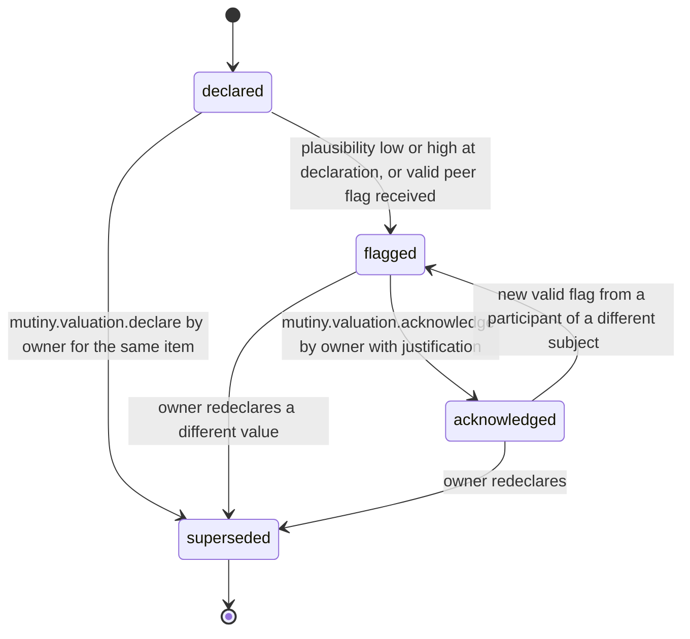

# PS-027-03 — Workflow state machine: Participant valuation

**Status:** SPECIFIED (Stage 3). **Module:** [F02.S04.M03 Participant valuation](SPEC.md) · **Scope:** MVP · **Code:** `packages/mutiny/src/value_balancing/valuation` · **Contracts:** [CTR-ID-001](../../../planning/contracts/CTR-ID-001.md), [CTR-EVT-001](../../../planning/contracts/CTR-EVT-001.md), [CTR-ERR-001](../../../planning/contracts/CTR-ERR-001.md), [CTR-CAP-001](../../../planning/contracts/CTR-CAP-001.md), [CTR-FED-001](../../../planning/contracts/CTR-FED-001.md), [CTR-IDM-001](../../../planning/contracts/CTR-IDM-001.md), [CTR-MNY-001](../../../planning/contracts/CTR-MNY-001.md), [CTR-PRV-001](../../../planning/contracts/CTR-PRV-001.md), [CTR-SCH-001](../../../planning/contracts/CTR-SCH-001.md)

> Generated from `module.spec.yaml` by `tools/specgen`. Edit the YAML, then run `pnpm spec:render`.

## Requirements

- **PS-027-03.R01** A valuation is declared, may be flagged automatically or by participants, may be acknowledged by the owner, and is superseded when the owner redeclares.
- **PS-027-03.R02** Every change that alters the signed projection increments seq by exactly 1 and is only possible while no reservation holds the item.
- **PS-027-03.R03** A flagged valuation blocks matching and consent for the item until acknowledged or superseded, and an acknowledgement never hides the flag history.

## Specification

### ItemValuation lifecycle

Initial **declared**; terminal **superseded**.

| Transition | Trigger | Guard / effect |
|---|---|---|
| declared -> flagged | plausibility low or high at declaration, or valid peer flag received | emits mutiny.valuation.flagged |
| declared -> superseded | mutiny.valuation.declare by owner for the same item | new record seq+1; old record kept as history |
| flagged -> acknowledged | mutiny.valuation.acknowledge by owner with justification | re-signs projection seq+1 with ackNote; emits mutiny.valuation.declared |
| flagged -> superseded | owner redeclares a different value | new record seq+1; emits mutiny.valuation.declared |
| acknowledged -> flagged | new valid flag from a participant of a different subject | emits mutiny.valuation.flagged |
| acknowledged -> superseded | owner redeclares | new record seq+1; emits mutiny.valuation.declared |

### Timeouts and scheduled transitions

_None._

## Verification

| Test | Level | Covers | Scenario | Expected |
|---|---|---|---|---|
| TEST-PS-027-09.T04 | property | PS-027-03.R01, PS-027-03.R02 | random declare, flag, acknowledge sequences | seq increments by exactly 1 per signed change; flagged items never reach matching or consent |
| TEST-PS-027-09.T05 | integration | PS-027-03.R03, PS-027-01.R03 | participant flags an item in a proposal, owner acknowledges | status flagged then acknowledged, flag history kept, item usable again |
| TEST-PS-027-09.T06 | integration | PS-027-03.R02, PS-027-05.R01 | item reserved by cycle.locked then owner tries to change value | MUTINY_VALUATION_LOCKED until mutiny.cycle.unlocked |

## Dependencies

Module depends on: F01.S02.M01, F01.S03.M01, F01.S01.M01, F09.S03.M01, F09.S03.M03, F16.S02.M03, F07.S01.M01, F15.S01.M01, CTR-ID-001, CTR-EVT-001, CTR-ERR-001, CTR-CAP-001, CTR-FED-001, CTR-IDM-001, CTR-MNY-001, CTR-PRV-001, CTR-SCH-001. Predecessor: [domain_schema.md](domain_schema.md).
