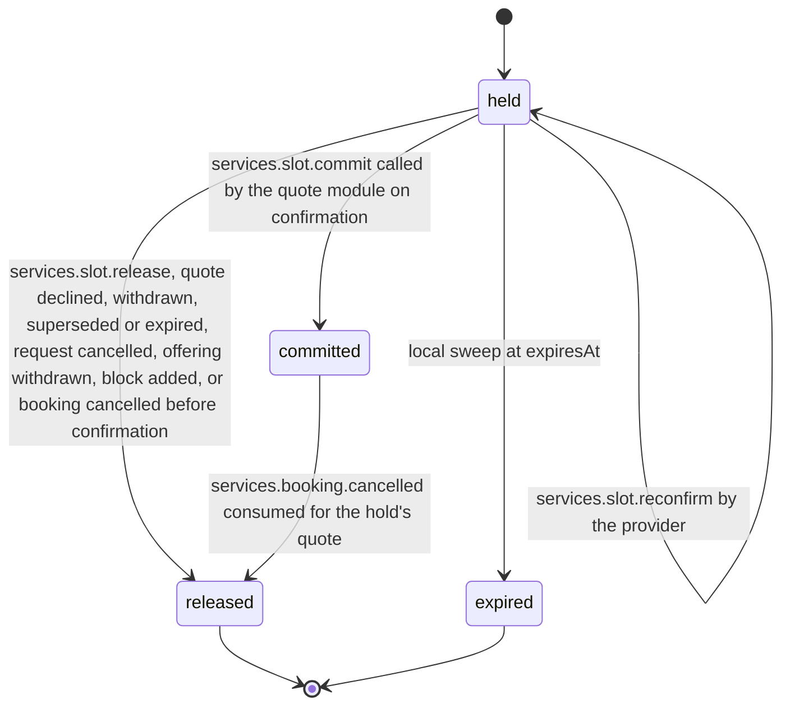

# PS-028-03 — Workflow state machine: Service availability

**Status:** SPECIFIED (Stage 3). **Module:** [F03.S01.M02 Service availability](SPEC.md) · **Scope:** MVP · **Code:** `packages/services/src/service_catalog/availability` · **Contracts:** [CTR-ID-001](../../../planning/contracts/CTR-ID-001.md), [CTR-EVT-001](../../../planning/contracts/CTR-EVT-001.md), [CTR-ERR-001](../../../planning/contracts/CTR-ERR-001.md), [CTR-CAP-001](../../../planning/contracts/CTR-CAP-001.md), [CTR-IDM-001](../../../planning/contracts/CTR-IDM-001.md), [CTR-PRV-001](../../../planning/contracts/CTR-PRV-001.md), [CTR-FED-001](../../../planning/contracts/CTR-FED-001.md)

> Generated from `module.spec.yaml` by `tools/specgen`. Edit the YAML, then run `pnpm spec:render`.

## Requirements

- **PS-028-03.R01** A slot hold follows held to committed, released or expired, may be extended once while held, and committed can only be released by a booking cancellation; a re-hold after expiry is a new hold that references the old one.
- **PS-028-03.R02** Hold expiry is evaluated against the provider vault clock at command time and by a local sweep, so a stale hold can never block a slot after its expiry.
- **PS-028-03.R03** Commit is atomic with the booking confirmation written by F03.S02.M01 inside one IndexedDB transaction and is refused while the hold needs reconfirmation.
- **PS-028-03.R04** Rule changes, new exceptions and tz database moves flag every affected held hold needsReconfirmation; such a hold commits only after the provider reconfirms it with services.slot.reconfirm, and committed holds keep their UTC interval.

## Specification

### SlotHold lifecycle

Initial **held**; terminal **released**, **expired**.

| Transition | Trigger | Guard / effect |
|---|---|---|
| held -> committed | services.slot.commit called by the quote module on confirmation | guard V09 (not expired, needsReconfirmation false, interval still generated or kept, no overlap); emits services.slot.committed |
| held -> held | services.slot.extend called by the quote module on verified acceptance receipt | once per hold; expiresAt set to the later of expiresAt and receipt plus 24 h; emits services.slot.held |
| held -> held | services.slot.reconfirm by the provider | needsReconfirmation cleared, kept set when the interval is no longer generated; emits services.slot.held |
| held -> released | services.slot.release, quote declined, withdrawn, superseded or expired, request cancelled, offering withdrawn, block added, or booking cancelled before confirmation | releaseReason stored; emits services.slot.released |
| held -> expired | local sweep at expiresAt | emits services.slot.released with reason expired |
| committed -> released | services.booking.cancelled consumed for the hold's quote | emits services.slot.released with reason booking_cancelled |

### Timeouts and scheduled transitions

- Hold expiry sweep runs at app start, on every calendar command and every 30 s while the PWA is open; a hold past expiresAt is treated as expired by every read even before the sweep runs.
- A hold placed for a quote expires at validUntil plus 5 minutes; once extended on acceptance receipt it expires at receipt plus 24 hours, matching the confirmation deadline of F03.S02.M01.
- A re-hold (services.slot.hold with reholdOf) is attempted only when an acceptance or confirmation finds the quote's hold expired or released; if the interval is taken the caller refuses with slot_taken.

## Verification

| Test | Level | Covers | Scenario | Expected |
|---|---|---|---|---|
| TEST-PS-028-09.T04 | unit | PS-028-01.R02, PS-028-03.R01 | hold, extend, reconfirm, commit, release, expire transitions plus undeclared ones and a second extend | only declared transitions succeed; others and the second extend return CONFLICT_STATE |
| TEST-PS-028-09.T05 | integration | PS-028-03.R03, PS-028-06.R03 | crash injected between commit and booking confirmation | both or neither persisted |
| TEST-PS-028-09.T15 | integration | PS-028-03.R02 | move the clock past a hold's expiresAt and request an overlapping hold before the sweep runs | new hold succeeds; the old hold reads as expired |
| TEST-PS-028-09.T18 | integration | PS-028-03.R04, PS-028-03.R03 | rule change removes the interval of a held hold, then commit, reconfirm with keep, commit | first commit SERVICES_SLOT_UNAVAILABLE; after reconfirm the commit succeeds and the interval stays committed |
| TEST-PS-028-09.T20 | integration | PS-028-03.R01, PS-028-03.R02 | quote hold with ttl 72 h 5 min, acceptance at 71 h extends it, commit at 80 h; second quote whose hold expired is re-held when free and refused when taken | commit succeeds; re-hold has reholdOf; taken interval returns SERVICES_SLOT_UNAVAILABLE |

## Dependencies

Module depends on: F07.S01.M01, F07.S02.M02, F08.S01.M01, F11.S01.M03, F10.S01.M01, F10.S01.M02, F10.S01.M03, F10.S01.M04, F10.S02.M02, CTR-ID-001, CTR-EVT-001, CTR-ERR-001, CTR-CAP-001, CTR-IDM-001, CTR-PRV-001, CTR-FED-001. Predecessor: [domain_schema.md](domain_schema.md).
