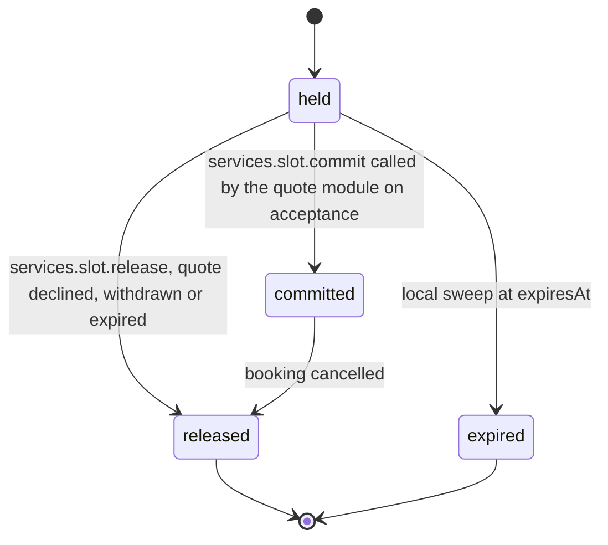

# PS-028-03 — Workflow state machine: Service availability

**Status:** SPECIFIED (Stage 3). **Module:** [F03.S01.M02 Service availability](SPEC.md) · **Scope:** MVP · **Code:** `packages/services/src/service_catalog/availability` · **Contracts:** [CTR-ID-001](../../../planning/contracts/CTR-ID-001.md), [CTR-EVT-001](../../../planning/contracts/CTR-EVT-001.md), [CTR-ERR-001](../../../planning/contracts/CTR-ERR-001.md), [CTR-CAP-001](../../../planning/contracts/CTR-CAP-001.md), [CTR-IDM-001](../../../planning/contracts/CTR-IDM-001.md), [CTR-PRV-001](../../../planning/contracts/CTR-PRV-001.md), [CTR-FED-001](../../../planning/contracts/CTR-FED-001.md)

> Generated from `module.spec.yaml` by `tools/specgen`. Edit the YAML, then run `pnpm spec:render`.

## Requirements

- **PS-028-03.R01** A slot hold follows held to committed, released or expired; committed can only be released by a booking cancellation.
- **PS-028-03.R02** Hold expiry is evaluated against the provider vault clock at command time and by a local sweep, so a stale hold can never block a slot after its expiry.
- **PS-028-03.R03** Commit is atomic with the booking confirmation written by F03.S02.M01 inside one IndexedDB transaction.

## Specification

### SlotHold lifecycle

Initial **held**; terminal **released**, **expired**.

| Transition | Trigger | Guard / effect |
|---|---|---|
| held -> committed | services.slot.commit called by the quote module on acceptance | hold not expired and no overlap; emits services.slot.committed |
| held -> released | services.slot.release, quote declined, withdrawn or expired | emits services.slot.released |
| held -> expired | local sweep at expiresAt | emits services.slot.released with reason expired |
| committed -> released | booking cancelled | emits services.slot.released with reason booking_cancelled |

### Timeouts and scheduled transitions

- Hold expiry sweep runs at app start, on every calendar command and every 30 s while the PWA is open; a hold past expiresAt is treated as expired by every read even before the sweep runs.

## Verification

| Test | Level | Covers | Scenario | Expected |
|---|---|---|---|---|
| TEST-PS-028-09.T03 | property | PS-028-01.R01, PS-028-02.R02, PS-028-03.R02, PS-028-09.R02 | random rules in every zone for 2026-2028 | derived slots are unique, ordered, non-overlapping, and no slot falls in a DST gap |
| TEST-PS-028-09.T04 | unit | PS-028-01.R02, PS-028-03.R01 | hold, commit, release, expire transitions plus undeclared ones | only declared transitions succeed; others CONFLICT_STATE |
| TEST-PS-028-09.T05 | integration | PS-028-03.R03, PS-028-06.R03 | crash injected between commit and booking confirmation | both or neither persisted |

## Dependencies

Module depends on: F03.S01.M01, F07.S01.M01, F11.S01.M03, CTR-ID-001, CTR-EVT-001, CTR-ERR-001, CTR-CAP-001, CTR-IDM-001, CTR-PRV-001, CTR-FED-001. Predecessor: [domain_schema.md](domain_schema.md).
