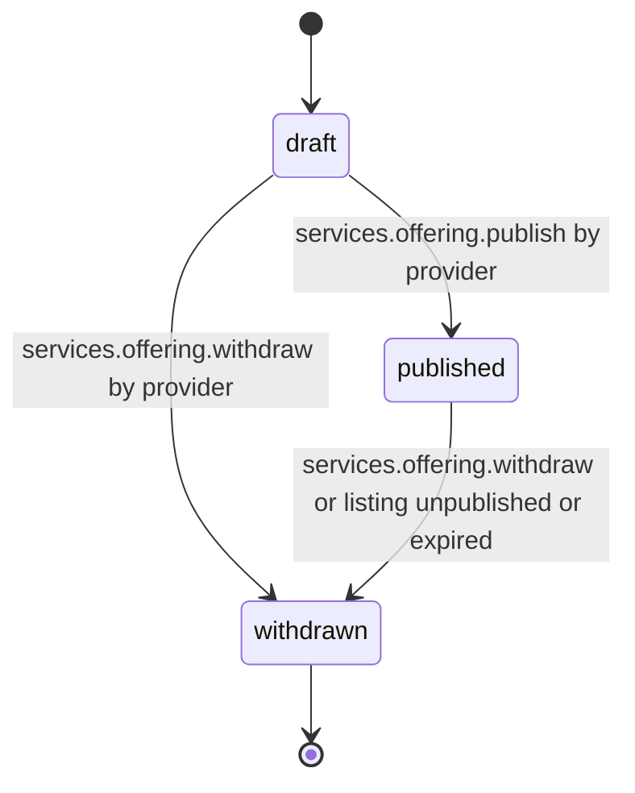

# PS-029-03 — Workflow state machine: Service skills catalog

**Status:** SPECIFIED (Stage 3). **Module:** [F03.S01.M01 Service skills catalog](SPEC.md) · **Scope:** MVP · **Code:** `packages/services/src/service_catalog/skills` · **Contracts:** [CTR-ID-001](../../../planning/contracts/CTR-ID-001.md), [CTR-EVT-001](../../../planning/contracts/CTR-EVT-001.md), [CTR-ERR-001](../../../planning/contracts/CTR-ERR-001.md), [CTR-CAP-001](../../../planning/contracts/CTR-CAP-001.md), [CTR-IDM-001](../../../planning/contracts/CTR-IDM-001.md), [CTR-MNY-001](../../../planning/contracts/CTR-MNY-001.md), [CTR-PRV-001](../../../planning/contracts/CTR-PRV-001.md), [CTR-FED-001](../../../planning/contracts/CTR-FED-001.md)

> Generated from `module.spec.yaml` by `tools/specgen`. Edit the YAML, then run `pnpm spec:render`.

## Requirements

- **PS-029-03.R01** Offerings follow draft, published, withdrawn; withdrawn is terminal and a new offering is created to return to market.
- **PS-029-03.R02** Publish re-runs all validation, requires a published service listing and a calendar from F03.S01.M02, signs the projection and writes the local event in the same IndexedDB transaction.
- **PS-029-03.R03** Withdrawal is automatic when the linked listing is unpublished or expired; relay-side removal never changes the local status.

## Specification

### ServiceOffering lifecycle

Initial **draft**; terminal **withdrawn**.

| Transition | Trigger | Guard / effect |
|---|---|---|
| draft -> published | services.offering.publish by provider | full validation passes and listing is published; emits services.offering.published |
| draft -> withdrawn | services.offering.withdraw by provider | discards draft; emits services.offering.withdrawn |
| published -> withdrawn | services.offering.withdraw or listing unpublished or expired | records withdrawReason; emits services.offering.withdrawn |

### Timeouts and scheduled transitions

- Draft offerings untouched for 90 days are withdrawn by a local sweep that runs at app start and every 60 minutes while the PWA is open; without the app open nothing runs and the sweep catches up at next start.

## Verification

| Test | Level | Covers | Scenario | Expected |
|---|---|---|---|---|
| TEST-PS-029-09.T03 | property | PS-029-03.R01 | random command sequences on one offering | only declared transitions succeed; withdrawn never leaves terminal state |
| TEST-PS-029-09.T04 | integration | PS-029-03.R02 | publish with listing unpublished and with missing calendar | PRECONDITION_FAILED or SERVICES_LISTING_NOT_SERVICE and no event |
| TEST-PS-029-09.T05 | integration | PS-029-03.R03, PS-029-04.R03 | bazaar.listing.unpublished event delivered twice and a relay refusal received | offering withdrawn once with reason listing_unavailable; relay refusal changes only sync state |
| TEST-PS-029-09.T14 | e2e | PS-029-01.R02, PS-029-03.R02, PS-029-09.R03 | mobile provider creates and publishes an offering and a client views it | credentials show self-attested; screen passes axe with zero serious issues |

## Dependencies

Module depends on: F01.S01.M01, F01.S01.M03, F18.S01.M03, F09.S03.M01, F06.S02.M01, F07.S01.M01, F11.S01.M03, CTR-ID-001, CTR-EVT-001, CTR-ERR-001, CTR-CAP-001, CTR-IDM-001, CTR-MNY-001, CTR-PRV-001, CTR-FED-001. Predecessor: [domain_schema.md](domain_schema.md).
