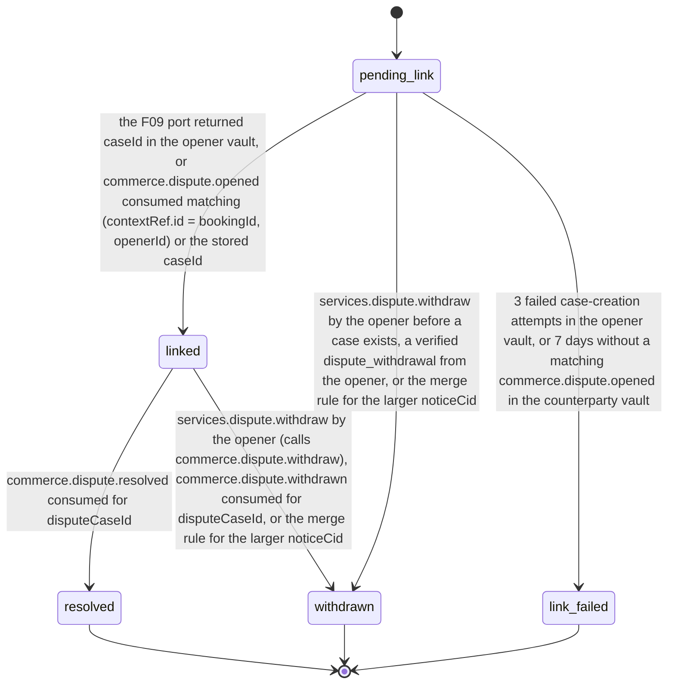

# PS-030-03 — Workflow state machine: Service disputes

**Status:** SPECIFIED (Stage 3). **Module:** [F03.S02.M03 Service disputes](SPEC.md) · **Scope:** MVP · **Code:** `packages/services/src/service_booking/disputes` · **Contracts:** [CTR-ID-001](../../../planning/contracts/CTR-ID-001.md), [CTR-EVT-001](../../../planning/contracts/CTR-EVT-001.md), [CTR-ERR-001](../../../planning/contracts/CTR-ERR-001.md), [CTR-CAP-001](../../../planning/contracts/CTR-CAP-001.md), [CTR-IDM-001](../../../planning/contracts/CTR-IDM-001.md), [CTR-COM-001](../../../planning/contracts/CTR-COM-001.md), [CTR-PRV-001](../../../planning/contracts/CTR-PRV-001.md), [CTR-FED-001](../../../planning/contracts/CTR-FED-001.md)

> Generated from `module.spec.yaml` by `tools/specgen`. Edit the YAML, then run `pnpm spec:render`.

## Requirements

- **PS-030-03.R01** Links move pending_link, linked, resolved; withdrawn and link_failed are terminal exits, link_failed happens only before a case is linked and never blocks a new open.
- **PS-030-03.R02** Resolution is reported only by F09 resolution and withdrawal events and mapped to service effects by the table in the note below; this module never decides an outcome and no effect changes an obligation.
- **PS-030-03.R03** Opening emits services.dispute.opened exactly once per link, when the link becomes linked to a verified case, so downstream freezes are idempotent; every terminal transition emits services.dispute.closed exactly once.
- **PS-030-03.R04** When commerce.dispute.resolved carries the advisory F09 disposition {kind continue|settled|cancelled|waived, favouredDid?, agreedAmount?}, the service effect follows the disposition kind per the mapping note; only when it is absent, or ignored because favouredDid is not a party of the booking, does the outcome-type mapping apply, and neither path changes an obligation.

## Specification

### ServiceDisputeLink lifecycle

Initial **pending_link**; terminal **resolved**, **withdrawn**, **link_failed**.

| Transition | Trigger | Guard / effect |
|---|---|---|
| pending_link -> linked | the F09 port returned caseId in the opener vault, or commerce.dispute.opened consumed matching (contextRef.id = bookingId, openerId) or the stored caseId | disputeCaseId and preDisputeState stored; emits services.dispute.opened |
| pending_link -> withdrawn | services.dispute.withdraw by the opener before a case exists, a verified dispute_withdrawal from the opener, or the merge rule for the larger noticeCid | withdrawal statement sent when this vault is the opener; emits services.dispute.closed with reason withdrawn or merged |
| pending_link -> link_failed | 3 failed case-creation attempts in the opener vault, or 7 days without a matching commerce.dispute.opened in the counterparty vault | nothing was frozen; emits services.dispute.closed with reason link_failed |
| linked -> resolved | commerce.dispute.resolved consumed for disputeCaseId | resolution, outcomeType and disposition stored, effect per the mapping (disposition kind when present, else outcome type); emits services.dispute.closed with reason resolved |
| linked -> withdrawn | services.dispute.withdraw by the opener (calls commerce.dispute.withdraw), commerce.dispute.withdrawn consumed for disputeCaseId, or the merge rule for the larger noticeCid | emits services.dispute.closed with reason withdrawn, case_withdrawn or merged |

**Note:** Resolution mapping, owned here and applied by F03.S02.M01 and F03.S02.M02 on the same F09 events matched by caseId. Disposition first - when commerce.dispute.resolved carries a disposition whose favouredDid, if any, is the client or provider of the booking, its kind decides the effect: continue - lift the freeze and restore the pre-dispute status (effect restore); settled with agreedAmount - lift the freeze and restore, show favouredDid and agreedAmount and prompt the party that is not favoured to open a new Deal for agreedAmount payable to favouredDid (F09.S01.M01; new_refund_deal when the client is favoured, new_settlement_deal when the provider is favoured), the existing milestone Deals are never changed (effect restore_then_renegotiate); settled without agreedAmount - as continue; cancelled - lift the freeze and restore, then prompt both parties to sign a mutual booking cancellation (consent.services.booking.cancel.v1) or, for an approved milestone in scope, a mutual Deal cancellation (effect restore_then_renegotiate); waived - lift the freeze and restore, label the claim in scope (the cancellation lateFeeClaim or the disputed milestone payment) as waived in favour of favouredDid without rewriting the stored amount, and for an approved milestone in scope prompt both parties to sign a mutual Deal cancellation (effect restore_then_renegotiate when such a milestone exists, else restore). Outcome-type mapping, used only when no disposition is present or it was ignored: no_fault_close (party-accepted or mediator-only), enforcement_referral and lapsed - lift the freeze and restore the stored pre-dispute status (booking confirmed or in_progress, milestone submitted or approved). refund_claimed - lift the freeze and restore, then prompt the provider to open a new Deal for the advisory refund if they agree (F09.S01.M01); the existing milestone Deal is never changed. return_agreed - lift the freeze and restore, then prompt both parties to sign a mutual booking cancellation (consent.services.booking.cancel.v1) or, for approved milestones, a mutual Deal cancellation. commerce.dispute.withdrawn, services.dispute.withdraw and a merge - lift the freeze and restore. Every effect is non-executable; obligations change only through mutually signed services or commerce statements, and no outcome cancels a payment obligation.

### Timeouts and scheduled transitions

- Case creation in the opener vault is retried at 10 s, 60 s and 10 minutes with the link id as idempotency reference; after the third failure the link becomes link_failed.
- A counterparty pending_link without a matching commerce.dispute.opened for 7 days becomes link_failed; a commerce.dispute.opened for a booking context without a notice is kept unmatched for 7 days and then left to F09 alone.
- A linked dispute with no resolution for 60 days shows a reminder to both parties; F09 lapses inactive cases after 30 days, which this module receives as resolution lapsed.

## Verification

| Test | Level | Covers | Scenario | Expected |
|---|---|---|---|---|
| TEST-PS-030-09.T03 | property | PS-030-03.R01 | random event orders for case opened, resolved, withdrawn, retry and timeout | only declared transitions succeed; terminal states never change |
| TEST-PS-030-09.T04 | integration | PS-030-03.R02, PS-030-04.R03 | each F09 outcome - no_fault_close accepted by both and mediator-only, refund_claimed, return_agreed, enforcement_referral, lapsed - and commerce.dispute.withdrawn, each delivered twice | link resolved or withdrawn once; resolution stored; services.dispute.closed carries the mapped effect; booking and milestone back in their pre-dispute status; no obligation changed |
| TEST-PS-030-09.T05 | integration | PS-030-03.R03, PS-030-04.R02 | services.dispute.opened, then the matching commerce.dispute.resolved, consumed by the quotes and milestones modules while services.dispute.closed is emitted here | booking disputed and milestones frozen exactly once, then unfrozen exactly once; exactly one opened and one closed event per link |
| TEST-PS-030-09.T18 | integration | PS-030-03.R01, PS-030-03.R03 | two vaults - open then withdraw while pending_link, and open then withdraw while linked | both vaults unfrozen; the linked withdrawal called commerce.dispute.withdraw; one services.dispute.closed per vault |
| TEST-PS-030-09.T19 | integration | PS-030-02.R02, PS-030-03.R03 | counterparty receives a valid notice but no case statement for 7 days | link_failed, nothing frozen, services.dispute.closed with reason link_failed |
| TEST-PS-030-09.T23 | integration | PS-030-03.R04, PS-030-04.R03 | commerce.dispute.resolved carrying dispositions continue, settled with agreedAmount EUR 45.00 favouring the client, settled favouring the provider, cancelled, waived on a cancellation_fee dispute, refund_claimed with disposition continue, a disposition whose favouredDid is not a booking party, and refund_claimed without disposition | disposition stored and the effect follows its kind (restore; new_refund_deal; new_settlement_deal; mutual_cancellation; lateFeeClaim labelled waived with the amount unchanged), refund_claimed with continue restores without a refund prompt, the foreign favouredDid falls back to the outcome-type mapping with a warning, the last uses the outcome-type mapping; services.dispute.closed carries the disposition; no obligation or Deal changed |

## Dependencies

Module depends on: F03.S02.M01, F03.S02.M02, F09.S02.M02, F09.S01.M01, F08.S01.M01, F08.S01.M03, F07.S01.M01, F07.S02.M02, F11.S01.M03, F10.S01.M02, F10.S01.M03, F10.S01.M04, F10.S02.M02, CTR-ID-001, CTR-EVT-001, CTR-ERR-001, CTR-CAP-001, CTR-IDM-001, CTR-COM-001, CTR-PRV-001, CTR-FED-001. Predecessor: [domain_schema.md](domain_schema.md).
