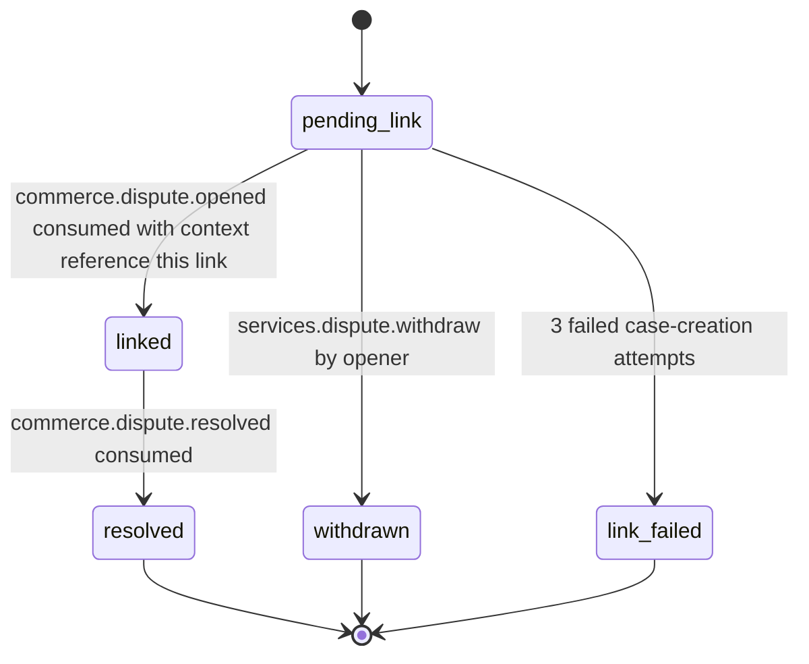

# PS-030-03 — Workflow state machine: Service disputes

**Status:** SPECIFIED (Stage 3). **Module:** [F03.S02.M03 Service disputes](SPEC.md) · **Scope:** MVP · **Code:** `packages/services/src/service_booking/disputes` · **Contracts:** [CTR-ID-001](../../../planning/contracts/CTR-ID-001.md), [CTR-EVT-001](../../../planning/contracts/CTR-EVT-001.md), [CTR-ERR-001](../../../planning/contracts/CTR-ERR-001.md), [CTR-CAP-001](../../../planning/contracts/CTR-CAP-001.md), [CTR-IDM-001](../../../planning/contracts/CTR-IDM-001.md), [CTR-COM-001](../../../planning/contracts/CTR-COM-001.md), [CTR-PRV-001](../../../planning/contracts/CTR-PRV-001.md), [CTR-FED-001](../../../planning/contracts/CTR-FED-001.md)

> Generated from `module.spec.yaml` by `tools/specgen`. Edit the YAML, then run `pnpm spec:render`.

## Requirements

- **PS-030-03.R01** Links move pending_link, linked, resolved; withdrawn and link_failed are terminal exits before the case exists.
- **PS-030-03.R02** Resolution is reported only by F09 resolution events; this module never decides an outcome.
- **PS-030-03.R03** Opening emits services.dispute.opened exactly once per link so downstream freezes are idempotent.

## Specification

### ServiceDisputeLink lifecycle

Initial **pending_link**; terminal **resolved**, **withdrawn**, **link_failed**.

| Transition | Trigger | Guard / effect |
|---|---|---|
| pending_link -> linked | commerce.dispute.opened consumed with context reference this link | case id stored; freeze already in effect |
| pending_link -> withdrawn | services.dispute.withdraw by opener | case not yet created; sends withdrawal inside the notice thread |
| pending_link -> link_failed | 3 failed case-creation attempts | opener told to retry by opening again |
| linked -> resolved | commerce.dispute.resolved consumed | outcome stored; emits no further freeze |

### Timeouts and scheduled transitions

- Case creation is retried at 10 s, 60 s and 10 minutes; after the third failure the link becomes link_failed. A linked dispute with no resolution for 60 days shows a reminder to both parties; it is never closed automatically.

## Verification

| Test | Level | Covers | Scenario | Expected |
|---|---|---|---|---|
| TEST-PS-030-09.T03 | property | PS-030-03.R01 | random event orders for case opened, resolved, withdraw and retry | only declared transitions succeed; terminal states never change |
| TEST-PS-030-09.T04 | integration | PS-030-03.R02, PS-030-04.R03 | commerce.dispute.opened then commerce.dispute.resolved consumed twice | link linked then resolved once; outcome stored; duplicates skipped |
| TEST-PS-030-09.T05 | integration | PS-030-03.R03, PS-030-04.R02 | services.dispute.opened consumed by quotes and milestones modules | booking disputed and milestones frozen exactly once |

## Dependencies

Module depends on: F03.S02.M01, F03.S02.M02, F09.S02.M02, F09.S01.M01, F08.S01.M03, F07.S01.M01, F11.S01.M03, CTR-ID-001, CTR-EVT-001, CTR-ERR-001, CTR-CAP-001, CTR-IDM-001, CTR-COM-001, CTR-PRV-001, CTR-FED-001. Predecessor: [domain_schema.md](domain_schema.md).
