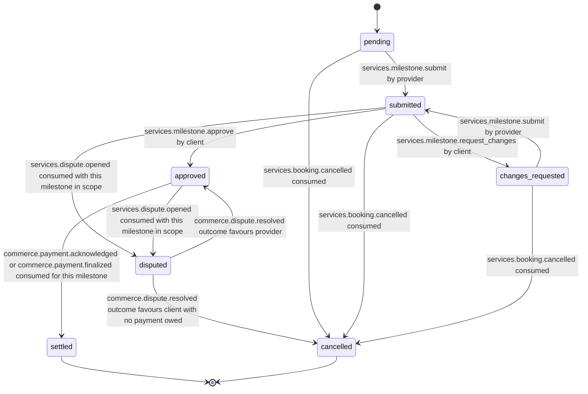

# PS-031-03 — Workflow state machine: Service milestones

**Status:** SPECIFIED (Stage 3). **Module:** [F03.S02.M02 Service milestones](SPEC.md) · **Scope:** MVP · **Code:** `packages/services/src/service_booking/milestones` · **Contracts:** [CTR-ID-001](../../../planning/contracts/CTR-ID-001.md), [CTR-EVT-001](../../../planning/contracts/CTR-EVT-001.md), [CTR-ERR-001](../../../planning/contracts/CTR-ERR-001.md), [CTR-CAP-001](../../../planning/contracts/CTR-CAP-001.md), [CTR-IDM-001](../../../planning/contracts/CTR-IDM-001.md), [CTR-MNY-001](../../../planning/contracts/CTR-MNY-001.md), [CTR-COM-001](../../../planning/contracts/CTR-COM-001.md), [CTR-PRV-001](../../../planning/contracts/CTR-PRV-001.md), [CTR-FED-001](../../../planning/contracts/CTR-FED-001.md)

> Generated from `module.spec.yaml` by `tools/specgen`. Edit the YAML, then run `pnpm spec:render`.

## Requirements

- **PS-031-03.R01** Milestones follow pending, submitted, approved, settled with a change loop; cancelled and settled are terminal.
- **PS-031-03.R02** Approval requires the exact current submission cid; payment never changes approval and approval never implies payment.
- **PS-031-03.R03** Settlement requires payee acknowledgement or chain finality; a claim alone never completes a milestone or the booking.

## Specification

### Milestone lifecycle

Initial **pending**; terminal **settled**, **cancelled**.

| Transition | Trigger | Guard / effect |
|---|---|---|
| pending -> submitted | services.milestone.submit by provider | statement verified; emits services.milestone.submitted |
| changes_requested -> submitted | services.milestone.submit by provider | new submission supersedes previous; emits services.milestone.submitted |
| submitted -> changes_requested | services.milestone.request_changes by client | changeRounds below 3; emits services.milestone.changes_requested |
| submitted -> approved | services.milestone.approve by client | approval names the latest submission cid; registers payment context with Deal; emits services.milestone.approved |
| approved -> settled | commerce.payment.acknowledged or commerce.payment.finalized consumed for this milestone | proof acknowledged or final; emits services.milestone.settled |
| submitted -> disputed | services.dispute.opened consumed with this milestone in scope | freezes approval |
| approved -> disputed | services.dispute.opened consumed with this milestone in scope | payment proof kept |
| disputed -> approved | commerce.dispute.resolved outcome favours provider | payment obligation restored |
| disputed -> cancelled | commerce.dispute.resolved outcome favours client with no payment owed | no payment obligation |
| pending -> cancelled | services.booking.cancelled consumed | no obligation |
| submitted -> cancelled | services.booking.cancelled consumed | no obligation unless already approved |
| changes_requested -> cancelled | services.booking.cancelled consumed | no obligation |

### Timeouts and scheduled transitions

- A submitted milestone with no client action for 14 days raises a dispute prompt to the provider; nothing is auto-approved. A claim without progress for 14 days becomes expired through F09 (COM-3) and is shown as such.

## Verification

| Test | Level | Covers | Scenario | Expected |
|---|---|---|---|---|
| TEST-PS-031-09.T03 | property | PS-031-03.R01 | random statement and event sequences on one milestone | only declared transitions succeed; settled and cancelled never change |
| TEST-PS-031-09.T04 | integration | PS-031-03.R02 | approval naming an older submission cid, then the latest | first SERVICES_SUBMISSION_STALE; second approved |
| TEST-PS-031-09.T05 | integration | PS-031-03.R03, PS-031-04.R03 | payment claimed, confirming, expired, acknowledged, finalized events in turn | proof labels follow COM-4; settled only at acknowledged or final; booking completes only after all non-cancelled milestones settled |

## Dependencies

Module depends on: F03.S02.M01, F09.S01.M01, F08.S01.M03, F07.S01.M01, F11.S01.M03, CTR-ID-001, CTR-EVT-001, CTR-ERR-001, CTR-CAP-001, CTR-IDM-001, CTR-MNY-001, CTR-COM-001, CTR-PRV-001, CTR-FED-001. Predecessor: [domain_schema.md](domain_schema.md).
