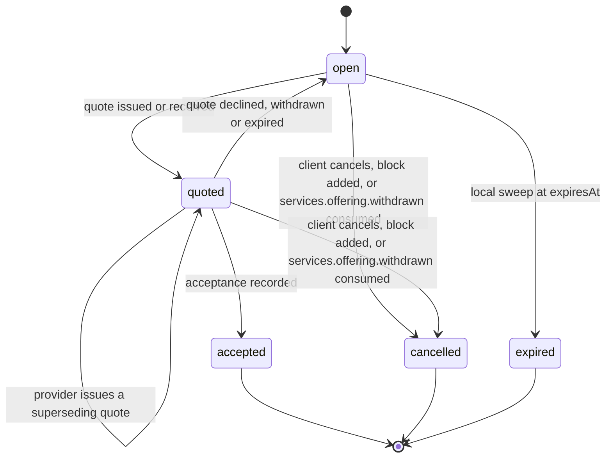
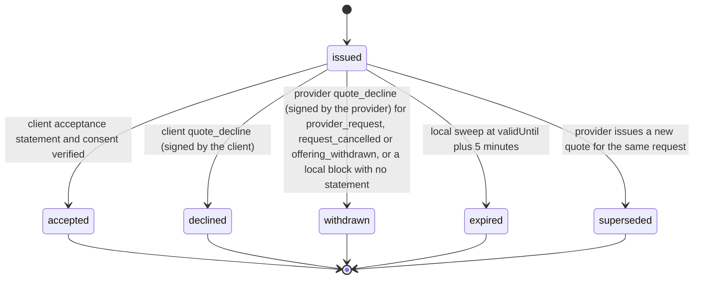
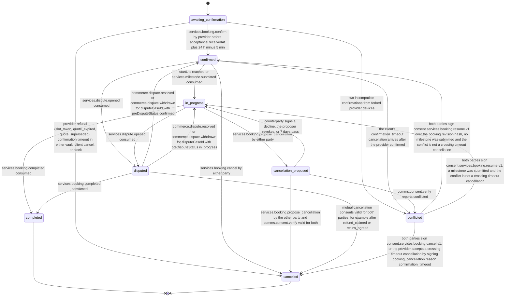

# PS-032-03 — Workflow state machine: Service quotes and booking

**Status:** SPECIFIED (Stage 3). **Module:** [F03.S02.M01 Service quotes and booking](SPEC.md) · **Scope:** MVP · **Code:** `packages/services/src/service_booking/quotes` · **Contracts:** [CTR-ID-001](../../../planning/contracts/CTR-ID-001.md), [CTR-EVT-001](../../../planning/contracts/CTR-EVT-001.md), [CTR-ERR-001](../../../planning/contracts/CTR-ERR-001.md), [CTR-CAP-001](../../../planning/contracts/CTR-CAP-001.md), [CTR-IDM-001](../../../planning/contracts/CTR-IDM-001.md), [CTR-MNY-001](../../../planning/contracts/CTR-MNY-001.md), [CTR-COM-001](../../../planning/contracts/CTR-COM-001.md), [CTR-PRV-001](../../../planning/contracts/CTR-PRV-001.md), [CTR-FED-001](../../../planning/contracts/CTR-FED-001.md)

> Generated from `module.spec.yaml` by `tools/specgen`. Edit the YAML, then run `pnpm spec:render`.

## Requirements

- **PS-032-03.R01** Requests, quotes and bookings follow the declared lifecycles; a statement that implies another transition is refused and quarantined with CONFLICT_STATE.
- **PS-032-03.R02** A booking is confirmed only by the provider's signed confirmation; acceptance alone yields awaiting_confirmation.
- **PS-032-03.R03** Confirmation commits (or re-holds and commits) the slot and stores the signed confirmation in one vault transaction; failure of either step leaves the booking awaiting_confirmation, and no Deal is opened here.
- **PS-032-03.R04** Both vaults run the 24 h confirmation timeout and the vault whose timer fires signs and sends a confirmation_timeout cancellation; a confirmation that crosses such a cancellation moves the booking to conflicted (frozen for explicit renegotiation, ADR-0016 section 5) instead of being quarantined.
- **PS-032-03.R05** Disputes overlay the booking - services.dispute.opened freezes a confirmed or in_progress booking as disputed with its pre-dispute status stored, and only sets openDisputeLinkId on bookings in other states; the matching commerce.dispute.resolved or commerce.dispute.withdrawn restores the pre-dispute status per the F03.S02.M03 resolution mapping, and obligations change only through mutually signed statements.
- **PS-032-03.R06** In-progress and disputed bookings are cancelled only by mutual consent through F08.S02.M02 (consent.services.booking.cancel.v1 over the booking revision hash), and a conflicted consent freezes the booking.

## Specification

### QuoteRequest lifecycle

Initial **open**; terminal **accepted**, **cancelled**, **expired**.

| Transition | Trigger | Guard / effect |
|---|---|---|
| open -> quoted | quote issued or received | verified quote for this request; emits services.quote.issued |
| quoted -> quoted | provider issues a superseding quote | previous quote superseded and its hold released (services.slot.release) in the same transaction; emits services.quote.issued and services.quote.declined with reason superseded |
| quoted -> open | quote declined, withdrawn or expired | request may receive a new quote; emits services.quote.declined or services.quote.expired |
| quoted -> accepted | acceptance recorded | exact quote cid matched and consent valid; emits services.quote.accepted |
| open -> cancelled | client cancels, block added, or services.offering.withdrawn consumed | cancelReason stored; emits services.quote.declined with reason request_cancelled, blocked or offering_withdrawn |
| quoted -> cancelled | client cancels, block added, or services.offering.withdrawn consumed | issued quote withdrawn and its hold released in the same transaction; emits services.quote.declined with the same reason |
| open -> expired | local sweep at expiresAt | no quote within 14 days |

### ServiceQuote lifecycle

Initial **issued**; terminal **accepted**, **declined**, **withdrawn**, **expired**, **superseded**.

| Transition | Trigger | Guard / effect |
|---|---|---|
| issued -> accepted | client acceptance statement and consent verified | quote cid equals signed cid and not expired; hold extended to receipt plus 24 h (services.slot.extend) or re-held when expired and free |
| issued -> declined | client quote_decline (signed by the client) | hold released; emits services.quote.declined |
| issued -> withdrawn | provider quote_decline (signed by the provider) for provider_request, request_cancelled or offering_withdrawn, or a local block with no statement | hold released; emits services.quote.declined |
| issued -> expired | local sweep at validUntil plus 5 minutes | hold released; emits services.quote.expired |
| issued -> superseded | provider issues a new quote for the same request | old hold released in the same transaction; emits services.quote.declined with reason superseded |

### Booking lifecycle

Initial **awaiting_confirmation**; terminal **completed**, **cancelled**.

| Transition | Trigger | Guard / effect |
|---|---|---|
| awaiting_confirmation -> confirmed | services.booking.confirm by provider before acceptanceReceivedAt plus 24 h minus 5 min | slot committed (or re-held and committed), plan equals the accepted quote; emits services.booking.confirmed |
| awaiting_confirmation -> cancelled | provider refusal (slot_taken, quote_expired, quote_superseded), confirmation timeout in either vault, client cancel, or block | the vault whose timer fires signs booking_cancellation reason confirmation_timeout; a block cancels locally only; emits services.booking.cancelled |
| awaiting_confirmation -> conflicted | two incompatible confirmations from forked provider devices | frozen; both statements surfaced |
| confirmed -> in_progress | startUtc reached or services.milestone.submitted consumed | local sweep or event |
| confirmed -> cancelled | services.booking.cancel by either party | applies cancellation policy; fee number carried in the statement; emits services.booking.cancelled |
| confirmed -> conflicted | the client's confirmation_timeout cancellation arrives after the provider confirmed | slot stays committed; fee claims frozen; both statements surfaced |
| in_progress -> cancellation_proposed | services.booking.propose_cancellation by either party | proposer signs consent.services.booking.cancel.v1 over the booking revision hash |
| cancellation_proposed -> cancelled | services.booking.propose_cancellation by the other party and comms.consent.verify valid for both | unapproved milestones cancelled, approved ones keep their Deal; emits services.booking.cancelled with reason mutual |
| cancellation_proposed -> in_progress | counterparty signs a decline, the proposer revokes, or 7 days pass | consent revoked; work continues |
| cancellation_proposed -> conflicted | comms.consent.verify reports conflicted | frozen for explicit renegotiation |
| in_progress -> completed | services.booking.completed consumed | bilateral completion statements held by F03.S02.M02 |
| confirmed -> disputed | services.dispute.opened consumed | preDisputeStatus confirmed and disputeCaseId stored; cancellation and fee claims frozen |
| in_progress -> disputed | services.dispute.opened consumed | preDisputeStatus in_progress and disputeCaseId stored; approvals and fee claims frozen |
| disputed -> confirmed | commerce.dispute.resolved or commerce.dispute.withdrawn for disputeCaseId with preDisputeStatus confirmed | freeze lifted per the F03.S02.M03 mapping; no obligation changes |
| disputed -> in_progress | commerce.dispute.resolved or commerce.dispute.withdrawn for disputeCaseId with preDisputeStatus in_progress | freeze lifted per the F03.S02.M03 mapping; no obligation changes |
| disputed -> completed | services.booking.completed consumed | F03.S02.M02 stays the only producer; openDisputeLinkId stays until the case closes |
| disputed -> cancelled | mutual cancellation consents valid for both parties, for example after refund_claimed or return_agreed | emits services.booking.cancelled with reason mutual; openDisputeLinkId stays until the case closes |
| conflicted -> cancelled | both parties sign consent.services.booking.cancel.v1, or the provider accepts a crossing timeout cancellation by signing booking_cancellation reason confirmation_timeout | slot released; emits services.booking.cancelled |
| conflicted -> confirmed | both parties sign consent.services.booking.resume.v1 over the booking revision hash, no milestone was submitted and the conflict is not a crossing timeout cancellation | freeze lifted |
| conflicted -> in_progress | both parties sign consent.services.booking.resume.v1, a milestone was submitted and the conflict is not a crossing timeout cancellation | freeze lifted |

### Timeouts and scheduled transitions

- Request expiry 14 days; quote expiry at validUntil plus 5 minutes; confirmation deadline in the provider vault at acceptanceReceivedAt plus 24 h minus 5 min, after which confirm is refused; confirmation timeout 24 h after the acceptance was signed in the client vault and at acceptanceReceivedAt plus 24 h in the provider vault, each signing and sending booking_cancellation reason confirmation_timeout; a cancellation proposal lapses after 7 days. All are evaluated on the local clock by a sweep at app start, on every command and every 60 s while the PWA is open, and by every read before the sweep has run.
- A provider confirmation that reaches a client vault whose booking was already cancelled with reason confirmation_timeout is stored as evidence and sets conflict on the cancelled booking so both statements stay visible; the provider's signed acceptance of the cancellation clears the banner.

## Verification

| Test | Level | Covers | Scenario | Expected |
|---|---|---|---|---|
| TEST-PS-032-09.T03 | property | PS-032-03.R01 | random statement sequences per entity | only declared transitions succeed; terminal states never change |
| TEST-PS-032-09.T04 | integration | PS-032-03.R02, PS-032-03.R03, PS-032-06.R03 | confirm with slot commit failing and with the hold flagged needsReconfirmation | booking stays awaiting_confirmation, no signature, no committed slot; no Deal is created at any point |
| TEST-PS-032-09.T09 | integration | PS-032-03.R01 | acceptance arrives 6 minutes after validUntil by provider clock | refused EXPIRED; quote shown expired; no booking confirmed |
| TEST-PS-032-09.T15 | e2e | PS-032-01.R01, PS-032-03.R02 | mobile client requests, provider quotes and confirms in a second browser context | both show confirmed; axe zero serious issues |
| TEST-PS-032-09.T19 | integration | PS-032-03.R04 | two vaults; provider confirmation delayed by 8 h past the client timeout, and a second run with skewed clocks | client signs a confirmation_timeout cancellation at 24 h; provider refuses confirm after receipt plus 24 h minus 5 min; a crossing confirmation moves the provider booking to conflicted with the slot committed and the client booking shows both statements; nothing quarantined |
| TEST-PS-032-09.T20 | integration | PS-032-03.R05 | dispute opened on confirmed and on in_progress bookings, then each F09 resolution (no_fault_close, refund_claimed, return_agreed, enforcement_referral, lapsed) and a withdrawal | booking returns to its pre-dispute status; no obligation or fee changes; completed and cancelled bookings get only the overlay |
| TEST-PS-032-09.T21 | integration | PS-032-03.R06 | propose mutual cancellation of an in_progress booking, counter-sign it, and a run where verify reports conflicted | cancelled only when verify is valid for both; conflicted consent moves the booking to conflicted |
| TEST-PS-032-09.T22 | integration | PS-032-03.R03 | quote valid 72 h accepted at hour 71 and confirmed at hour 80 | hold extended on acceptance receipt; booking confirmed with the slot committed |

## Dependencies

Module depends on: F03.S01.M01, F03.S01.M02, F08.S01.M01, F08.S01.M03, F08.S02.M02, F07.S01.M01, F07.S02.M02, F11.S01.M03, F09.S03.M01, F09.S03.M03, F10.S01.M02, F10.S01.M03, F10.S01.M04, F10.S02.M02, CTR-ID-001, CTR-EVT-001, CTR-ERR-001, CTR-CAP-001, CTR-IDM-001, CTR-MNY-001, CTR-COM-001, CTR-PRV-001, CTR-FED-001. Predecessor: [domain_schema.md](domain_schema.md).
