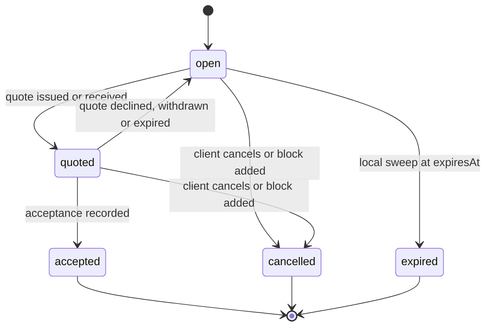
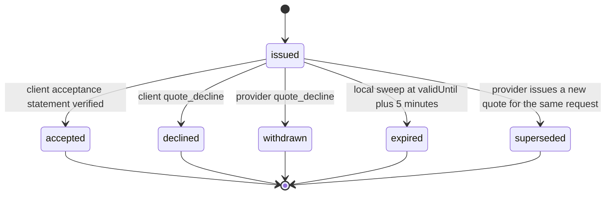
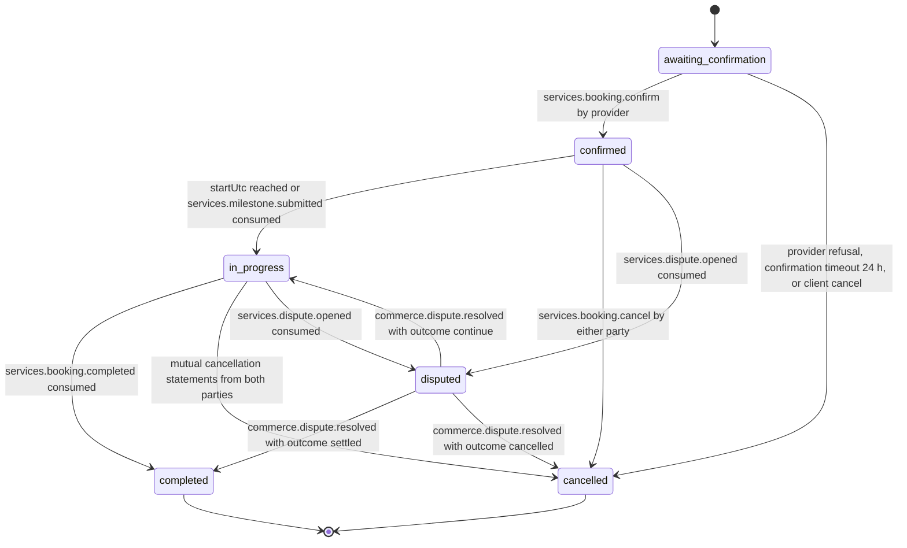

# PS-032-03 — Workflow state machine: Service quotes and booking

**Status:** SPECIFIED (Stage 3). **Module:** [F03.S02.M01 Service quotes and booking](SPEC.md) · **Scope:** MVP · **Code:** `packages/services/src/service_booking/quotes` · **Contracts:** [CTR-ID-001](../../../planning/contracts/CTR-ID-001.md), [CTR-EVT-001](../../../planning/contracts/CTR-EVT-001.md), [CTR-ERR-001](../../../planning/contracts/CTR-ERR-001.md), [CTR-CAP-001](../../../planning/contracts/CTR-CAP-001.md), [CTR-IDM-001](../../../planning/contracts/CTR-IDM-001.md), [CTR-MNY-001](../../../planning/contracts/CTR-MNY-001.md), [CTR-COM-001](../../../planning/contracts/CTR-COM-001.md), [CTR-PRV-001](../../../planning/contracts/CTR-PRV-001.md), [CTR-FED-001](../../../planning/contracts/CTR-FED-001.md)

> Generated from `module.spec.yaml` by `tools/specgen`. Edit the YAML, then run `pnpm spec:render`.

## Requirements

- **PS-032-03.R01** Requests, quotes and bookings follow the declared lifecycles; a statement that implies another transition is refused and quarantined with CONFLICT_STATE.
- **PS-032-03.R02** A booking is confirmed only by the provider's signed confirmation; acceptance alone yields awaiting_confirmation.
- **PS-032-03.R03** Confirmation commits the slot, stores the confirmation and opens the local Deal in one vault transaction; failure of any step leaves the booking awaiting_confirmation.

## Specification

### QuoteRequest lifecycle

Initial **open**; terminal **accepted**, **cancelled**, **expired**.

| Transition | Trigger | Guard / effect |
|---|---|---|
| open -> quoted | quote issued or received | verified quote for this request; emits services.quote.issued |
| quoted -> open | quote declined, withdrawn or expired | request may receive a new quote; emits services.quote.declined or services.quote.expired |
| quoted -> accepted | acceptance recorded | exact quote cid matched; emits services.quote.accepted |
| open -> cancelled | client cancels or block added | emits services.quote.declined with reason request_cancelled |
| quoted -> cancelled | client cancels or block added | open quote is withdrawn |
| open -> expired | local sweep at expiresAt | no quote within 14 days |

### ServiceQuote lifecycle

Initial **issued**; terminal **accepted**, **declined**, **withdrawn**, **expired**, **superseded**.

| Transition | Trigger | Guard / effect |
|---|---|---|
| issued -> accepted | client acceptance statement verified | quote cid equals signed cid and not expired |
| issued -> declined | client quote_decline | frees the slot hold |
| issued -> withdrawn | provider quote_decline | frees the slot hold |
| issued -> expired | local sweep at validUntil plus 5 minutes | frees the slot hold; emits services.quote.expired |
| issued -> superseded | provider issues a new quote for the same request | frees the old slot hold |

### Booking lifecycle

Initial **awaiting_confirmation**; terminal **completed**, **cancelled**.

| Transition | Trigger | Guard / effect |
|---|---|---|
| awaiting_confirmation -> confirmed | services.booking.confirm by provider | slot committed, Deal opened; emits services.booking.confirmed |
| awaiting_confirmation -> cancelled | provider refusal, confirmation timeout 24 h, or client cancel | emits services.booking.cancelled |
| confirmed -> in_progress | startUtc reached or services.milestone.submitted consumed | local sweep or event |
| confirmed -> cancelled | services.booking.cancel by either party | applies cancellation policy; emits services.booking.cancelled |
| in_progress -> completed | services.booking.completed consumed | all milestones settled |
| in_progress -> cancelled | mutual cancellation statements from both parties | unpaid milestones cancelled; emits services.booking.cancelled |
| in_progress -> disputed | services.dispute.opened consumed | freezes further approvals |
| confirmed -> disputed | services.dispute.opened consumed | freezes cancellation fee claims |
| disputed -> in_progress | commerce.dispute.resolved with outcome continue | resumes |
| disputed -> completed | commerce.dispute.resolved with outcome settled | emits services.booking.completed |
| disputed -> cancelled | commerce.dispute.resolved with outcome cancelled | emits services.booking.cancelled |

### Timeouts and scheduled transitions

- Request expiry 14 days, quote expiry at validUntil plus 5 minutes, confirmation timeout 24 h after acceptance; all evaluated on the local clock by a sweep at app start, on every command and every 60 s while the PWA is open, and by every read before the sweep has run.

## Verification

| Test | Level | Covers | Scenario | Expected |
|---|---|---|---|---|
| TEST-PS-032-09.T03 | property | PS-032-03.R01 | random statement sequences per entity | only declared transitions succeed; terminal states never change |
| TEST-PS-032-09.T04 | integration | PS-032-03.R02, PS-032-03.R03, PS-032-06.R03 | confirm with slot commit failing, then with Deal creation failing | booking stays awaiting_confirmation, no signature, no committed slot, no Deal |
| TEST-PS-032-09.T09 | integration | PS-032-01.R02, PS-032-03.R01, PS-032-07.R03 | acceptance arrives 6 minutes after validUntil by provider clock | refused EXPIRED; quote shown expired; no booking confirmed |
| TEST-PS-032-09.T15 | e2e | PS-032-01.R01, PS-032-03.R02 | mobile client requests, provider quotes and confirms in a second browser context | both show confirmed; axe zero serious issues |

## Dependencies

Module depends on: F03.S01.M01, F03.S01.M02, F09.S01.M01, F08.S01.M01, F07.S01.M01, F07.S02.M02, F11.S01.M03, F09.S03.M01, CTR-ID-001, CTR-EVT-001, CTR-ERR-001, CTR-CAP-001, CTR-IDM-001, CTR-MNY-001, CTR-COM-001, CTR-PRV-001, CTR-FED-001. Predecessor: [domain_schema.md](domain_schema.md).
