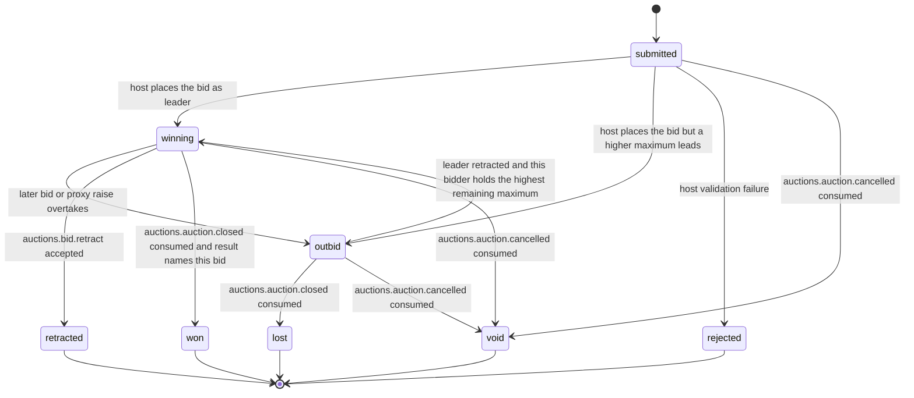

# PS-033-03 — Workflow state machine: Bidding

**Status:** SPECIFIED (Stage 3). **Module:** [F04.S01.M02 Bidding](SPEC.md) · **Scope:** MVP · **Code:** `packages/auctions/src/auction_lifecycle/bids` · **Contracts:** [CTR-ID-001](../../../planning/contracts/CTR-ID-001.md), [CTR-EVT-001](../../../planning/contracts/CTR-EVT-001.md), [CTR-ERR-001](../../../planning/contracts/CTR-ERR-001.md), [CTR-CAP-001](../../../planning/contracts/CTR-CAP-001.md), [CTR-IDM-001](../../../planning/contracts/CTR-IDM-001.md), [CTR-MNY-001](../../../planning/contracts/CTR-MNY-001.md), [CTR-PRV-001](../../../planning/contracts/CTR-PRV-001.md), [CTR-FED-001](../../../planning/contracts/CTR-FED-001.md)

> Generated from `module.spec.yaml` by `tools/specgen`. Edit the YAML, then run `pnpm spec:render`.

## Requirements

- **PS-033-03.R01** Bids follow submitted, then winning or outbid or rejected, with retraction only from winning and final states won, lost, retracted, rejected and void.
- **PS-033-03.R02** Leader changes are decided only inside the per-auction lease by the deterministic proxy algorithm, so replaying the ledger always reproduces the same prices.
- **PS-033-03.R03** A retraction of the leader promotes the highest remaining maximum to leader at a recomputed price, using the same algorithm.

## Specification

### Bid lifecycle

Initial **submitted**; terminal **won**, **lost**, **retracted**, **rejected**, **void**.

| Transition | Trigger | Guard / effect |
|---|---|---|
| submitted -> winning | host places the bid as leader | proxy algorithm leaves this bidder leading; emits auctions.bid.placed |
| submitted -> outbid | host places the bid but a higher maximum leads | emits auctions.bid.placed and auctions.bid.outbid |
| submitted -> rejected | host validation failure | rejectCode stored; no ledger entry |
| winning -> outbid | later bid or proxy raise overtakes | emits auctions.bid.outbid |
| winning -> retracted | auctions.bid.retract accepted | retraction rules satisfied; emits auctions.bid.retracted |
| outbid -> winning | leader retracted and this bidder holds the highest remaining maximum | recomputed price |
| winning -> won | auctions.auction.closed consumed and result names this bid | host-signed result |
| outbid -> lost | auctions.auction.closed consumed | auction closed without this bid winning |
| submitted -> void | auctions.auction.cancelled consumed | auction cancelled |
| winning -> void | auctions.auction.cancelled consumed | auction cancelled |
| outbid -> void | auctions.auction.cancelled consumed | auction cancelled |

### Timeouts and scheduled transitions

- A bid in submitted state with no host receipt for 60 s shows needs attention and the vault fetches the receipt by bid cid at 5 s, 15 s and 45 s; the host keeps a 24 h idempotency record per clientNonce.

## Verification

| Test | Level | Covers | Scenario | Expected |
|---|---|---|---|---|
| TEST-PS-033-09.T03 | property | PS-033-03.R02 | random bid and retraction sequences compared with the reference proxy model | price, leader and aliases equal the model; replaying the ledger reproduces the same result |
| TEST-PS-033-09.T04 | unit | PS-033-03.R03 | leader with max 100 retracts, second bidder has max 60, third max 40 | second becomes winning at 40 plus increment capped at 60; hashes stay chained |
| TEST-PS-033-09.T05 | property | PS-033-03.R01 | random command sequences on one bid | only declared transitions succeed; terminal states never change |

## Dependencies

Module depends on: F04.S01.M01, F04.S02.M01, F04.S02.M02, F07.S01.M01, F11.S01.M03, F09.S03.M01, CTR-ID-001, CTR-EVT-001, CTR-ERR-001, CTR-CAP-001, CTR-IDM-001, CTR-MNY-001, CTR-PRV-001, CTR-FED-001. Predecessor: [domain_schema.md](domain_schema.md).
