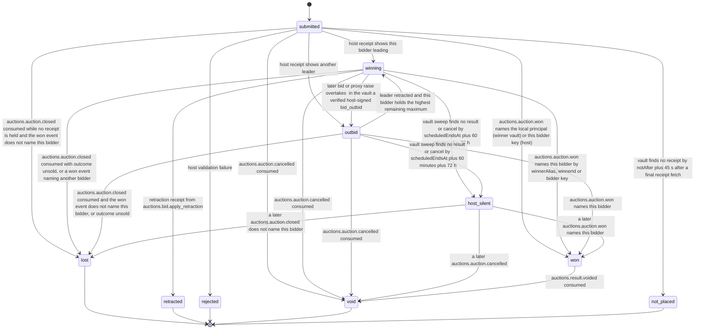

# PS-033-03 — Workflow state machine: Bidding

**Status:** SPECIFIED (Stage 3). **Module:** [F04.S01.M02 Bidding](SPEC.md) · **Scope:** MVP · **Code:** `packages/auctions/src/auction_lifecycle/bids` · **Contracts:** [CTR-ID-001](../../../planning/contracts/CTR-ID-001.md), [CTR-EVT-001](../../../planning/contracts/CTR-EVT-001.md), [CTR-ERR-001](../../../planning/contracts/CTR-ERR-001.md), [CTR-CAP-001](../../../planning/contracts/CTR-CAP-001.md), [CTR-IDM-001](../../../planning/contracts/CTR-IDM-001.md), [CTR-MNY-001](../../../planning/contracts/CTR-MNY-001.md), [CTR-PRV-001](../../../planning/contracts/CTR-PRV-001.md), [CTR-FED-001](../../../planning/contracts/CTR-FED-001.md)

> Generated from `module.spec.yaml` by `tools/specgen`. Edit the YAML, then run `pnpm spec:render`.

## Requirements

- **PS-033-03.R01** Bids follow submitted, then winning, outbid, rejected or not_placed, with retraction only from winning; won comes only from auctions.auction.won naming the bidder and can still become void; lost, retracted, rejected, not_placed and void are final, and host_silent covers a host that never reports.
- **PS-033-03.R02** Leader changes are decided only inside the per-auction lease by the deterministic proxy algorithm, so replaying the ledger always reproduces the same prices.
- **PS-033-03.R03** A retraction of the leader promotes the highest remaining maximum to leader at a recomputed price, using the same algorithm.
- **PS-033-03.R04** At close the outcome decides - an unsold auction makes its leader lost, never won - and a bid without a receipt resolves to not_placed or lost rather than staying submitted.

## Specification

### Bid lifecycle

Initial **submitted**; terminal **lost**, **retracted**, **rejected**, **void**, **not_placed**.

| Transition | Trigger | Guard / effect |
|---|---|---|
| submitted -> winning | host receipt shows this bidder leading | proxy rules leave this bidder leading; emits auctions.bid.placed |
| submitted -> outbid | host receipt shows another leader | emits auctions.bid.placed and auctions.bid.outbid |
| submitted -> rejected | host validation failure | rejectCode stored; no ledger entry |
| submitted -> not_placed | vault finds no receipt by notAfter plus 45 s after a final receipt fetch | the host refuses the bid after notAfter, so it can never be placed later |
| submitted -> won | auctions.auction.won names the local principal (winner vault) or this bidder key (host) | the receipt was lost but the result is held |
| submitted -> lost | auctions.auction.closed consumed while no receipt is held and the won event does not name this bidder | treated as not placed |
| submitted -> void | auctions.auction.cancelled consumed | auction cancelled |
| winning -> outbid | later bid or proxy raise overtakes; in the vault a verified host-signed bid_outbid | emits auctions.bid.outbid |
| winning -> retracted | retraction receipt from auctions.bid.apply_retraction | retraction rules satisfied; emits auctions.bid.retracted |
| winning -> won | auctions.auction.won names this bidder by winnerAlias, winnerId or bidder key | host-signed result |
| winning -> lost | auctions.auction.closed consumed with outcome unsold, or a won event naming another bidder | the leader of a reserve-not-met auction is not a winner |
| winning -> void | auctions.auction.cancelled consumed | auction cancelled |
| winning -> host_silent | vault sweep finds no result or cancel by scheduledEndsAt plus 60 minutes plus 72 h | shows host did not report a result |
| outbid -> winning | leader retracted and this bidder holds the highest remaining maximum | recomputed price from the retraction receipt or ledger head |
| outbid -> won | auctions.auction.won names this bidder | the local view was stale |
| outbid -> lost | auctions.auction.closed consumed and the won event does not name this bidder, or outcome unsold | auction closed without this bid winning |
| outbid -> void | auctions.auction.cancelled consumed | auction cancelled |
| outbid -> host_silent | vault sweep finds no result or cancel by scheduledEndsAt plus 60 minutes plus 72 h | shows host did not report a result |
| host_silent -> won | a later auctions.auction.won names this bidder | the late host result overrides the silence |
| host_silent -> lost | a later auctions.auction.closed does not name this bidder | late result |
| host_silent -> void | a later auctions.auction.cancelled | late host cancel |
| won -> void | auctions.result.voided consumed | the host voided its result; F04.S01.M03 decides in the vault whether the sale record changes |

### Timeouts and scheduled transitions

- A bid in submitted state fetches its receipt by bid cid at 5 s, 15 s and 45 s; with no receipt by notAfter plus 45 s and a final fetch it becomes not_placed; the host keeps a 24 h idempotency record per clientNonce.
- The bidder vault sweep at app start and every 60 s moves winning and outbid bids to host_silent at scheduledEndsAt plus 60 minutes plus 72 h without a verified result or cancel.

## Verification

| Test | Level | Covers | Scenario | Expected |
|---|---|---|---|---|
| TEST-PS-033-09.T03 | property | PS-033-03.R02, PS-033-02.R04 | random bid, max-only and retraction sequences, with and without a reserve, compared with the proxy-v1 reference model (PX1–PX5) | price, leader and aliases equal the model; replaying the ledger reproduces the same result |
| TEST-PS-033-09.T04 | unit | PS-033-03.R03, PS-033-02.R04 | B3 bids 1000 max 4000, B2 bids 1050 max 6000, B1 bids 5100 max 10000, then B1 retracts | B2 leads at 5000 after its bid (PX3 gives 4050, the reserve rule PX4 lifts it to 5000); B1 leads at 6100; after the retraction B2 is winning at 5000 again; retraction and auto entries appended; hashes stay chained |
| TEST-PS-033-09.T05 | property | PS-033-03.R01, PS-033-03.R04 | random command sequences on one bid, including close with outcome unsold, close without a receipt, a won event naming another alias, and a void after won | only declared transitions succeed; the leader of an unsold auction becomes lost; submitted without receipt becomes lost; won becomes void on auctions.result.voided; terminal states never change |
| TEST-PS-033-09.T17 | unit | PS-033-02.R04, PS-033-03.R02 | ties, max-only updates and the reserve rule - B1 and B2 with equal maxima 2000; the leader raises its maximum with amount absent; sole bidder max 8000 with reserve 5000 | tie keeps the earlier leader at 2000; the max-only update is exempt from V04, needs the leader (V11) and appends no entry; the reserve rule appends one auto entry at 5000 |
| TEST-PS-033-09.T25 | integration | PS-033-03.R04 | host silent after the auction end | winning and outbid bids show host_silent after the deadline; a later result moves them to won or lost |

## Dependencies

Module depends on: F04.S01.M01, F04.S02.M01, F04.S02.M02, F07.S01.M01, F07.S02.M02, F11.S01.M01, F11.S01.M03, F09.S03.M01, F10.S01.M01, F10.S01.M02, F10.S01.M03, F10.S01.M04, F10.S02.M02, F12.S03.M03, F12.S03.M04, F13.S02.M01, F15.S02.M01, CTR-ID-001, CTR-EVT-001, CTR-ERR-001, CTR-CAP-001, CTR-IDM-001, CTR-MNY-001, CTR-PRV-001, CTR-FED-001. Predecessor: [domain_schema.md](domain_schema.md).
