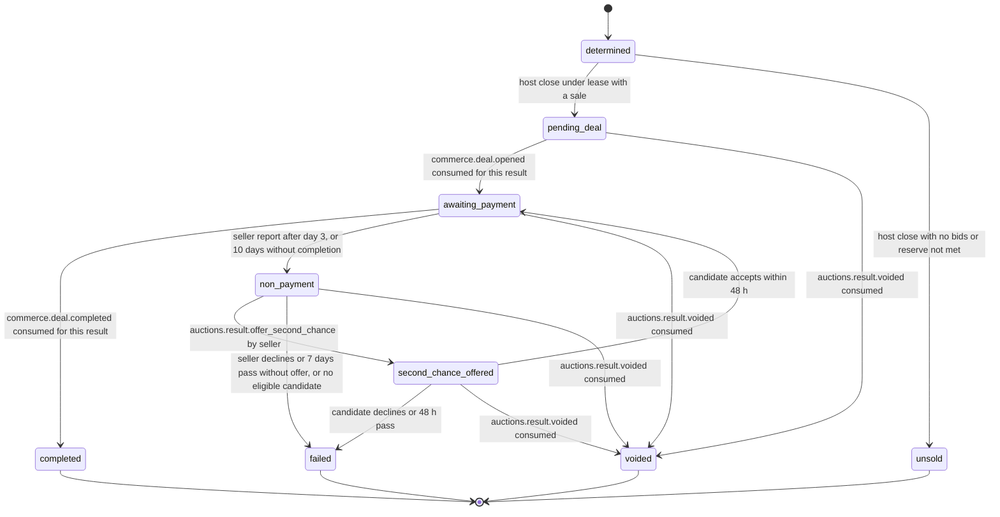

# PS-034-03 — Workflow state machine: Auction close

**Status:** SPECIFIED (Stage 3). **Module:** [F04.S01.M03 Auction close](SPEC.md) · **Scope:** MVP · **Code:** `packages/auctions/src/auction_lifecycle/close` · **Contracts:** [CTR-ID-001](../../../planning/contracts/CTR-ID-001.md), [CTR-EVT-001](../../../planning/contracts/CTR-EVT-001.md), [CTR-ERR-001](../../../planning/contracts/CTR-ERR-001.md), [CTR-CAP-001](../../../planning/contracts/CTR-CAP-001.md), [CTR-IDM-001](../../../planning/contracts/CTR-IDM-001.md), [CTR-MNY-001](../../../planning/contracts/CTR-MNY-001.md), [CTR-COM-001](../../../planning/contracts/CTR-COM-001.md), [CTR-PRV-001](../../../planning/contracts/CTR-PRV-001.md), [CTR-FED-001](../../../planning/contracts/CTR-FED-001.md)

> Generated from `module.spec.yaml` by `tools/specgen`. Edit the YAML, then run `pnpm spec:render`.

## Requirements

- **PS-034-03.R01** A result is determined once, then follows the sale path to completed, or ends unsold, failed or voided; terminal states never change.
- **PS-034-03.R02** completed requires commerce.deal.completed with acknowledged or final payment per CTR-COM-001; a claim alone does not complete.
- **PS-034-03.R03** Non-payment and second chance are explicit and signed; there is no automatic penalty, and the host only records a signal.

## Specification

### AuctionResult lifecycle

Initial **determined**; terminal **unsold**, **completed**, **failed**, **voided**.

| Transition | Trigger | Guard / effect |
|---|---|---|
| determined -> pending_deal | host close under lease with a sale | emits auctions.auction.closed and auctions.auction.won |
| determined -> unsold | host close with no bids or reserve not met | emits auctions.auction.closed and auctions.auction.unsold |
| pending_deal -> awaiting_payment | commerce.deal.opened consumed for this result | dealId stored |
| awaiting_payment -> completed | commerce.deal.completed consumed for this result | payment acknowledged or final |
| awaiting_payment -> non_payment | seller report after day 3, or 10 days without completion | emits auctions.result.non_payment |
| non_payment -> second_chance_offered | auctions.result.offer_second_chance by seller | candidate eligible; emits auctions.result.second_chance_offered |
| non_payment -> failed | seller declines or 7 days pass without offer, or no eligible candidate | sale lapses |
| second_chance_offered -> awaiting_payment | candidate accepts within 48 h | new Deal for the candidate price |
| second_chance_offered -> failed | candidate declines or 48 h pass | sale lapses |
| pending_deal -> voided | auctions.result.voided consumed | Deal not yet opened or closed through F09 port |
| awaiting_payment -> voided | auctions.result.voided consumed | no acknowledged payment exists; Deal closed through F09 port |
| non_payment -> voided | auctions.result.voided consumed | sale cancelled |
| second_chance_offered -> voided | auctions.result.voided consumed | sale cancelled |

### Timeouts and scheduled transitions

- Host close tick every 1 s; Deal window 10 days after close in the seller vault; second-chance expiry 48 h; seller second-chance decision window 7 days after non_payment; result retention in winner mailbox 30 days. Vault timers run at app start and every 60 s while open.

## Verification

| Test | Level | Covers | Scenario | Expected |
|---|---|---|---|---|
| TEST-PS-034-09.T03 | property | PS-034-03.R01 | random timer and command sequences | only declared transitions succeed; terminal states never change |
| TEST-PS-034-09.T04 | integration | PS-034-03.R02, PS-034-04.R03 | Deal opened, payment claimed only, then acknowledged | state stays awaiting_payment on claim; completed only on commerce.deal.completed |
| TEST-PS-034-09.T08 | integration | PS-034-03.R03, PS-034-04.R03 | non-payment on day 3 and day 10; second chance accepted, declined and expired | states and Deals follow the machine; at most one second chance |
| TEST-PS-034-09.T12 | integration | PS-034-03.R01, PS-034-04.R03 | voided event after Deal opened without acknowledged payment, and after acknowledged payment | Deal closed through port; second case refused as not voidable and flagged |

## Dependencies

Module depends on: F04.S01.M01, F04.S01.M02, F09.S01.M01, F07.S01.M01, F11.S01.M03, F09.S03.M01, CTR-ID-001, CTR-EVT-001, CTR-ERR-001, CTR-CAP-001, CTR-IDM-001, CTR-MNY-001, CTR-COM-001, CTR-PRV-001, CTR-FED-001. Predecessor: [domain_schema.md](domain_schema.md).
