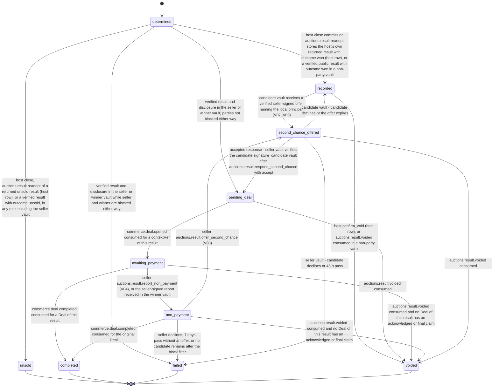

# PS-034-03 — Workflow state machine: Auction close

**Status:** SPECIFIED (Stage 3). **Module:** [F04.S01.M03 Auction close](SPEC.md) · **Scope:** MVP · **Code:** `packages/auctions/src/auction_lifecycle/close` · **Contracts:** [CTR-ID-001](../../../planning/contracts/CTR-ID-001.md), [CTR-EVT-001](../../../planning/contracts/CTR-EVT-001.md), [CTR-ERR-001](../../../planning/contracts/CTR-ERR-001.md), [CTR-CAP-001](../../../planning/contracts/CTR-CAP-001.md), [CTR-IDM-001](../../../planning/contracts/CTR-IDM-001.md), [CTR-MNY-001](../../../planning/contracts/CTR-MNY-001.md), [CTR-COM-001](../../../planning/contracts/CTR-COM-001.md), [CTR-PRV-001](../../../planning/contracts/CTR-PRV-001.md), [CTR-FED-001](../../../planning/contracts/CTR-FED-001.md)

> Generated from `module.spec.yaml` by `tools/specgen`. Edit the YAML, then run `pnpm spec:render`.

## Requirements

- **PS-034-03.R01** A result is determined once and then follows its role - the host row and non-party mirrors are recorded, the seller and winner follow the sale path to completed - or ends unsold, failed or voided; terminal states never change.
- **PS-034-03.R02** completed requires commerce.deal.completed with acknowledged or final payment per CTR-COM-001; a claim alone does not complete.
- **PS-034-03.R03** Non-payment and second chance are explicit and signed; day 10 only prompts the seller, there is no automatic transition or penalty, and the host only records a signal.
- **PS-034-03.R04** A host void is a finding each vault applies on its own - voided when the local Deals have no acknowledged or final claim, otherwise recorded as void after payment with no state change - and it never cancels a Deal, which needs every party's signed cancel in F09.

## Specification

### AuctionResult lifecycle

Initial **determined**; terminal **unsold**, **completed**, **failed**, **voided**.

| Transition | Trigger | Guard / effect |
|---|---|---|
| determined -> recorded | host close commits or auctions.result.readopt stores the host's own returned result with outcome won (host row), or a verified public result with outcome won in a non-party vault | emits auctions.auction.closed and auctions.auction.won (host-local, or vault-derived without winnerId) |
| determined -> unsold | host close, auctions.result.readopt of a returned unsold result (host row), or a verified result with outcome unsold, in any role including the seller vault | emits auctions.auction.closed and auctions.auction.unsold with listingId |
| determined -> pending_deal | verified result and disclosure in the seller or winner vault, parties not blocked either way | emits auctions.auction.closed and auctions.auction.won; calls commerce.deal.open with contextRef (auction_result, resultId) |
| determined -> failed | verified result and disclosure in the seller or winner vault while seller and winner are blocked either way | failReason blocked; result shown; no Deal; no non-payment report |
| pending_deal -> awaiting_payment | commerce.deal.opened consumed for a contextRef of this result | dealId stored for that buyer |
| awaiting_payment -> completed | commerce.deal.completed consumed for a Deal of this result | payment acknowledged or final |
| awaiting_payment -> non_payment | seller auctions.result.report_non_payment (V04), or the seller-signed report received in the winner vault | emits auctions.result.non_payment |
| non_payment -> completed | commerce.deal.completed consumed for the original Deal | late payment acknowledged or final |
| non_payment -> second_chance_offered | seller auctions.result.offer_second_chance (V08) | emits auctions.result.second_chance_offered |
| non_payment -> failed | seller declines, 7 days pass without an offer, or no candidate remains after the block filter | failReason declined, lapsed or no_candidate |
| recorded -> second_chance_offered | candidate vault receives a verified seller-signed offer naming the local principal (V07, V09) | role candidate; emits auctions.result.second_chance_offered |
| second_chance_offered -> pending_deal | accepted response - seller vault verifies the candidate signature; candidate vault after auctions.result.respond_second_chance with accept | commerce.deal.open with contextRef (auction_result, uuid derived from offerCid) |
| second_chance_offered -> failed | seller vault - candidate declines or 48 h pass | failReason declined or expired |
| second_chance_offered -> recorded | candidate vault - candidate declines or the offer expires | role back to bidder |
| recorded -> voided | host confirm_void (host row), or auctions.result.voided consumed in a non-party vault | hostVoid stored with appliedAs voided |
| pending_deal -> voided | auctions.result.voided consumed | no Deal opened yet, so no acknowledged or final claim; Deal opening stops |
| awaiting_payment -> voided | auctions.result.voided consumed and no Deal of this result has an acknowledged or final claim | Deal kept; Cancel Deal offered (commerce.deal.cancel, mutual) or the Deal expires |
| non_payment -> voided | auctions.result.voided consumed and no Deal of this result has an acknowledged or final claim | Deal kept; Cancel Deal offered |
| second_chance_offered -> voided | auctions.result.voided consumed | offer withdrawn; candidate vault shows withdrawn |

### Timeouts and scheduled transitions

- Host close tick every 1 s; result and disclosure retention in mailboxes 30 days; void window on the host 60 days after close (F04.S02.M03).
- Seller vault - day 10 after close shows a prompt only; the non-payment report window is day 3 to day 30; seller second-chance decision window 7 days after non_payment; second-chance expiry 48 h. Vault timers run at app start and every 60 s while open.

## Verification

| Test | Level | Covers | Scenario | Expected |
|---|---|---|---|---|
| TEST-PS-034-09.T03 | property | PS-034-03.R01 | random timer, command and statement sequences per role | only declared transitions succeed; terminal states never change |
| TEST-PS-034-09.T04 | integration | PS-034-03.R02 | Deal opened, payment claimed only, then acknowledged | state stays awaiting_payment on claim; completed only on commerce.deal.completed |
| TEST-PS-034-09.T08 | integration | PS-034-03.R03 | day 10 passes without report; non-payment report on day 11 with no acknowledged claim; second chance accepted, declined and expired; winner pays after the report | day 10 only prompts; day 11 report accepted; second-chance Deal uses its own contextRef; late payment completes from non_payment; at most one second chance |
| TEST-PS-034-09.T12 | integration | PS-034-03.R04, PS-034-06.R04 | voided statement after the Deal opened without acknowledged payment, and after acknowledged payment, in seller and winner vaults | first - result voided, Deal kept, Cancel Deal offered and commerce.deal.cancel needs both signatures; second - state unchanged, hostVoid void_after_payment, dispute link shown |
| TEST-PS-034-09.T24 | unit | PS-034-03.R01 | host row and non-party mirrors after a sale; second-chance offer to a candidate vault | host and non-party copies go determined to recorded; the candidate vault goes recorded to second_chance_offered and back to recorded on decline |

## Dependencies

Module depends on: F04.S01.M01, F04.S01.M02, F09.S01.M01, F07.S01.M01, F07.S02.M02, F11.S01.M01, F11.S01.M03, F09.S03.M01, F10.S01.M02, F10.S01.M03, F10.S01.M04, F10.S02.M02, F12.S03.M03, F13.S02.M01, CTR-ID-001, CTR-EVT-001, CTR-ERR-001, CTR-CAP-001, CTR-IDM-001, CTR-MNY-001, CTR-COM-001, CTR-PRV-001, CTR-FED-001. Predecessor: [domain_schema.md](domain_schema.md).
