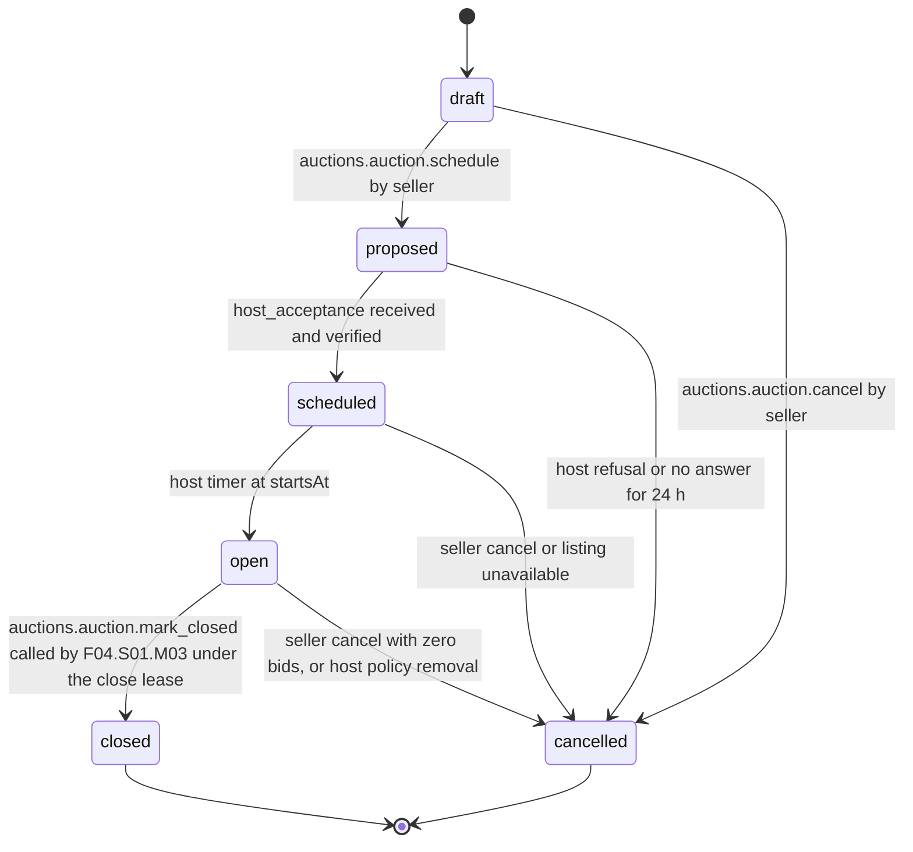

# PS-035-03 — Workflow state machine: Auction setup and reserve

**Status:** SPECIFIED (Stage 3). **Module:** [F04.S01.M01 Auction setup and reserve](SPEC.md) · **Scope:** MVP · **Code:** `packages/auctions/src/auction_lifecycle/reserve` · **Contracts:** [CTR-ID-001](../../../planning/contracts/CTR-ID-001.md), [CTR-EVT-001](../../../planning/contracts/CTR-EVT-001.md), [CTR-ERR-001](../../../planning/contracts/CTR-ERR-001.md), [CTR-CAP-001](../../../planning/contracts/CTR-CAP-001.md), [CTR-IDM-001](../../../planning/contracts/CTR-IDM-001.md), [CTR-MNY-001](../../../planning/contracts/CTR-MNY-001.md), [CTR-PRV-001](../../../planning/contracts/CTR-PRV-001.md), [CTR-FED-001](../../../planning/contracts/CTR-FED-001.md), [CTR-FLG-001](../../../planning/contracts/CTR-FLG-001.md)

> Generated from `module.spec.yaml` by `tools/specgen`. Edit the YAML, then run `pnpm spec:render`.

## Requirements

- **PS-035-03.R01** Auctions follow draft, proposed, scheduled, open, closed with cancelled as an exit before close; closed and cancelled are terminal.
- **PS-035-03.R02** Scheduled requires the host's verified countersignature; no host acceptance means no auction.
- **PS-035-03.R03** Opening, end adjustment and closing are host-clock decisions; the seller vault shows them only after receiving the host-signed statements.

## Specification

### Auction lifecycle

Initial **draft**; terminal **closed**, **cancelled**.

| Transition | Trigger | Guard / effect |
|---|---|---|
| draft -> proposed | auctions.auction.schedule by seller | terms signed and sent to the chosen host; host required |
| draft -> cancelled | auctions.auction.cancel by seller | local discard |
| proposed -> scheduled | host_acceptance received and verified | host rules passed; emits auctions.auction.scheduled |
| proposed -> cancelled | host refusal or no answer for 24 h | cancelReason host_refused or host_unreachable; emits auctions.auction.cancelled |
| scheduled -> open | host timer at startsAt | emits auctions.auction.opened |
| scheduled -> cancelled | seller cancel or listing unavailable | emits auctions.auction.cancelled |
| open -> closed | auctions.auction.mark_closed called by F04.S01.M03 under the close lease | currentEndsAt reached |
| open -> cancelled | seller cancel with zero bids, or host policy removal | emits auctions.auction.cancelled |

### Timeouts and scheduled transitions

- Host timer checks scheduled auctions every 5 s and opens those with startsAt <= host now; proposed auctions with no host answer for 24 h are cancelled by the seller vault sweep that runs at app start and every 60 s while open.

## Verification

| Test | Level | Covers | Scenario | Expected |
|---|---|---|---|---|
| TEST-PS-035-09.T03 | property | PS-035-03.R01 | random command and timer sequences | only declared transitions succeed; closed and cancelled never change |
| TEST-PS-035-09.T04 | integration | PS-035-03.R02, PS-035-02.R02 | schedule with no host, with host refusing, and with host silent for 24 h | AUCTIONS_HOST_REQUIRED; cancelled host_refused; cancelled host_unreachable; never scheduled |
| TEST-PS-035-09.T05 | integration | PS-035-03.R03, PS-035-06.R02 | advance host clock past startsAt; run open twice and adjust_end with stale lease token | opened once; stale token refused |
| TEST-PS-035-09.T15 | e2e | PS-035-01.R02, PS-035-03.R02, PS-035-09.R03 | mobile seller schedules with a host, bidder views host panel and auction page | host named, reserve status shown, no host means feature disabled; axe zero serious issues |

## Dependencies

Module depends on: F01.S01.M01, F01.S01.M03, F09.S03.M01, F11.S01.M03, F07.S01.M01, CTR-ID-001, CTR-EVT-001, CTR-ERR-001, CTR-CAP-001, CTR-IDM-001, CTR-MNY-001, CTR-PRV-001, CTR-FED-001, CTR-FLG-001. Predecessor: [domain_schema.md](domain_schema.md).
