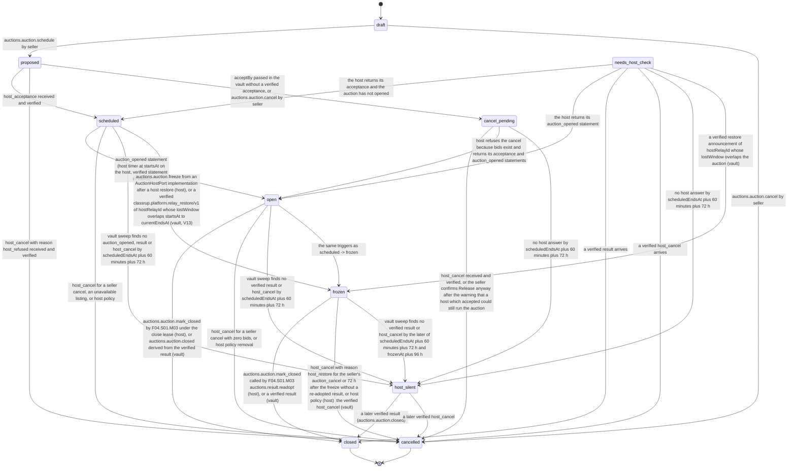

# PS-035-03 — Workflow state machine: Auction setup and reserve

**Status:** SPECIFIED (Stage 3). **Module:** [F04.S01.M01 Auction setup and reserve](SPEC.md) · **Scope:** MVP · **Code:** `packages/auctions/src/auction_lifecycle/reserve` · **Contracts:** [CTR-ID-001](../../../planning/contracts/CTR-ID-001.md), [CTR-EVT-001](../../../planning/contracts/CTR-EVT-001.md), [CTR-ERR-001](../../../planning/contracts/CTR-ERR-001.md), [CTR-CAP-001](../../../planning/contracts/CTR-CAP-001.md), [CTR-IDM-001](../../../planning/contracts/CTR-IDM-001.md), [CTR-MNY-001](../../../planning/contracts/CTR-MNY-001.md), [CTR-PRV-001](../../../planning/contracts/CTR-PRV-001.md), [CTR-FED-001](../../../planning/contracts/CTR-FED-001.md), [CTR-FLG-001](../../../planning/contracts/CTR-FLG-001.md)

> Generated from `module.spec.yaml` by `tools/specgen`. Edit the YAML, then run `pnpm spec:render`.

## Requirements

- **PS-035-03.R01** Auctions follow draft, proposed, scheduled, open, closed, with cancelled as an exit before close and cancel_pending, host_silent and needs_host_check as vault states for an unanswered cancel, a silent host and an unconfirmed import; closed and cancelled are terminal.
- **PS-035-03.R02** Scheduled requires the host's verified countersignature; no host acceptance means no auction.
- **PS-035-03.R03** Opening, end adjustment, host cancellation and closing are host-clock decisions; the seller vault shows them only after receiving the host-signed statements (auction_opened, extension, host_cancel, result).
- **PS-035-03.R04** A vault never cancels a proposed auction silently - at acceptBy it sends a signed auction_cancel and waits in cancel_pending - and an auction whose host stops answering moves to host_silent, which releases the listing lock but still yields to a later valid host statement.
- **PS-035-03.R05** A host restore freezes every auction whose bids or close may have been lost - on the host through auctions.auction.freeze before the restored relay accepts a request, in vaults from the verified restore announcement - and a frozen auction takes no bid, extension or close until it is renegotiated - re-adoption of the host's own signed result closes it, and the seller's cancel or the host's cancel 72 h after the freeze, both with reason host_restore, cancel it; no new result is ever determined for it.

## Specification

### Auction lifecycle

Initial **draft**; terminal **closed**, **cancelled**.

| Transition | Trigger | Guard / effect |
|---|---|---|
| draft -> proposed | auctions.auction.schedule by seller | listing linked and published (V06), consent granted (V11), terms with listingCid, acceptBy and softCloseRulesVersion signed and sent to the chosen host; host required |
| draft -> cancelled | auctions.auction.cancel by seller | local discard; nothing was sent; emits auctions.auction.cancelled |
| proposed -> scheduled | host_acceptance received and verified | acceptance host time at or before acceptBy; emits auctions.auction.scheduled |
| proposed -> cancelled | host_cancel with reason host_refused received and verified | cancelReason host_refused; emits auctions.auction.cancelled |
| proposed -> cancel_pending | acceptBy passed in the vault without a verified acceptance, or auctions.auction.cancel by seller | signed auction_cancel sent to the host; listing lock kept |
| cancel_pending -> cancelled | host_cancel received and verified, or the seller confirms Release anyway after the warning that a host which accepted could still run the auction | cancelReason seller, accept_window_passed or host_unreachable; later host statements are shown as conflicting host evidence; emits auctions.auction.cancelled |
| cancel_pending -> open | host refuses the cancel because bids exist and returns its acceptance and auction_opened statements | AUCTIONS_HAS_BIDS shown; emits auctions.auction.scheduled and auctions.auction.opened |
| cancel_pending -> host_silent | no host answer by scheduledEndsAt plus 60 minutes plus 72 h | listing lock released; shows host did not answer the cancel |
| scheduled -> open | auction_opened statement (host timer at startsAt on the host, verified statement in vaults) | emits auctions.auction.opened |
| scheduled -> cancelled | host_cancel for a seller cancel, an unavailable listing, or host policy | emits auctions.auction.cancelled |
| scheduled -> host_silent | vault sweep finds no auction_opened, result or host_cancel by scheduledEndsAt plus 60 minutes plus 72 h | listing lock released; shows host did not report a result |
| open -> closed | auctions.auction.mark_closed by F04.S01.M03 under the close lease (host), or auctions.auction.closed derived from the verified result (vault) | currentEndsAt reached |
| open -> cancelled | host_cancel for a seller cancel with zero bids, or host policy removal | emits auctions.auction.cancelled |
| open -> host_silent | vault sweep finds no verified result or host_cancel by scheduledEndsAt plus 60 minutes plus 72 h | listing lock released; shows host did not report a result |
| host_silent -> closed | a later verified result (auctions.auction.closed) | the late host result overrides the silence |
| host_silent -> cancelled | a later verified host_cancel | emits auctions.auction.cancelled |
| needs_host_check -> scheduled | the host returns its acceptance and the auction has not opened | state entered only by import |
| needs_host_check -> open | the host returns its auction_opened statement | emits auctions.auction.opened |
| needs_host_check -> closed | a verified result arrives | final projection stored |
| needs_host_check -> cancelled | a verified host_cancel arrives | emits auctions.auction.cancelled |
| needs_host_check -> host_silent | no host answer by scheduledEndsAt plus 60 minutes plus 72 h | listing lock released |
| scheduled -> frozen | auctions.auction.freeze from an AuctionHostPort implementation after a host restore (host), or a verified classrup.platform.relay_restore/v1 of hostRelayId whose lostWindow overlaps startsAt to currentEndsAt (vault, V13) | bids, extensions and close refused; emits auctions.auction.frozen |
| open -> frozen | the same triggers as scheduled -> frozen | bids, extensions and close refused; live bids keep their state until the freeze ends; emits auctions.auction.frozen |
| needs_host_check -> frozen | a verified restore announcement of hostRelayId whose lostWindow overlaps the auction (vault) | emits auctions.auction.frozen |
| frozen -> closed | auctions.auction.mark_closed called by F04.S01.M03 auctions.result.readopt (host), or a verified result (vault) | the host's own signed result is re-adopted; no new result is determined |
| frozen -> cancelled | host_cancel with reason host_restore for the seller's auction_cancel or 72 h after the freeze without a re-adopted result, or host policy (host); the verified host_cancel (vault) | live bids void; emits auctions.auction.cancelled |
| frozen -> host_silent | vault sweep finds no verified result or host_cancel by the later of scheduledEndsAt plus 60 minutes plus 72 h and frozenAt plus 96 h | listing lock released; shows host did not report a result |

### Timeouts and scheduled transitions

- Host timer checks scheduled auctions every 5 s, opens those with startsAt <= host now and signs auction_opened.
- Seller vault sweep at app start and every 60 s while open - proposed auctions past acceptBy move to cancel_pending and send auction_cancel; scheduled, open, cancel_pending and needs_host_check auctions past scheduledEndsAt plus 60 minutes plus 72 h without a verified result or host_cancel move to host_silent. The sweep never cancels an auction.
- Host restore - the host sweep every 60 s signs a host_cancel with reason host_restore for each frozen auction without a re-adopted result 72 h after frozenAt; the vault sweep moves frozen auctions to host_silent at the later of scheduledEndsAt plus 60 minutes plus 72 h and frozenAt plus 96 h.

## Verification

| Test | Level | Covers | Scenario | Expected |
|---|---|---|---|---|
| TEST-PS-035-09.T03 | property | PS-035-03.R01 | random command, statement and timer sequences | only declared transitions succeed; closed and cancelled never change |
| TEST-PS-035-09.T04 | integration | PS-035-03.R02, PS-035-02.R02, PS-035-03.R04 | schedule with no host, with host refusing, and with host silent past acceptBy | AUCTIONS_HOST_REQUIRED; cancelled host_refused after a verified host_cancel; cancel_pending with auction_cancel sent; never scheduled |
| TEST-PS-035-09.T05 | integration | PS-035-03.R03, PS-035-06.R02 | advance host clock past startsAt; run open twice; call adjust_end and mark_closed with a stale fence token | opened once with one signed auction_opened; both stale calls refused with PRECONDITION_FAILED |
| TEST-PS-035-09.T15 | e2e | PS-035-01.R02, PS-035-03.R02, PS-035-09.R03 | mobile seller schedules with a host, bidder views host panel and auction page | host named, reserve status shown, no host means feature disabled; axe zero serious issues |
| TEST-PS-035-09.T18 | integration | PS-035-06.R04, PS-035-03.R04, PS-035-02.R04 | host accepts but the acceptance is lost; 24 h pass; host opened and a bidder bid; second run without bids; host tries to accept after acceptBy | vault sends auction_cancel at acceptBy and waits in cancel_pending; with a bid the host refuses AUCTIONS_HAS_BIDS and the vault shows open; without bids host_cancel and cancelled; late acceptance refused with EXPIRED |
| TEST-PS-035-09.T19 | integration | PS-035-03.R04 | host stops answering after scheduling | after scheduledEndsAt plus 60 minutes plus 72 h the auction is host_silent and the listing lock is released; a later valid result moves it to closed |
| TEST-PS-035-09.T25 | integration | PS-035-03.R05, PS-035-06.R05, PS-035-04.R08 | restore host H from a backup whose lost window covers bids on open auction A and the end of auction C; the AuctionHostPort implementations run before the port opens; seller vault S receives the restore announcement; S cancels A; nobody returns the result of C for 72 h | A and C frozen once on the host and in vaults with auctions.auction.frozen; bids and close refused; the cancel of A gives host_cancel host_restore although A has bids; C cancelled host_restore at 72 h; no new result determined for either; push dispatched once per opted-in recipient |

## Dependencies

Module depends on: F01.S01.M01, F01.S01.M03, F09.S03.M01, F11.S01.M01, F11.S01.M03, F07.S01.M01, F10.S01.M01, F10.S01.M02, F10.S01.M03, F10.S01.M04, F10.S02.M02, F12.S03.M03, F12.S03.M04, F13.S02.M01, F15.S02.M01, CTR-ID-001, CTR-EVT-001, CTR-ERR-001, CTR-CAP-001, CTR-IDM-001, CTR-MNY-001, CTR-PRV-001, CTR-FED-001, CTR-FLG-001. Predecessor: [domain_schema.md](domain_schema.md).
