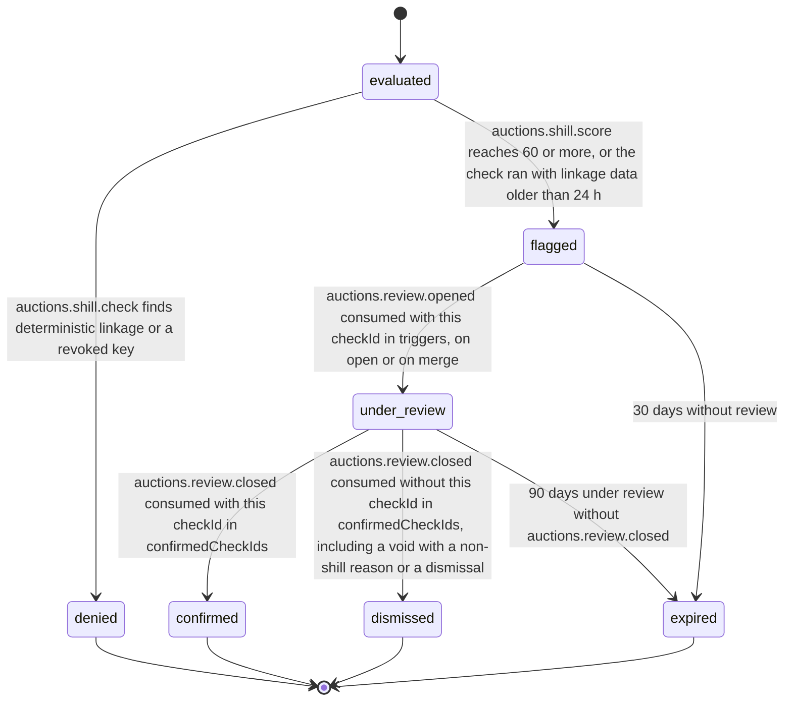

# PS-036-03 — Workflow state machine: Anti-shill controls

**Status:** SPECIFIED (Stage 3). **Module:** [F04.S02.M01 Anti-shill controls](SPEC.md) · **Scope:** MVP · **Code:** `packages/auctions/src/auction_integrity/anti` · **Contracts:** [CTR-ID-001](../../../planning/contracts/CTR-ID-001.md), [CTR-EVT-001](../../../planning/contracts/CTR-EVT-001.md), [CTR-ERR-001](../../../planning/contracts/CTR-ERR-001.md), [CTR-CAP-001](../../../planning/contracts/CTR-CAP-001.md), [CTR-IDM-001](../../../planning/contracts/CTR-IDM-001.md), [CTR-PRV-001](../../../planning/contracts/CTR-PRV-001.md), [CTR-FED-001](../../../planning/contracts/CTR-FED-001.md)

> Generated from `module.spec.yaml` by `tools/specgen`. Edit the YAML, then run `pnpm spec:render`.

## Requirements

- **PS-036-03.R01** An evaluation ends at once as denied, or as flagged, or is not stored; flagged moves through review to confirmed or dismissed, or expires when no review takes it up or a review never closes.
- **PS-036-03.R02** Flags never alter bids, prices or results; only F04.S02.M03 decisions do.
- **PS-036-03.R03** Review outcomes arrive per check in auctions.review.closed (confirmedCheckIds) from the fraud review module; only the listed checks are confirmed, the other checks of that review are dismissed, and no outcome is assumed.

## Specification

### ShillCheck lifecycle

Initial **evaluated**; terminal **denied**, **confirmed**, **dismissed**, **expired**.

| Transition | Trigger | Guard / effect |
|---|---|---|
| evaluated -> denied | auctions.shill.check finds deterministic linkage or a revoked key | bid rejected generically; no event to the bidder; retention RET-EVIDENCE |
| evaluated -> flagged | auctions.shill.score reaches 60 or more, or the check ran with linkage data older than 24 h | heuristic flags emit auctions.shill.suspected; linkage_stale flags emit nothing and only enter the moderator queue |
| flagged -> under_review | auctions.review.opened consumed with this checkId in triggers, on open or on merge | reviewId stored |
| under_review -> confirmed | auctions.review.closed consumed with this checkId in confirmedCheckIds | retention RET-EVIDENCE |
| under_review -> dismissed | auctions.review.closed consumed without this checkId in confirmedCheckIds, including a void with a non-shill reason or a dismissal | retention RET-SHORT |
| under_review -> expired | 90 days under review without auctions.review.closed | host sweep; operator alert; retention RET-SHORT |
| flagged -> expired | 30 days without review | host sweep; retention RET-SHORT |

### Timeouts and scheduled transitions

- Host sweep every hour expires flagged checks older than 30 days and under_review checks older than 90 days with an operator alert; scoring runs within 5 s of a placed bid and is retried up to 3 times at 5 s, 15 s and 45 s.

## Verification

| Test | Level | Covers | Scenario | Expected |
|---|---|---|---|---|
| TEST-PS-036-09.T03 | property | PS-036-03.R01 | random check, review and sweep event sequences | only declared transitions succeed; terminal states never change |
| TEST-PS-036-09.T04 | integration | PS-036-03.R02, PS-036-03.R03 | flagged bidder wins; review opened then closed without the check in confirmedCheckIds | result unchanged by the flag; check dismissed; confirmed only when listed |
| TEST-PS-036-09.T14 | integration | PS-036-01.R04, PS-036-03.R01 | same_owner attestation revoked after a denial; seller revokes K2 and bids with it; auction scheduled before the revocation | within 30 days the attestation still denies; K2 denied as revoked_key; for the earlier auction the link is permanent; after 30 days a later auction allows the attested key; past denial kept as history |
| TEST-PS-036-09.T18 | integration | PS-036-03.R03 | review with flagged bidders B2 and B5 closes with only B2's check in confirmedCheckIds | B2's check confirmed with RET-EVIDENCE; B5's check dismissed with RET-SHORT |

## Dependencies

Module depends on: F04.S01.M01, F07.S01.M01, F07.S01.M02, F07.S02.M01, F07.S03.M02, F11.S01.M03, F10.S01.M02, F10.S01.M03, F10.S01.M04, F10.S02.M02, CTR-ID-001, CTR-EVT-001, CTR-ERR-001, CTR-CAP-001, CTR-IDM-001, CTR-PRV-001, CTR-FED-001. Predecessor: [domain_schema.md](domain_schema.md).
