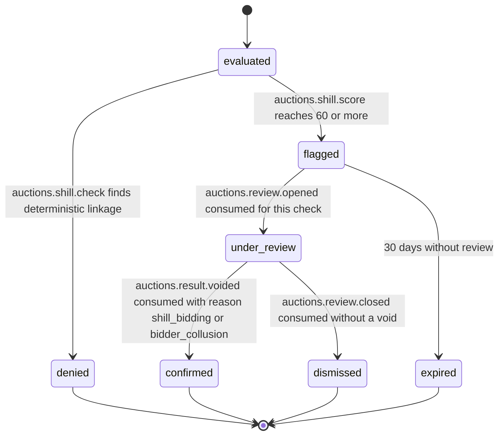

# PS-036-03 — Workflow state machine: Anti-shill controls

**Status:** SPECIFIED (Stage 3). **Module:** [F04.S02.M01 Anti-shill controls](SPEC.md) · **Scope:** MVP · **Code:** `packages/auctions/src/auction_integrity/anti` · **Contracts:** [CTR-ID-001](../../../planning/contracts/CTR-ID-001.md), [CTR-EVT-001](../../../planning/contracts/CTR-EVT-001.md), [CTR-ERR-001](../../../planning/contracts/CTR-ERR-001.md), [CTR-CAP-001](../../../planning/contracts/CTR-CAP-001.md), [CTR-IDM-001](../../../planning/contracts/CTR-IDM-001.md), [CTR-PRV-001](../../../planning/contracts/CTR-PRV-001.md), [CTR-FED-001](../../../planning/contracts/CTR-FED-001.md)

> Generated from `module.spec.yaml` by `tools/specgen`. Edit the YAML, then run `pnpm spec:render`.

## Requirements

- **PS-036-03.R01** An evaluation ends at once as denied, or as flagged, or is not stored; flagged moves through review to confirmed or dismissed or expires.
- **PS-036-03.R02** Flags never alter bids, prices or results; only F04.S02.M03 decisions do.
- **PS-036-03.R03** Review outcomes arrive as events from the fraud review module and close the check; no outcome is assumed.

## Specification

### ShillCheck lifecycle

Initial **evaluated**; terminal **denied**, **confirmed**, **dismissed**, **expired**.

| Transition | Trigger | Guard / effect |
|---|---|---|
| evaluated -> denied | auctions.shill.check finds deterministic linkage | bid rejected generically; no event to the bidder |
| evaluated -> flagged | auctions.shill.score reaches 60 or more | emits auctions.shill.suspected |
| flagged -> under_review | auctions.review.opened consumed for this check | reviewId stored |
| under_review -> confirmed | auctions.result.voided consumed with reason shill_bidding or bidder_collusion | check closed as confirmed |
| under_review -> dismissed | auctions.review.closed consumed without a void | check closed as dismissed |
| flagged -> expired | 30 days without review | host sweep |

### Timeouts and scheduled transitions

- Host sweep every hour expires flagged checks older than 30 days; scoring runs within 5 s of a placed bid and is retried up to 3 times at 5 s, 15 s and 45 s.

## Verification

| Test | Level | Covers | Scenario | Expected |
|---|---|---|---|---|
| TEST-PS-036-09.T03 | property | PS-036-03.R01 | random check, review and void event sequences | only declared transitions succeed; terminal states never change |
| TEST-PS-036-09.T04 | integration | PS-036-03.R02, PS-036-03.R03 | flagged bidder wins; review opened then dismissed | result unchanged by the flag; check dismissed; confirmed only after void event |
| TEST-PS-036-09.T14 | integration | PS-036-07.R03, PS-036-03.R01 | identity attestation revoked after denial | next check allows; past denial kept as history |

## Dependencies

Module depends on: F04.S01.M01, F07.S01.M01, F07.S02.M01, F07.S03.M02, F11.S01.M03, CTR-ID-001, CTR-EVT-001, CTR-ERR-001, CTR-CAP-001, CTR-IDM-001, CTR-PRV-001, CTR-FED-001. Predecessor: [domain_schema.md](domain_schema.md).
