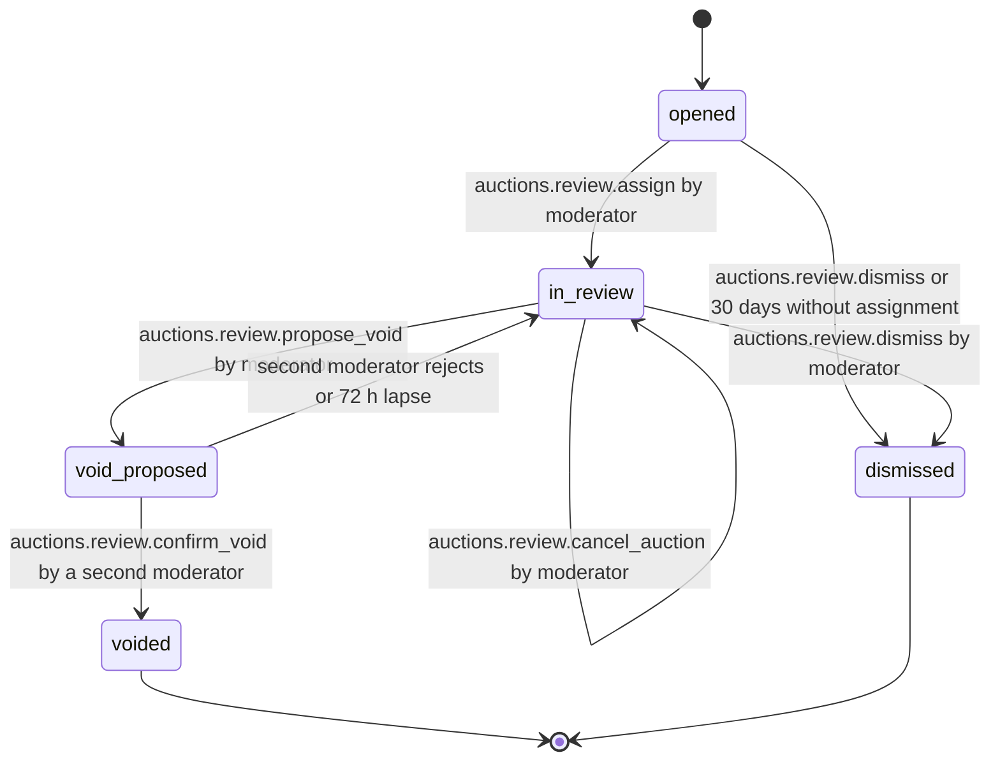

# PS-037-03 — Workflow state machine: Auction fraud review

**Status:** SPECIFIED (Stage 3). **Module:** [F04.S02.M03 Auction fraud review](SPEC.md) · **Scope:** MVP · **Code:** `packages/auctions/src/auction_integrity/fraud` · **Contracts:** [CTR-ID-001](../../../planning/contracts/CTR-ID-001.md), [CTR-EVT-001](../../../planning/contracts/CTR-EVT-001.md), [CTR-ERR-001](../../../planning/contracts/CTR-ERR-001.md), [CTR-CAP-001](../../../planning/contracts/CTR-CAP-001.md), [CTR-IDM-001](../../../planning/contracts/CTR-IDM-001.md), [CTR-PRV-001](../../../planning/contracts/CTR-PRV-001.md), [CTR-FED-001](../../../planning/contracts/CTR-FED-001.md)

> Generated from `module.spec.yaml` by `tools/specgen`. Edit the YAML, then run `pnpm spec:render`.

## Requirements

- **PS-037-03.R01** Reviews move opened, in_review, optionally void_proposed, and end voided or dismissed; both are terminal.
- **PS-037-03.R02** Voiding requires propose and confirm by two different moderators within 72 hours of the proposal, otherwise the proposal lapses back to in_review.
- **PS-037-03.R03** Every terminal transition emits auctions.review.closed, and a void additionally emits auctions.result.voided, in the same host transaction.
- **PS-037-03.R04** A successful appeal never changes the terminal review status; it adds an advisory host-signed rescission, and vaults show that statement without reopening the sale.

## Specification

### AuctionReview lifecycle

Initial **opened**; terminal **voided**, **dismissed**.

| Transition | Trigger | Guard / effect |
|---|---|---|
| opened -> in_review | auctions.review.assign by moderator | conflict check passed (V01); evidence snapshots captured and refs frozen |
| opened -> dismissed | auctions.review.dismiss or 30 days without assignment | emits auctions.review.closed with empty confirmedCheckIds |
| in_review -> dismissed | auctions.review.dismiss by moderator | findings stored; emits auctions.review.closed with empty confirmedCheckIds |
| in_review -> in_review | auctions.review.cancel_auction by moderator | open auction cancelled through apply_cancel with reason host_policy; review continues for the enforcement recommendation |
| in_review -> void_proposed | auctions.review.propose_void by moderator | result eligible (V05), reason, findings and confirmedCheckIds stored |
| void_proposed -> voided | auctions.review.confirm_void by a second moderator | signs the void statement, records the EnforcementAction, moves the host's result row to voided; emits auctions.result.voided and auctions.review.closed |
| void_proposed -> in_review | second moderator rejects or 72 h lapse | proposal cleared |

### Timeouts and scheduled transitions

- Unassigned reviews are dismissed with reason expired after 30 days; void proposals lapse after 72 hours; a high-priority review with no assignment after 24 hours raises an operator alert. The host sweep runs every 5 minutes.

## Verification

| Test | Level | Covers | Scenario | Expected |
|---|---|---|---|---|
| TEST-PS-037-09.T03 | unit | PS-037-03.R01, PS-037-03.R02, PS-037-02.R02 | propose by M1, confirm by M1, confirm by M2 after 73 hours, confirm by M2 within 72 hours | second and third refused or lapsed; fourth voids and signs |
| TEST-PS-037-09.T05 | property | PS-037-03.R01 | random command sequences on one review | only declared transitions succeed; voided and dismissed never change |
| TEST-PS-037-09.T15 | e2e | PS-037-03.R03 | two moderators in two browsers void a sale; bidder and seller vaults open the notice | statuses correct on all four; auctions.review.closed and auctions.result.voided in one host transaction; notice has no names and says the Deal stays until both cancel; axe zero serious issues |
| TEST-PS-037-09.T19 | integration | PS-037-04.R05, PS-037-03.R04 | void confirmed; seller appeals; appeal overturned; on a second auction an appeal decided reduced; a vault-origin copy of moderation.appeal.decided | record_host_policy called with source auction_review, hostRef reviewId and both moderators, actionId and caseId stored; overturned matched on actionId with origin relay, rescission statement issued, shown as advisory, review stays voided; reduced stores appealReducedTo and signs no rescission; the vault-origin copy is ignored |

## Dependencies

Module depends on: F04.S01.M01, F04.S01.M02, F04.S01.M03, F04.S02.M01, F04.S02.M02, F12.S01.M01, F12.S01.M02, F12.S01.M03, F12.S02.M01, F11.S01.M01, F11.S01.M03, F07.S01.M01, F10.S01.M02, F10.S01.M03, F10.S01.M04, F10.S02.M02, F13.S02.M01, CTR-ID-001, CTR-EVT-001, CTR-ERR-001, CTR-CAP-001, CTR-IDM-001, CTR-PRV-001, CTR-FED-001. Predecessor: [domain_schema.md](domain_schema.md).
