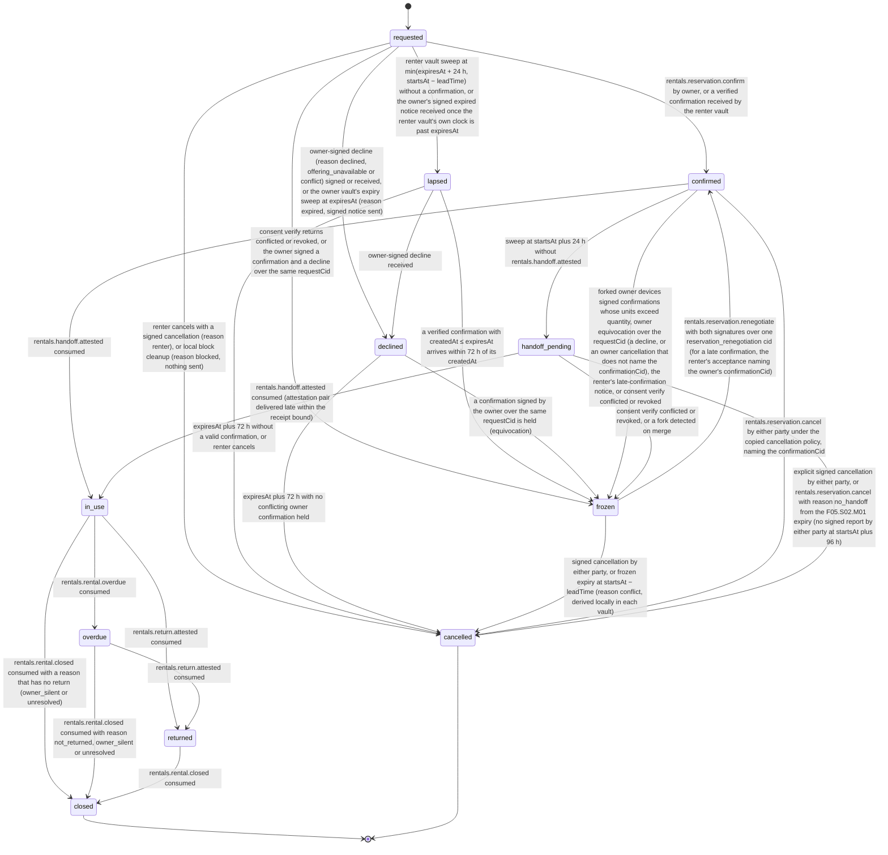

# PS-039-03 — Workflow state machine: Rental availability

**Status:** SPECIFIED (Stage 3). **Module:** [F05.S01.M01 Rental availability](SPEC.md) · **Scope:** MVP · **Code:** `packages/rentals/src/rental_catalog/availability` · **Contracts:** [CTR-ID-001](../../../planning/contracts/CTR-ID-001.md), [CTR-EVT-001](../../../planning/contracts/CTR-EVT-001.md), [CTR-ERR-001](../../../planning/contracts/CTR-ERR-001.md), [CTR-CAP-001](../../../planning/contracts/CTR-CAP-001.md), [CTR-IDM-001](../../../planning/contracts/CTR-IDM-001.md), [CTR-MNY-001](../../../planning/contracts/CTR-MNY-001.md), [CTR-COM-001](../../../planning/contracts/CTR-COM-001.md), [CTR-PRV-001](../../../planning/contracts/CTR-PRV-001.md), [CTR-FED-001](../../../planning/contracts/CTR-FED-001.md)

> Generated from `module.spec.yaml` by `tools/specgen`. Edit the YAML, then run `pnpm spec:render`.

## Requirements

- **PS-039-03.R01** Reservations follow requested, confirmed, handoff_pending once the pickup window passes, in_use, optionally overdue, returned and closed, with lapsed, declined and frozen as holding states and cancelled as the exit before use; transitions driven by other modules arrive only as events or local calls.
- **PS-039-03.R02** A reservation is confirmed only by the owner's signed confirmation over the request terms the renter signed; the overlap check and the confirmation commit in one vault transaction.
- **PS-039-03.R03** Conflicting signed confirmations from forked owner devices, and a confirmation plus a decline signed by the owner over the same requestCid in either arrival order, freeze the affected reservations, keep counting them toward capacity, notify each affected renter with a signed reservation_frozen notice and require explicit renegotiation, never last-writer-wins.
- **PS-039-03.R04** Requests expire on the signed absolute expiresAt in both vaults - the owner vault at expiresAt with a signed expired notice, the renter vault at min(expiresAt plus a 24 hour delivery allowance, startsAt − leadTime) - and a valid confirmation that reaches the renter after that is held frozen for the renter's explicit acceptance.
- **PS-039-03.R05** A confirmed reservation is never cancelled automatically while either party may hold a signed handoff report; after startsAt plus 24 hours it is handoff_pending, and only an explicit signed cancellation or the F05.S02.M01 no_handoff cancellation (no signed report by either party at startsAt plus 96 hours) cancels it.
- **PS-039-03.R06** An item that is never returned ends the reservation when rentals.rental.closed arrives without a return, and the occupied interval ends at the closure time.

## Specification

### RentalReservation lifecycle

Initial **requested**; terminal **closed**, **cancelled**.

| Transition | Trigger | Guard / effect |
|---|---|---|
| requested -> confirmed | rentals.reservation.confirm by owner, or a verified confirmation received by the renter vault | owner vault: V05, V11 and V12 pass and the owner's confirm consent is signed; renter vault: confirmation createdAt ≤ expiresAt and received within 72 h; emits rentals.reservation.confirmed |
| requested -> declined | owner-signed decline (reason declined, offering_unavailable or conflict) signed or received, or the owner vault's expiry sweep at expiresAt (reason expired, signed notice sent) | interval free; not counted in V07; emits rentals.reservation.cancelled |
| requested -> cancelled | renter cancels with a signed cancellation (reason renter), or local block cleanup (reason blocked, nothing sent) | emits rentals.reservation.cancelled |
| requested -> lapsed | renter vault sweep at min(expiresAt + 24 h, startsAt − leadTime) without a confirmation, or the owner's signed expired notice received once the renter vault's own clock is past expiresAt | retries stop; no longer counted in V07; UI shows that the owner did not confirm in time |
| requested -> frozen | consent verify returns conflicted or revoked, or the owner signed a confirmation and a decline over the same requestCid | counted in capacity; reservation_frozen notice |
| lapsed -> frozen | a verified confirmation with createdAt ≤ expiresAt arrives within 72 h of its createdAt | frozenReason late_confirmation; held for the renter's explicit acceptance; renter-signed reservation_frozen notice to the owner |
| lapsed -> declined | owner-signed decline received | interval free; emits rentals.reservation.cancelled |
| lapsed -> cancelled | expiresAt plus 72 h without a valid confirmation, or renter cancels | reason expired or renter; emits rentals.reservation.cancelled |
| declined -> cancelled | expiresAt plus 72 h with no conflicting owner confirmation held | final; the cancelled event was already emitted on decline |
| declined -> frozen | a confirmation signed by the owner over the same requestCid is held (equivocation) | frozenReason equivocation; counted in capacity; reservation_frozen notice supersedes the decline |
| confirmed -> frozen | forked owner devices signed confirmations whose units exceed quantity, owner equivocation over the requestCid (a decline, or an owner cancellation that does not name the confirmationCid), the renter's late-confirmation notice, or consent verify conflicted or revoked | units still counted in V05; signed reservation_frozen notice to each affected renter |
| frozen -> confirmed | rentals.reservation.renegotiate with both signatures over one reservation_renegotiation cid (for a late confirmation, the renter's acceptance naming the owner's confirmationCid) | the possibly changed interval passes V05 counting all other reservations including frozen ones; emits rentals.reservation.confirmed |
| frozen -> cancelled | signed cancellation by either party, or frozen expiry at startsAt − leadTime (reason conflict, derived locally in each vault) | frees the interval; emits rentals.reservation.cancelled |
| confirmed -> cancelled | rentals.reservation.cancel by either party under the copied cancellation policy, naming the confirmationCid | frees the interval; for a renter cancellation after the free period the owner vault opens the fee Deal on acceptance; emits rentals.reservation.cancelled |
| confirmed -> handoff_pending | sweep at startsAt plus 24 h without rentals.handoff.attested | no automatic cancellation; interval stays blocked |
| confirmed -> in_use | rentals.handoff.attested consumed | start of the rental period; owner vault opens the rent Deal |
| handoff_pending -> in_use | rentals.handoff.attested consumed (attestation pair delivered late within the receipt bound) | owner vault opens the rent Deal |
| handoff_pending -> cancelled | explicit signed cancellation by either party, or rentals.reservation.cancel with reason no_handoff from the F05.S02.M01 expiry (no signed report by either party at startsAt plus 96 h) | frees the interval; emits rentals.reservation.cancelled |
| handoff_pending -> frozen | consent verify conflicted or revoked, or a fork detected on merge | counted in capacity |
| in_use -> overdue | rentals.rental.overdue consumed | occupied interval extended until return |
| in_use -> returned | rentals.return.attested consumed | occupiedUntil shortened to return time plus buffer |
| in_use -> closed | rentals.rental.closed consumed with a reason that has no return (owner_silent or unresolved) | occupiedUntil set to closedAt |
| overdue -> returned | rentals.return.attested consumed | occupiedUntil set to return time plus buffer |
| overdue -> closed | rentals.rental.closed consumed with reason not_returned, owner_silent or unresolved | occupied interval ends at closedAt |
| returned -> closed | rentals.rental.closed consumed | final |

### Timeouts and scheduled transitions

- Owner vault: requests end at the signed expiresAt (declined, reason expired, signed notice sent) and declines settle to cancelled at expiresAt plus 72 h. Renter vault: requests lapse at min(expiresAt + 24 h, startsAt − leadTime), or earlier on the owner's signed expired notice once its own clock is past expiresAt, and are cancelled at expiresAt plus 72 h without a valid confirmation. Confirmed reservations move to handoff_pending at startsAt plus 24 h and are cancelled with no_handoff only through the F05.S02.M01 expiry at startsAt plus 96 h. Frozen reservations expire at startsAt − leadTime (reason conflict). A vault sweep runs at app start, on every command and every 60 s while the PWA is open, and every read applies expiry on the fly.

## Verification

| Test | Level | Covers | Scenario | Expected |
|---|---|---|---|---|
| TEST-PS-039-09.T04 | unit | PS-039-02.R02, PS-039-03.R01 | boundary cases - touching intervals with zero buffers, one minute inside the buffer, DST change inside the rental | half-open rule respected; elapsed-time durations; blackout by local date |
| TEST-PS-039-09.T05 | property | PS-039-03.R01 | random command and event sequences including renter cancellations before and inside the fee period | only declared transitions succeed; closed and cancelled never change; a cancellation inside the fee period opens exactly one fee Deal of the policy amount and one before it opens none |
| TEST-PS-039-09.T06 | integration | PS-039-03.R02, PS-039-06.R02 | confirm with consent signing failing; crash injected between the overlap check and the write | reservation stays requested, no signature, no partial state |
| TEST-PS-039-09.T07 | integration | PS-039-03.R03, PS-039-06.R03 | two owner devices sign overlapping confirmations for R1 and R2, merge, then R3 requests the same interval and the owner renegotiates R1 after cancelling R2 | R1 and R2 frozen and counted; R3 confirm returns RENTALS_INTERVAL_CONFLICT; each renter holds a signed reservation_frozen notice; R1 confirmed after co-signed renegotiation; an untouched frozen reservation is cancelled with reason conflict at startsAt − leadTime |
| TEST-PS-039-09.T11 | integration | PS-039-04.R03, PS-039-03.R01, PS-039-03.R06 | handoff, overdue, return and closed events delivered twice and out of order, and rentals.rental.closed with reason not_returned for an overdue reservation | reservation follows the machine; early return frees tail after buffer; overdue extends blocking; the not_returned closure ends the occupied interval at closedAt |
| TEST-PS-039-09.T20 | integration | PS-039-03.R04, PS-039-02.R04 | request unanswered; confirm attempted after expiresAt and after startsAt − leadTime; confirmation signed before expiresAt delivered to the renter at expiresAt plus 30 h | owner vault declines with a signed expired notice at expiresAt; owner confirm returns EXPIRED; renter vault lapses at expiresAt plus 24 h, stops retrying and frees the V07 slot; a second request whose startsAt − leadTime falls 6 h after expiresAt lapses at that instant; the late confirmation is held frozen until the renter accepts it through renegotiate |
| TEST-PS-039-09.T21 | integration | PS-039-03.R03 | owner-signed confirmation and decline over the same requestCid delivered to the renter in both orders; a confirmation followed by an owner cancellation that does not name the confirmationCid | frozen with frozenReason equivocation in every order; never confirmed or cancelled by arrival order |
| TEST-PS-039-09.T22 | integration | PS-039-03.R05 | both parties sign the handoff at +1 h and the signatures arrive at +30 h; in a second reservation nobody signs anything by +96 h | first reservation handoff_pending at +24 h then in_use, never cancelled; second reservation cancelled with no_handoff in both vaults with a signed cancellation |

## Dependencies

Module depends on: F01.S01.M01, F01.S01.M03, F09.S01.M01, F09.S03.M01, F09.S03.M03, F08.S01.M01, F08.S02.M02, F07.S01.M01, F07.S02.M02, F11.S01.M01, F11.S01.M03, F06.S02.M01, F06.S02.M02, F10.S01.M01, F10.S01.M02, F10.S01.M03, F10.S01.M04, F10.S02.M02, CTR-ID-001, CTR-EVT-001, CTR-ERR-001, CTR-CAP-001, CTR-IDM-001, CTR-MNY-001, CTR-COM-001, CTR-PRV-001, CTR-FED-001. Predecessor: [domain_schema.md](domain_schema.md).
