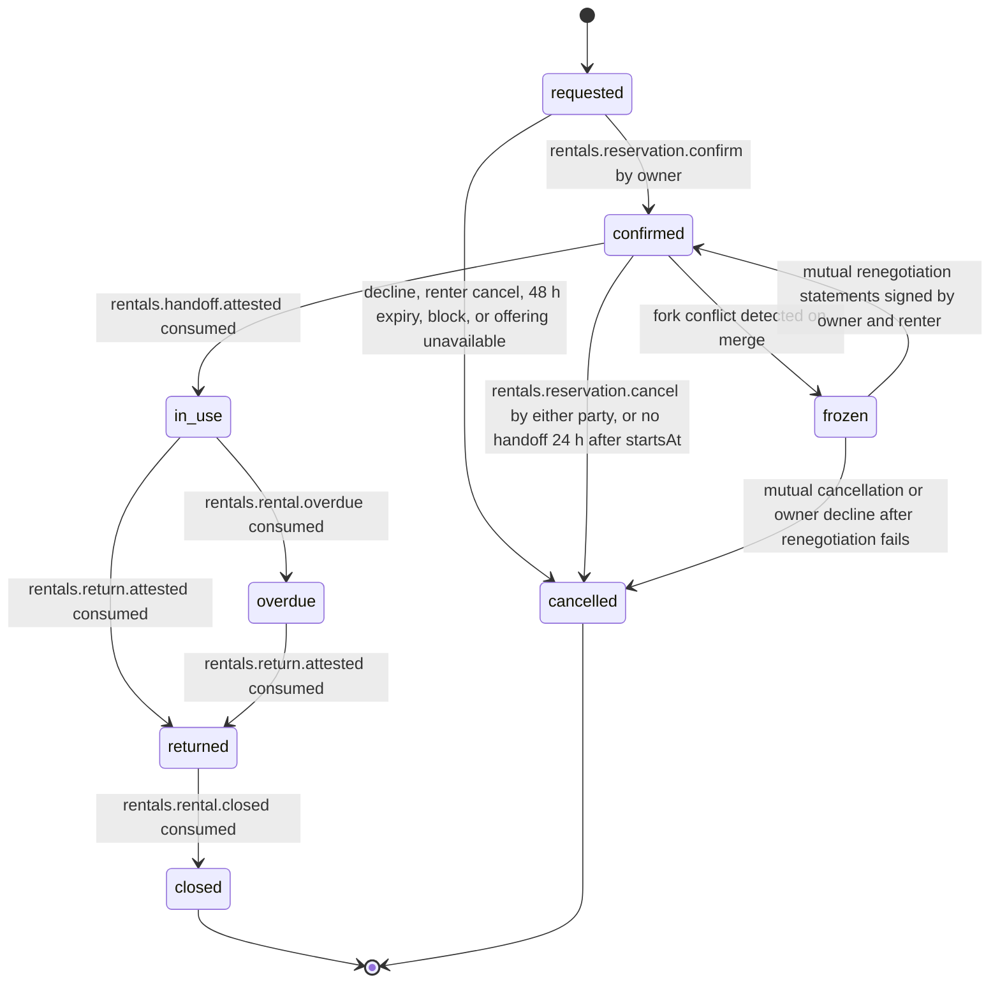

# PS-039-03 — Workflow state machine: Rental availability

**Status:** SPECIFIED (Stage 3). **Module:** [F05.S01.M01 Rental availability](SPEC.md) · **Scope:** MVP · **Code:** `packages/rentals/src/rental_catalog/availability` · **Contracts:** [CTR-ID-001](../../../planning/contracts/CTR-ID-001.md), [CTR-EVT-001](../../../planning/contracts/CTR-EVT-001.md), [CTR-ERR-001](../../../planning/contracts/CTR-ERR-001.md), [CTR-CAP-001](../../../planning/contracts/CTR-CAP-001.md), [CTR-IDM-001](../../../planning/contracts/CTR-IDM-001.md), [CTR-MNY-001](../../../planning/contracts/CTR-MNY-001.md), [CTR-COM-001](../../../planning/contracts/CTR-COM-001.md), [CTR-PRV-001](../../../planning/contracts/CTR-PRV-001.md), [CTR-FED-001](../../../planning/contracts/CTR-FED-001.md)

> Generated from `module.spec.yaml` by `tools/specgen`. Edit the YAML, then run `pnpm spec:render`.

## Requirements

- **PS-039-03.R01** Reservations follow requested, confirmed, in_use, optionally overdue, returned, closed with cancelled as an exit before use; transitions driven by other modules arrive only as events.
- **PS-039-03.R02** A reservation is confirmed only by the owner's signed confirmation; the overlap check and the confirmation commit in one vault transaction.
- **PS-039-03.R03** Conflicting signed confirmations from forked owner devices freeze the affected reservations and require explicit renegotiation, never last-writer-wins.

## Specification

### RentalReservation lifecycle

Initial **requested**; terminal **closed**, **cancelled**.

| Transition | Trigger | Guard / effect |
|---|---|---|
| requested -> confirmed | rentals.reservation.confirm by owner | overlap check passes, Deal opened; emits rentals.reservation.confirmed |
| requested -> cancelled | decline, renter cancel, 48 h expiry, block, or offering unavailable | emits rentals.reservation.cancelled |
| confirmed -> cancelled | rentals.reservation.cancel by either party, or no handoff 24 h after startsAt | frees the interval; emits rentals.reservation.cancelled |
| confirmed -> in_use | rentals.handoff.attested consumed | start of the rental period |
| confirmed -> frozen | fork conflict detected on merge | both reservations frozen |
| frozen -> confirmed | mutual renegotiation statements signed by owner and renter | interval re-checked |
| frozen -> cancelled | mutual cancellation or owner decline after renegotiation fails | emits rentals.reservation.cancelled |
| in_use -> overdue | rentals.rental.overdue consumed | occupied interval extended until return |
| in_use -> returned | rentals.return.attested consumed | occupiedUntil shortened to return time plus buffer |
| overdue -> returned | rentals.return.attested consumed | occupiedUntil set to return time plus buffer |
| returned -> closed | rentals.rental.closed consumed | final |

### Timeouts and scheduled transitions

- Requests expire 48 hours after the owner vault receives them (owner clock); confirmed reservations with no handoff 24 hours after startsAt are cancelled with reason no_handoff. A vault sweep runs at app start, on every command and every 60 s while the PWA is open, and every read applies expiry on the fly.

## Verification

| Test | Level | Covers | Scenario | Expected |
|---|---|---|---|---|
| TEST-PS-039-09.T04 | unit | PS-039-02.R02, PS-039-03.R01 | boundary cases - touching intervals with zero buffers, one minute inside the buffer, DST change inside the rental | half-open rule respected; elapsed-time durations; blackout by local date |
| TEST-PS-039-09.T05 | property | PS-039-03.R01 | random command and event sequences | only declared transitions succeed; closed and cancelled never change |
| TEST-PS-039-09.T06 | integration | PS-039-03.R02, PS-039-06.R02 | confirm with Deal creation failing; crash between check and write | reservation stays requested, no signature, no partial state |
| TEST-PS-039-09.T07 | integration | PS-039-03.R03, PS-039-06.R03, PS-039-07.R02 | two owner devices sign overlapping confirmations and then merge | both reservations frozen; renegotiation required; no last-writer-wins |
| TEST-PS-039-09.T11 | integration | PS-039-04.R03, PS-039-03.R01 | handoff, overdue, return and closed events delivered twice and out of order | reservation follows the machine; early return frees tail after buffer; overdue extends blocking |

## Dependencies

Module depends on: F01.S01.M01, F09.S01.M01, F09.S03.M01, F08.S01.M01, F07.S01.M01, F07.S02.M02, F11.S01.M03, F06.S02.M01, CTR-ID-001, CTR-EVT-001, CTR-ERR-001, CTR-CAP-001, CTR-IDM-001, CTR-MNY-001, CTR-COM-001, CTR-PRV-001, CTR-FED-001. Predecessor: [domain_schema.md](domain_schema.md).
