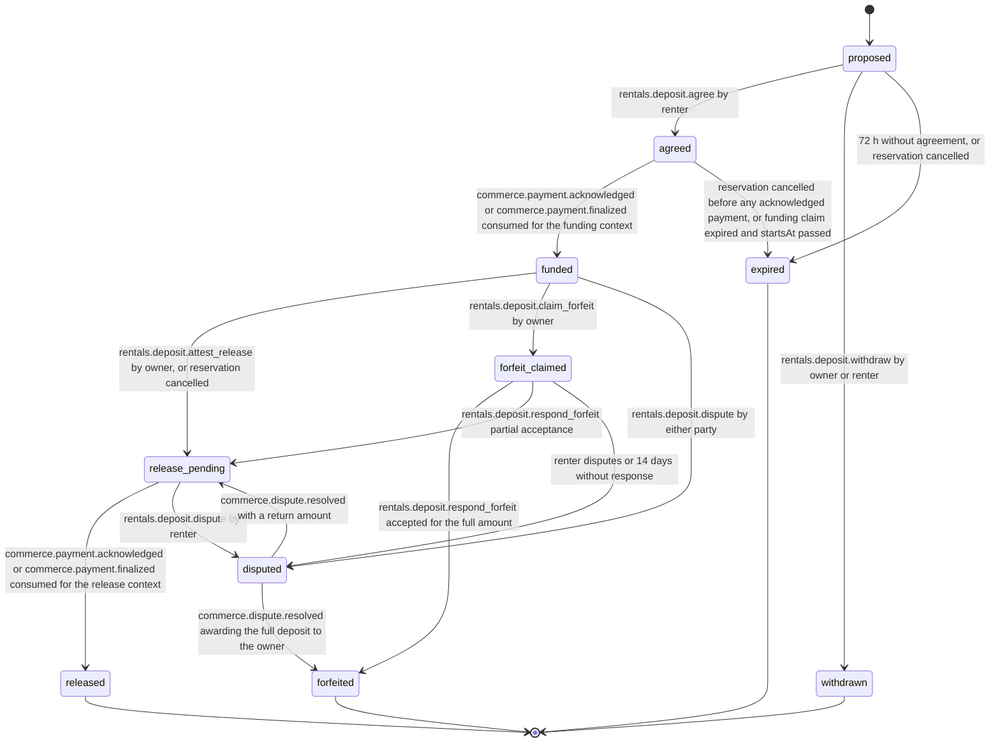

# PS-040-03 — Workflow state machine: Rental deposits (noncustodial)

**Status:** SPECIFIED (Stage 3). **Module:** [F05.S01.M02 Rental deposits (noncustodial)](SPEC.md) · **Scope:** MVP · **Code:** `packages/rentals/src/rental_catalog/deposits` · **Contracts:** [CTR-ID-001](../../../planning/contracts/CTR-ID-001.md), [CTR-EVT-001](../../../planning/contracts/CTR-EVT-001.md), [CTR-ERR-001](../../../planning/contracts/CTR-ERR-001.md), [CTR-CAP-001](../../../planning/contracts/CTR-CAP-001.md), [CTR-IDM-001](../../../planning/contracts/CTR-IDM-001.md), [CTR-MNY-001](../../../planning/contracts/CTR-MNY-001.md), [CTR-COM-001](../../../planning/contracts/CTR-COM-001.md), [CTR-PRV-001](../../../planning/contracts/CTR-PRV-001.md), [CTR-FED-001](../../../planning/contracts/CTR-FED-001.md)

> Generated from `module.spec.yaml` by `tools/specgen`. Edit the YAML, then run `pnpm spec:render`.

## Requirements

- **PS-040-03.R01** Deposits follow proposed, agreed, funded and then release or forfeit paths; released, forfeited, withdrawn and expired are terminal.
- **PS-040-03.R02** Funded, released and forfeited states are reached only from acknowledged or final F09 payment proof or from a resolved dispute, never from a claim alone.
- **PS-040-03.R03** Silence never settles money - a forfeit claim without response after 14 days becomes a dispute, and an owner who does not decide after return is visible as overdue and can be disputed.

## Specification

### DepositTerms lifecycle

Initial **proposed**; terminal **released**, **forfeited**, **withdrawn**, **expired**.

| Transition | Trigger | Guard / effect |
|---|---|---|
| proposed -> agreed | rentals.deposit.agree by renter | agreement names current terms cid; emits rentals.deposit.agreed |
| proposed -> withdrawn | rentals.deposit.withdraw by owner or renter | no obligation |
| proposed -> expired | 72 h without agreement, or reservation cancelled | no obligation |
| agreed -> funded | commerce.payment.acknowledged or commerce.payment.finalized consumed for the funding context | proof acknowledged or final; emits rentals.deposit.funded |
| agreed -> expired | reservation cancelled before any acknowledged payment, or funding claim expired and startsAt passed | no money held |
| funded -> release_pending | rentals.deposit.attest_release by owner, or reservation cancelled | owner attests release; return payment context registered |
| funded -> forfeit_claimed | rentals.deposit.claim_forfeit by owner | return attested, within window, amount at most funded |
| funded -> disputed | rentals.deposit.dispute by either party | F09 case requested |
| release_pending -> released | commerce.payment.acknowledged or commerce.payment.finalized consumed for the release context | renter has the money back; emits rentals.deposit.released |
| release_pending -> disputed | rentals.deposit.dispute by renter | release never arrived |
| forfeit_claimed -> forfeited | rentals.deposit.respond_forfeit accepted for the full amount | outcome retained_full; emits rentals.deposit.released |
| forfeit_claimed -> release_pending | rentals.deposit.respond_forfeit partial acceptance | remainder to be returned |
| forfeit_claimed -> disputed | renter disputes or 14 days without response | F09 case requested |
| disputed -> release_pending | commerce.dispute.resolved with a return amount | release amount from the resolution |
| disputed -> forfeited | commerce.dispute.resolved awarding the full deposit to the owner | emits rentals.deposit.released with outcome retained_full |

### Timeouts and scheduled transitions

- Proposals expire after 72 h; the owner decision clock is 7 days after return attestation, then the deposit shows overdue decision to both parties; forfeit claims unanswered for 14 days become disputed; payment claims expire after 14 days without progress (COM-3). Vault sweeps run at app start, on every command and every 60 s while the PWA is open.

## Verification

| Test | Level | Covers | Scenario | Expected |
|---|---|---|---|---|
| TEST-PS-040-09.T03 | property | PS-040-03.R01 | random statement and event sequences | only declared transitions succeed; terminal states never change |
| TEST-PS-040-09.T04 | integration | PS-040-03.R02, PS-040-04.R03 | payment claimed only, confirming only, expired, then acknowledged | funded only at acknowledged or final; proof labels follow COM-4 |
| TEST-PS-040-09.T05 | property | PS-040-01.R02, PS-040-03.R02 | random partial forfeits and releases | retained plus released equals funded; never above funded; integer minor units |
| TEST-PS-040-09.T06 | integration | PS-040-03.R03 | forfeit claim unanswered for 14 days; owner silent for 7 days after return | claim becomes disputed, never accepted; overdue decision banner shown, no auto release or forfeit |
| TEST-PS-040-09.T12 | integration | PS-040-03.R01, PS-040-04.R03 | reservation cancelled after funding | deposit moves to release_pending; owner attests full release; released after renter acknowledges |

## Dependencies

Module depends on: F05.S01.M01, F09.S01.M01, F09.S02.M02, F09.S03.M01, F08.S01.M01, F07.S01.M01, F11.S01.M03, CTR-ID-001, CTR-EVT-001, CTR-ERR-001, CTR-CAP-001, CTR-IDM-001, CTR-MNY-001, CTR-COM-001, CTR-PRV-001, CTR-FED-001. Predecessor: [domain_schema.md](domain_schema.md).
