# PS-040-03 — Workflow state machine: Rental deposits (noncustodial)

**Status:** SPECIFIED (Stage 3). **Module:** [F05.S01.M02 Rental deposits (noncustodial)](SPEC.md) · **Scope:** MVP · **Code:** `packages/rentals/src/rental_catalog/deposits` · **Contracts:** [CTR-ID-001](../../../planning/contracts/CTR-ID-001.md), [CTR-EVT-001](../../../planning/contracts/CTR-EVT-001.md), [CTR-ERR-001](../../../planning/contracts/CTR-ERR-001.md), [CTR-CAP-001](../../../planning/contracts/CTR-CAP-001.md), [CTR-IDM-001](../../../planning/contracts/CTR-IDM-001.md), [CTR-MNY-001](../../../planning/contracts/CTR-MNY-001.md), [CTR-COM-001](../../../planning/contracts/CTR-COM-001.md), [CTR-PRV-001](../../../planning/contracts/CTR-PRV-001.md), [CTR-FED-001](../../../planning/contracts/CTR-FED-001.md)

> Generated from `module.spec.yaml` by `tools/specgen`. Edit the YAML, then run `pnpm spec:render`.

## Requirements

- **PS-040-03.R01** Deposits follow proposed, agreed, funded and then release or forfeit paths, with escalation_due, escalated_pending, disputed and frozen as holding states; released, forfeited, withdrawn and expired are terminal.
- **PS-040-03.R02** Funded and released are reached only from acknowledged or final F09 payment proof, and forfeited only from the renter's signed acceptance of the full funded amount (a forfeit response or a both-accepted dispute outcome), never from a claim alone or a mediator-only outcome.
- **PS-040-03.R03** Silence never settles money - a forfeit claim unanswered by its signed respondBy moves to escalation_due with a prefilled draft case that the owner opens explicitly, and an owner who does not decide after return is visible as decision overdue and can be disputed by the renter.
- **PS-040-03.R04** Dispute outcomes are mapped explicitly - refund_claimed or return_agreed accepted by both parties fix releaseAmount (the advisoryRefund, always read as the amount the owner returns to the renter whichever party opened the case, capped at the funded amount, or the full funded amount when absent); no_fault_close, enforcement_referral and lapsed return the deposit to funded with decisionOverdue set; commerce.dispute.withdrawn returns it to the state it was disputed from.
- **PS-040-03.R05** Every path into release_pending fixes releaseAmount (full on cancellation or full release, funded minus the accepted forfeit, or the mapped dispute amount), and the owner can attest that release from release_pending while no release Deal exists, with no return or window condition.
- **PS-040-03.R06** Exactly one vault opens a dispute case per deposit - the renter on contest, decision overdue or a missing release, the owner after an unanswered forfeit claim - and the other vault waits in escalated_pending and links the case from commerce.dispute.opened.
- **PS-040-03.R07** A frozen deposit leaves frozen only by a co-signed renegotiation back to the state it was frozen from, an explicit dispute, or expiry (72 hours before funding, 14 days after funding into escalation_due).

## Specification

### DepositTerms lifecycle

Initial **proposed**; terminal **released**, **forfeited**, **withdrawn**, **expired**.

| Transition | Trigger | Guard / effect |
|---|---|---|
| proposed -> agreed | rentals.deposit.agree by renter through comms.consent.sign over termsCid, or the verified agreement received by the owner vault | the owner vault opens the funding Deal {rental_deposit, depositId} with contextCid agreementCid; the renter vault derives the same fundingDealId and mirrors the Deal when the owner's deal statement arrives; emits rentals.deposit.agreed |
| proposed -> withdrawn | rentals.deposit.withdraw by owner (withdrawal) or renter (decline) | signed deposit_withdrawal; a later agreement fails with CONFLICT_STATE |
| proposed -> expired | 72 h without agreement, or reservation cancelled | no obligation |
| proposed -> frozen | two live terms for one reservation signed by forked owner devices | evidence kept; frozenFrom proposed |
| agreed -> funded | commerce.payment.acknowledged or commerce.payment.finalized for contextRef {rental_deposit, depositId} | proof acknowledged or final; emits rentals.deposit.funded |
| agreed -> withdrawn | owner's signed withdrawal over the same termsCid received before any funding claim exists | the agreement is void with CONFLICT_STATE in both vaults; the funding Deal is cancelled with commerce.deal.cancel signed by both; emits rentals.deposit.released with outcome not_funded |
| agreed -> expired | reservation cancelled before any acknowledged payment, or the funding Deal expired or startsAt passed without funding | no money held; an open funding Deal is cancelled with commerce.deal.cancel signed by both parties; emits rentals.deposit.released with outcome not_funded |
| agreed -> frozen | withdrawal received after a funding claim exists, or comms.consent.verify returns conflicted or revoked for the agreement | the renter's claim must be resolved explicitly |
| funded -> release_pending | rentals.deposit.attest_release by owner, at any time | releaseAmount = funded; release Deal {rental_deposit_release, depositId} opened with contextCid the attestation cid |
| funded -> release_pending | rentals.reservation.cancelled consumed | releaseAmount = funded; no release Deal yet; the owner attests from release_pending without return or window conditions |
| funded -> forfeit_claimed | rentals.deposit.claim_forfeit by owner | V05, V06, V09 and V10 pass; signed respondBy; emits rentals.deposit.forfeit_claimed |
| funded -> disputed | rentals.deposit.dispute by the renter (decision overdue or release refused) | renter is the opener of the case {rental_deposit, depositId}; deposit_dispute_notice to the owner |
| funded -> escalated_pending | the renter's deposit_dispute_notice or commerce.dispute.opened received in the owner vault | waiting to link the case |
| funded -> frozen | contradictory signed statements from forked devices of one party | frozenFrom funded |
| release_pending -> release_pending | rentals.deposit.attest_release by owner while no release Deal exists | releaseAmount as fixed by the path; release Deal opened with contextCid the attestation cid |
| release_pending -> released | commerce.payment.acknowledged or commerce.payment.finalized for contextRef {rental_deposit_release, depositId} | renter has the money back; outcome released_full or released_partial; emits rentals.deposit.released |
| release_pending -> disputed | rentals.deposit.dispute by renter | release never arrived; renter is the opener |
| release_pending -> escalated_pending | the renter's deposit_dispute_notice received in the owner vault | waiting to link the case |
| release_pending -> frozen | contradictory release attestations, or a mapped dispute amount that differs from an existing release Deal | frozenFrom release_pending |
| forfeit_claimed -> forfeited | rentals.deposit.respond_forfeit accepted and forfeit.amount equals the funded amount | outcome retained_full; emits rentals.deposit.released |
| forfeit_claimed -> release_pending | rentals.deposit.respond_forfeit accepted for a forfeit.amount below the funded amount, or partial with acceptedAmount | retainedAmount = accepted; releaseAmount = funded − accepted; no release Deal yet |
| forfeit_claimed -> disputed | rentals.deposit.respond_forfeit disputed together with rentals.deposit.dispute by the renter | the contesting renter is the opener |
| forfeit_claimed -> escalated_pending | the renter's disputed response or dispute notice received in the owner vault | waiting to link the case |
| forfeit_claimed -> escalation_due | sweep at respondBy plus 72 h with no response held | owner vault: prefilled draft case held locally, nothing sent to F09; renter vault: waiting; never acceptance |
| forfeit_claimed -> frozen | two forfeit claims, or responses naming different claim cids | frozenFrom forfeit_claimed |
| escalation_due -> disputed | rentals.deposit.dispute by the owner (claimant) on explicit action | case opened from the draft; deposit_dispute_notice to the renter |
| escalation_due -> escalated_pending | the owner's deposit_dispute_notice received in the renter vault | waiting to link the case |
| escalation_due -> release_pending | rentals.deposit.attest_release by the owner instead of escalating | releaseAmount = funded |
| escalation_due -> funded | 30 days in escalation_due without a case | forfeit claim lapses; decisionOverdue set; never forfeited |
| escalated_pending -> disputed | commerce.dispute.opened with contextRef {rental_deposit, depositId} consumed | case id linked |
| escalated_pending -> funded | 30 days without a linked case when disputedFrom is funded, forfeit_claimed or escalation_due | decisionOverdue set |
| escalated_pending -> release_pending | the owner's release attestation received, or 30 days without a linked case when disputedFrom is release_pending | release amount as fixed by the path |
| disputed -> release_pending | commerce.dispute.resolved refund_claimed or return_agreed accepted by both parties, mapped releaseAmount above 0 | releaseAmount = min(advisoryRefund, funded), or funded when advisoryRefund is absent; retainedAmount = funded − releaseAmount |
| disputed -> forfeited | commerce.dispute.resolved refund_claimed accepted by both parties with mapped releaseAmount 0 | retained_full backed by the renter's acceptance in the outcome; emits rentals.deposit.released |
| disputed -> funded | commerce.dispute.resolved no_fault_close, enforcement_referral or lapsed | decisionOverdue set; the owner decides again; never forfeited |
| disputed -> funded | commerce.dispute.withdrawn when disputedFrom is funded or escalation_due | prior decision state restored with decisionOverdue as computed |
| disputed -> release_pending | commerce.dispute.withdrawn when disputedFrom is release_pending | release continues |
| disputed -> forfeit_claimed | commerce.dispute.withdrawn when disputedFrom is forfeit_claimed | a passed respondBy moves it to escalation_due on the next sweep |
| frozen -> proposed | rentals.deposit.renegotiate co-signed naming the terms that stand, frozenFrom proposed | other terms superseded |
| frozen -> agreed | rentals.deposit.renegotiate co-signed, frozenFrom agreed | agreement re-verified |
| frozen -> funded | rentals.deposit.renegotiate co-signed, frozenFrom funded | prior state restored |
| frozen -> release_pending | rentals.deposit.renegotiate co-signed, frozenFrom release_pending | release amount restated in the renegotiation |
| frozen -> forfeit_claimed | rentals.deposit.renegotiate co-signed naming the claim and response that stand, frozenFrom forfeit_claimed | respondBy from the claim that stands |
| frozen -> disputed | rentals.deposit.dispute by the party that did not fork | case opened explicitly |
| frozen -> expired | frozenFrom proposed or agreed and 72 h without renegotiation | no money held; emits rentals.deposit.released with outcome not_funded when it was agreed |
| frozen -> escalation_due | frozenFrom funded or later and 14 days without renegotiation or dispute | prefilled draft case for the party that did not fork; never settles money |

```mermaid
stateDiagram-v2
  [*] --> proposed
  proposed --> agreed: rentals.deposit.agree by renter through comms.consent.sign over termsCid, or the verified agreement received by the owner vault
  proposed --> withdrawn: rentals.deposit.withdraw by owner (withdrawal) or renter (decline)
  proposed --> expired: 72 h without agreement, or reservation cancelled
  proposed --> frozen: two live terms for one reservation signed by forked owner devices
  agreed --> funded: commerce.payment.acknowledged or commerce.payment.finalized for contextRef {rental_deposit, depositId}
  agreed --> withdrawn: owner's signed withdrawal over the same termsCid received before any funding claim exists
  agreed --> expired: reservation cancelled before any acknowledged payment, or the funding Deal expired or startsAt passed without funding
  agreed --> frozen: withdrawal received after a funding claim exists, or comms.consent.verify returns conflicted or revoked for the agreement
  funded --> release_pending: rentals.deposit.attest_release by owner, at any time
  funded --> release_pending: rentals.reservation.cancelled consumed
  funded --> forfeit_claimed: rentals.deposit.claim_forfeit by owner
  funded --> disputed: rentals.deposit.dispute by the renter (decision overdue or release refused)
  funded --> escalated_pending: the renter's deposit_dispute_notice or commerce.dispute.opened received in the owner vault
  funded --> frozen: contradictory signed statements from forked devices of one party
  release_pending --> release_pending: rentals.deposit.attest_release by owner while no release Deal exists
  release_pending --> released: commerce.payment.acknowledged or commerce.payment.finalized for contextRef {rental_deposit_release, depositId}
  release_pending --> disputed: rentals.deposit.dispute by renter
  release_pending --> escalated_pending: the renter's deposit_dispute_notice received in the owner vault
  release_pending --> frozen: contradictory release attestations, or a mapped dispute amount that differs from an existing release Deal
  forfeit_claimed --> forfeited: rentals.deposit.respond_forfeit accepted and forfeit.amount equals the funded amount
  forfeit_claimed --> release_pending: rentals.deposit.respond_forfeit accepted for a forfeit.amount below the funded amount, or partial with acceptedAmount
  forfeit_claimed --> disputed: rentals.deposit.respond_forfeit disputed together with rentals.deposit.dispute by the renter
  forfeit_claimed --> escalated_pending: the renter's disputed response or dispute notice received in the owner vault
  forfeit_claimed --> escalation_due: sweep at respondBy plus 72 h with no response held
  forfeit_claimed --> frozen: two forfeit claims, or responses naming different claim cids
  escalation_due --> disputed: rentals.deposit.dispute by the owner (claimant) on explicit action
  escalation_due --> escalated_pending: the owner's deposit_dispute_notice received in the renter vault
  escalation_due --> release_pending: rentals.deposit.attest_release by the owner instead of escalating
  escalation_due --> funded: 30 days in escalation_due without a case
  escalated_pending --> disputed: commerce.dispute.opened with contextRef {rental_deposit, depositId} consumed
  escalated_pending --> funded: 30 days without a linked case when disputedFrom is funded, forfeit_claimed or escalation_due
  escalated_pending --> release_pending: the owner's release attestation received, or 30 days without a linked case when disputedFrom is release_pending
  disputed --> release_pending: commerce.dispute.resolved refund_claimed or return_agreed accepted by both parties, mapped releaseAmount above 0
  disputed --> forfeited: commerce.dispute.resolved refund_claimed accepted by both parties with mapped releaseAmount 0
  disputed --> funded: commerce.dispute.resolved no_fault_close, enforcement_referral or lapsed
  disputed --> funded: commerce.dispute.withdrawn when disputedFrom is funded or escalation_due
  disputed --> release_pending: commerce.dispute.withdrawn when disputedFrom is release_pending
  disputed --> forfeit_claimed: commerce.dispute.withdrawn when disputedFrom is forfeit_claimed
  frozen --> proposed: rentals.deposit.renegotiate co-signed naming the terms that stand, frozenFrom proposed
  frozen --> agreed: rentals.deposit.renegotiate co-signed, frozenFrom agreed
  frozen --> funded: rentals.deposit.renegotiate co-signed, frozenFrom funded
  frozen --> release_pending: rentals.deposit.renegotiate co-signed, frozenFrom release_pending
  frozen --> forfeit_claimed: rentals.deposit.renegotiate co-signed naming the claim and response that stand, frozenFrom forfeit_claimed
  frozen --> disputed: rentals.deposit.dispute by the party that did not fork
  frozen --> expired: frozenFrom proposed or agreed and 72 h without renegotiation
  frozen --> escalation_due: frozenFrom funded or later and 14 days without renegotiation or dispute
  released --> [*]
  forfeited --> [*]
  withdrawn --> [*]
  expired --> [*]
```

### Timeouts and scheduled transitions

- Proposals expire after 72 h. The soft owner decision clock is 7 days after the signed return attestation time, then the deposit shows decision overdue to both parties. Forfeit claims carry a signed respondBy = createdAt + 14 d + 72 h; responses created by respondBy are accepted when received within 72 h; at respondBy plus 72 h without a response the deposit moves to escalation_due. escalation_due and escalated_pending fall back after 30 days without a case. Frozen deposits expire after 72 h before funding and after 14 days otherwise. Payment claims expire after 14 days without progress (COM-3). Vault sweeps run at app start, on every command and every 60 s while the PWA is open.

## Verification

| Test | Level | Covers | Scenario | Expected |
|---|---|---|---|---|
| TEST-PS-040-09.T03 | property | PS-040-03.R01, PS-040-03.R07 | random statement and event sequences including forks | only declared transitions succeed; terminal states never change; frozen leaves only through renegotiation, dispute or expiry |
| TEST-PS-040-09.T04 | integration | PS-040-03.R02, PS-040-04.R03 | payment claimed only, confirming only, expired, then acknowledged | funded only at acknowledged or final; proof labels follow COM-4 |
| TEST-PS-040-09.T05 | property | PS-040-01.R02, PS-040-03.R02, PS-040-09.R02 | random partial forfeits, forfeits claimed below the deposit and accepted in full, releases, and two damage claims | retained plus released equals funded; an accepted forfeit below the funded amount goes to release_pending with funded − amount, never forfeited; at most one forfeit per damage claim; integer minor units |
| TEST-PS-040-09.T06 | integration | PS-040-03.R03 | forfeit claim unanswered past respondBy plus 72 h; owner silent for 7 days after return | escalation_due with a prefilled draft case in the owner vault and no case opened; overdue decision banner, no auto release or forfeit; after 30 days in escalation_due back to funded with decisionOverdue |
| TEST-PS-040-09.T12 | integration | PS-040-03.R05, PS-040-04.R03 | reservation cancelled after funding, owner attests on day 40 | deposit moves to release_pending with the full amount and no release Deal; attest_release allowed without return attestation and after day 30; released after the renter acknowledges |
| TEST-PS-040-09.T18 | integration | PS-040-03.R04 | for a disputed deposit deliver each F09 outcome - refund_claimed with advisoryRefund EUR 60.00 accepted by both, return_agreed accepted by both, no_fault_close, enforcement_referral, lapsed - plus a refund_claimed outcome with advisoryRefund EUR 60.00 accepted by both in a case the owner opened, and separately commerce.dispute.withdrawn | release_pending with EUR 60.00 and EUR 40.00 retained for both refund_claimed cases; release_pending with the full amount for return_agreed; funded with decisionOverdue for the other three; prior state restored on withdrawal; never forfeited without both acceptances |
| TEST-PS-040-09.T19 | integration | PS-040-03.R06 | renter contests a forfeit; another forfeit goes unanswered | only the renter vault opens a case on contest, only the owner vault offers the draft on silence; the other vault waits in escalated_pending and links the case from commerce.dispute.opened; exactly one case per deposit |
| TEST-PS-040-09.T20 | integration | PS-040-02.R02, PS-040-03.R05 | not_returned forfeit without return attestation at overdue day 13 and day 15; damage resolved on day 40 after return and forfeit on day 50; forfeit for damage after a verified return_waiver; forfeit for damage above the agreedAmount of its resolved claim; not_returned forfeit without the recorded not_returned damage claim id | RENTALS_DEPOSIT_WINDOW on day 13; allowed on day 15; allowed until 14 days after the resolution; waiver case refused with RENTALS_DEPOSIT_WINDOW; the last two refused with VALIDATION_FAILED |
| TEST-PS-040-09.T21 | integration | PS-040-03.R07, PS-040-06.R02 | frozen deposit renegotiated, disputed by the non-forking party, and left alone before and after funding | each exit reaches the documented state; expiry after 72 h before funding and escalation_due after 14 days after funding |
| TEST-PS-040-09.T25 | integration | PS-040-04.R06, PS-040-03.R01 | comms.consent.revoked whose revokedIds[] holds the agreementCid of an agreed deposit with afterCommit false; the same for a funded deposit with afterCommit true; one naming an unrelated consent; the first revocationId replayed | the agreed deposit frozen with frozenFrom agreed and agreementRevocationId set after comms.consent.verify returns revoked; the funded deposit keeps its state with the revocation recorded; the unrelated and replayed cases change nothing |

## Dependencies

Module depends on: F05.S01.M01, F09.S01.M01, F09.S01.M03, F09.S02.M02, F09.S03.M01, F09.S03.M03, F08.S01.M01, F08.S02.M02, F07.S01.M01, F07.S02.M02, F11.S01.M01, F11.S01.M03, F10.S01.M02, F10.S01.M03, F10.S01.M04, F10.S02.M02, CTR-ID-001, CTR-EVT-001, CTR-ERR-001, CTR-CAP-001, CTR-IDM-001, CTR-MNY-001, CTR-COM-001, CTR-PRV-001, CTR-FED-001. Predecessor: [domain_schema.md](domain_schema.md).
