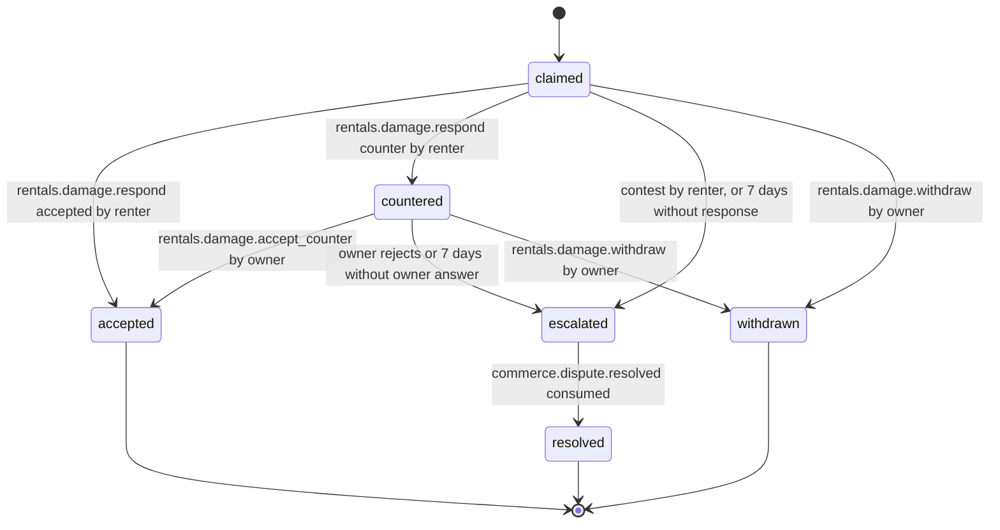

# PS-041-03 — Workflow state machine: Rental damage claims

**Status:** SPECIFIED (Stage 3). **Module:** [F05.S02.M03 Rental damage claims](SPEC.md) · **Scope:** MVP · **Code:** `packages/rentals/src/rental_lifecycle/damage` · **Contracts:** [CTR-ID-001](../../../planning/contracts/CTR-ID-001.md), [CTR-EVT-001](../../../planning/contracts/CTR-EVT-001.md), [CTR-ERR-001](../../../planning/contracts/CTR-ERR-001.md), [CTR-CAP-001](../../../planning/contracts/CTR-CAP-001.md), [CTR-IDM-001](../../../planning/contracts/CTR-IDM-001.md), [CTR-MNY-001](../../../planning/contracts/CTR-MNY-001.md), [CTR-COM-001](../../../planning/contracts/CTR-COM-001.md), [CTR-PRV-001](../../../planning/contracts/CTR-PRV-001.md), [CTR-FED-001](../../../planning/contracts/CTR-FED-001.md)

> Generated from `module.spec.yaml` by `tools/specgen`. Edit the YAML, then run `pnpm spec:render`.

## Requirements

- **PS-041-03.R01** Claims move claimed, optionally countered, then accepted, escalated to resolved, or withdrawn; accepted, resolved and withdrawn are terminal.
- **PS-041-03.R02** Silence never settles money - unanswered claims and unanswered counters escalate to a dispute after 7 days.
- **PS-041-03.R03** Each terminal transition emits rentals.damage.resolved once with the outcome; escalation produces the dispute request before the state changes.

## Specification

### DamageClaim lifecycle

Initial **claimed**; terminal **accepted**, **resolved**, **withdrawn**.

| Transition | Trigger | Guard / effect |
|---|---|---|
| claimed -> accepted | rentals.damage.respond accepted by renter | agreedAmount equals totalClaimed; emits rentals.damage.resolved with outcome accepted |
| claimed -> countered | rentals.damage.respond counter by renter | one counter below totalClaimed |
| claimed -> escalated | contest by renter, or 7 days without response | F09.S02.M02 case requested |
| claimed -> withdrawn | rentals.damage.withdraw by owner | emits rentals.damage.resolved with outcome withdrawn |
| countered -> accepted | rentals.damage.accept_counter by owner | agreedAmount equals counterAmount; emits rentals.damage.resolved with outcome counter_accepted |
| countered -> escalated | owner rejects or 7 days without owner answer | F09.S02.M02 case requested |
| countered -> withdrawn | rentals.damage.withdraw by owner | emits rentals.damage.resolved with outcome withdrawn |
| escalated -> resolved | commerce.dispute.resolved consumed | agreedAmount from the resolution; emits rentals.damage.resolved with the dispute outcome |

### Timeouts and scheduled transitions

- Response deadline 7 days after the claim is received (receiver clock); counter answer deadline 7 days; both escalate, never accept. Vault sweeps run at app start, on every command and every 60 s while the PWA is open, and every read applies the deadlines on the fly.

## Verification

| Test | Level | Covers | Scenario | Expected |
|---|---|---|---|---|
| TEST-PS-041-09.T03 | property | PS-041-02.R02, PS-041-03.R01 | random handoff and return checklists | worsened set equals the reference model; claims without worsened items refused; basis mismatch refused on receipt |
| TEST-PS-041-09.T04 | integration | PS-041-03.R02, PS-041-03.R03 | renter silent for 7 days; owner silent on a counter for 7 days | both escalate to a dispute and never to accepted; events once |
| TEST-PS-041-09.T05 | property | PS-041-03.R01 | random statement and event sequences | only declared transitions succeed; terminal states never change |
| TEST-PS-041-09.T12 | integration | PS-041-03.R01, PS-041-01.R03 | not_returned claim at day 13 and day 15 overdue | RENTALS_DAMAGE_WINDOW at day 13; allowed at day 15 with overdue history as basis |

## Dependencies

Module depends on: F05.S02.M01, F05.S02.M02, F05.S01.M01, F05.S01.M02, F09.S01.M01, F09.S02.M02, F08.S01.M03, F07.S01.M01, F11.S01.M03, CTR-ID-001, CTR-EVT-001, CTR-ERR-001, CTR-CAP-001, CTR-IDM-001, CTR-MNY-001, CTR-COM-001, CTR-PRV-001, CTR-FED-001. Predecessor: [domain_schema.md](domain_schema.md).
